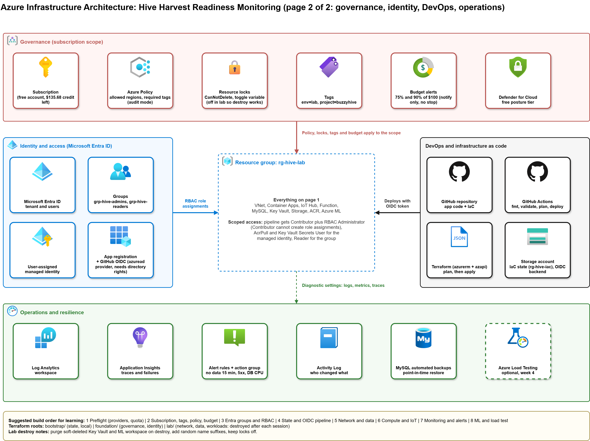

# BuzzyHive on Azure: containers, IoT and ML (Terraform)

This is a learning project. It designs how to run [BuzzyHive 2.0](https://github.com/tttaufiqqq/Kelulut-Hive-Harvest-Readiness-Prediction), a kelulut (stingless bee) harvest readiness platform, on Azure with Docker containers and Terraform, using services such as Azure IoT Hub, Container Apps and Azure Machine Learning.

> [!NOTE]
> This is a personal learning design. It is not official Microsoft guidance. On 24/11/2026 the three Terraform roots were applied once to a Free Trial subscription, the app images ran on Container Apps, and a simulated device produced predictions. The IoT Hub forwarder Function runs on Flex Consumption and forwarded a simulated device's readings to Laravel, the CI plan and apply jobs are not built, the lab has not been destroyed and re-created, and the cost of the run is not measured. Service prices are estimates, and each one is labelled that way.

*Page 1, network and runtime: how a sensor reading travels from the ESP32 to the dashboard. Source: [`docs/architecture/architecture.drawio`](docs/architecture/architecture.drawio).*

## Summary

- **Goal:** move BuzzyHive from Exabytes shared hosting to containers on Azure, and learn IoT Hub, Container Apps, Azure ML, private networking, governance and CI/CD with OIDC on the way.
- **Approach:** three container apps (`laravel-web`, `laravel-worker`, `flask-ml`) in a VNet, MySQL Flexible Server on a private subnet, IoT Hub, and Azure ML for training. Everything is defined in Terraform and applied by hand. The IoT Hub forwarder Function runs on Flex Consumption (classic App Service plans failed on a quota of 0), a CI plan and apply pipeline is designed but not built, and GitHub Actions only runs `fmt`, `validate` and `tflint`.
- **Run time:** the environment is meant to run for about a day, then be destroyed.

## Status

| Part | State |
|---|---|
| Architecture diagram and documentation | Done |
| Terraform (`bootstrap`, `foundation`, `lab`) | Applied once on 24/11/2026. `validate` passes and CI (fmt, validate, tflint) is green |
| Preflight against a real subscription | Passed (providers, MySQL SKU, quota, IoT Hub region) |
| Docker images and local Compose stack | Built and tested end to end. 168 app tests pass |
| Images on Azure | Pushed to the registry and running on Container Apps. The `laravel-migrate` Job and the seeder succeeded |
| Smoke test | Passed: the simulator posted 5 readings, each `201` in under 0.3 s with a prediction |
| Telegram alerts | Verified end to end: a `ready` and a `nearly_ready` reading each produced one message |
| Load test (k6) | Four runs. A probe restart and a MySQL deadlock were found and fixed. At 10 requests per second the single web replica reaches its CPU limit. See [the load test](docs/load-test.md) |
| Azure ML | A job trained the readiness model on Azure, it was registered, compared with the stale model in service, and deployed. See [Azure ML](docs/azure-ml.md) |
| Destroy, re-creation and measured cost | **Not done yet.** The runbook is [Teardown and redeploy](docs/teardown-and-redeploy.md), marked not run |
| IoT Hub forwarder Function | Deployed on Flex Consumption in East US. Three readings from a simulated device reached Laravel through IoT Hub and the Function on 25/11/2026. Classic App Service plans failed on a quota of 0 ([troubleshooting 40](docs/troubleshooting.md)) |
| CI plan and apply | Not written yet |

What was found along the way, and what is still open, is in the [implementation log](docs/implementation-log.md).

## 1. Learning goals

- Containerize a Laravel + React app and a Flask ML API, and run them on Azure Container Apps.
- Ingest device data through Azure IoT Hub and an Azure Function.
- Train and register a model with Azure Machine Learning, then rebuild the serving image from it.
- Keep data private with a VNet, a delegated MySQL subnet, private endpoints and private DNS.
- Apply governance (Policy, tags, budget, locks, RBAC) and deploy with Terraform and GitHub OIDC, with no stored secrets.

## 2. What this deploys

Deployed on 24/11/2026:

| Resource | Purpose | Note |
|---|---|---|
| IoT Hub (free tier) | Receives device readings over MQTT | A simulated device sent readings, and the Function forwards them to Laravel |
| Azure Function on Flex Consumption (East US), with a blob container for its code | Forwards each IoT Hub message to `laravel-web` | Needs `enable_function` and `function_hosting = "flex"`. On its first start it replayed 20 older readings still held in the hub ([troubleshooting 41](docs/troubleshooting.md)) |
| Container Apps environment: `laravel-web`, `laravel-worker`, `flask-ml`, plus the `laravel-migrate` and `laravel-schedule` Jobs | Web app, queue worker, ML API, scheduler and migrations | Verified, including Telegram alerts |
| MySQL Flexible Server (Burstable B1ms) in a delegated subnet | Application database, no public endpoint | |
| Key Vault, private endpoints, private DNS zones | Secrets reached over Private Link | |
| Two Storage accounts (one private, one public) | The public one is used by Azure ML | The private one has no consumer yet |
| Container Registry (Basic) | Holds the Laravel and flask-ml images | |
| Azure Machine Learning workspace and a compute cluster that scales to zero | Trains the KNN model and registers it | Off by default (`enable_ml`). Azure ML also created a registry of its own that Terraform does not own |
| Log Analytics, Application Insights, alert rules | Logs and alerts | Application Insights receives telemetry from the Function only. The Laravel and Flask images send none |
| Policy (audit mode), tags, a budget | Subscription-scope guardrails | |
| Entra groups, a managed identity, a GitHub OIDC app registration | Access without passwords | The OIDC identity exists, but no workflow uses it yet |

Defined in Terraform but not deployed, or not built:

| Resource | Why |
|---|---|

| Resource group locks | Behind a variable (`enable_locks`), off in the lab because a lock makes `terraform destroy` fail |
| Front Door Standard, Azure Load Testing | Optional, never deployed. The load test used k6 from a laptop instead |

The two container images (Laravel on FrankenPHP and Alpine, 333 MB; flask-ml on Python slim, 452 MB) are built and tested locally with Docker Compose. Why they are built that way, with measurements: [Docker images](docs/docker.md).

*Page 2, governance, identity, DevOps and operations around `rg-hive-lab`.*

For a full explanation, see [Architecture](docs/architecture.md).

### Limitations

- **Applied once, not repeated.** The steps in [Deploy](docs/deploy.md) were run once, in order, and hit two Terraform errors and several tooling problems along the way (all fixed and written up). I have not destroyed and re-created the environment, so a clean second run and the teardown script (`scripts/down.ps1`) are untested. The runbook is [Teardown and redeploy](docs/teardown-and-redeploy.md).
- **Synthetic ML data.** The KNN model is trained on a synthetic dataset, so Azure ML here is a pipeline exercise, not a modelling one.
- **The Function runs on Flex Consumption in East US, and was checked with a simulated device only.** Classic App Service plans failed on a Free Trial quota of 0 in three regions ([troubleshooting 40](docs/troubleshooting.md)). The API key is a plain app setting, and on its first start the Function replayed 20 readings that were still held in IoT Hub. The real ESP32 has not been tried.
- **Simulated device.** The real ESP32 firmware posts plain HTTP with an API key. Talking to IoT Hub needs firmware changes, so the lab uses a Python device simulator.
- **One environment.** There is a single `rg-hive-lab` group with no separate dev or staging.
- **Application Insights has the Function's telemetry only.** The Laravel and Flask images contain no SDK, so they send nothing. Their logs are read from Log Analytics instead.
- **The web replica is the limit.** One 0.5 vCPU `laravel-web` replica reached its CPU limit at 10 requests per second. The MySQL trigger that re-aggregates a hive's whole day on every insert is still the weak point, mitigated by a retry. See [the load test](docs/load-test.md).
- **The ML model is retrained, not evaluated.** The Azure ML run reproduced the local result, but the data is synthetic and no held-out evaluation was run.
- **Pusher and Telegram stay external.** They are SaaS and are called over outbound HTTPS.

### Cost

- **Estimate, not measured:** about US$50 to 70 per month if everything is left running, so well under $5 for a one-day lab. The drivers are MySQL B1ms, the always-on worker, two private endpoints and the registry.
- **What can break the budget:** Front Door Premium (WAF managed rules, about $330 per month) and a dedicated Container Apps workload profile (about $140 per month). Neither is in the plan.
- **Credit:** $135.68 remaining on 24/11/2026, **expiring 02/12/2026**, so a one-day run uses only a small part of it. About $64.32 of that month's spend predates this project (see [Cost and teardown](docs/cost-and-teardown.md#13-what-else-is-in-the-subscription)).
- **Keep it low:** destroy the `lab` root when you finish. See [Cost and teardown](docs/cost-and-teardown.md).

## 3. Prerequisites

- An Azure subscription (the free account has a $200 credit for 30 days; $135.68 was left on 24/11/2026, expiring 02/12/2026)
- [Terraform](https://developer.hashicorp.com/terraform/install) >= 1.5
- Azure CLI, Docker, and Git
- Rights to create Entra groups and app registrations in your tenant
- The [BuzzyHive repository](https://github.com/tttaufiqqq/Kelulut-Hive-Harvest-Readiness-Prediction) for the application code and `ml/` folder

## 4. Build order

1. Preflight (register resource providers, check quota), then subscription, tags, policy and budget
2. Entra groups and RBAC
3. Terraform state storage and the GitHub OIDC pipeline
4. Network, MySQL, Key Vault, Storage, ACR
5. Container Apps and IoT Hub with the Function (Flex Consumption)
6. Monitoring and alerts
7. Azure ML, and a load test with k6 (Azure Load Testing was not used)

The commands for each root are in [Deploy, redeploy, and destroy](docs/deploy.md).

> [!WARNING]
> MySQL, the registry and private endpoints bill hourly even with no traffic. Destroy the environment when you finish. See [Cost and teardown](docs/cost-and-teardown.md).

## 5. Design decisions at a glance

| Choice | Reason |
|---|---|
| Container Apps, consumption plan only | Scale to zero, no cluster to run, and no fixed workload-profile cost |
| `schedule:run` and `migrate` as Container Apps Jobs | A worker replica should not run migrations or the scheduler, and several replicas would run them twice |
| Terraform with `azurerm`, plus `azapi` where needed | `azurerm` covers most services. `azapi` writes Key Vault secrets and storage shares through ARM, because private data planes return 403 from outside the VNet |
| Three Terraform roots: `bootstrap`, `foundation`, `lab` | Only `lab` is destroyed after each session, with fewer state files than separate stacks |
| Locks behind a variable, off in the lab | A `CanNotDelete` lock makes `terraform destroy` fail |
| Python simulator in place of the ESP32 | No firmware change, same IoT Hub path |
| Database sessions and cache | Any replica can serve any request |

The reasoning behind each is in [Architecture](docs/architecture.md#6-design-decisions).

## 6. Results so far

The first block comes from local builds, CI and read-only commands, measured on one laptop (Docker 29.7 in WSL2), one run each. The second block was observed on Azure on 24/11/2026, one run each, with screenshots in [`docs/evidence/`](docs/evidence/).

| Check | Result |
|---|---|
| Laravel image | 333 MB on Alpine (a Debian build is 900 MB) |
| ML image | 452 MB (533 MB before removing bundled test folders) |
| Alpine against Debian, 0.5 CPU | `/up` 77.5 against 88.9 requests per second, `/login` 32.2 against 35.7, memory 51 MB for both |
| Local stack | MySQL, flask-ml, migrate, web, worker and scheduler run end to end. A sensor POST returns 201 in 0.16 s warm |
| App tests with the changed code | 168 passed, 842 assertions |
| CI on the first push | `fmt`, `validate` and `tflint` green for all three roots |
| Preflight on the real subscription | Providers registered, MySQL B1ms offered in Malaysia West, 4 vCPU quota, IoT Hub listed for Southeast Asia |

On Azure:

| Check | Result |
|---|---|
| `bootstrap` apply | 5 added in roughly two minutes |
| `foundation` apply | 17 added, no errors. The budget and both policy definition IDs were accepted |
| `lab` apply | Two errors on the first run (subnet delegation, IoT Hub partitions), both fixed. Then 5 added, then 2 added and 4 changed with real images |
| Slowest resources | IoT Hub 4 min 9 s. Policy assignments 1 min 41 s. Each Container App 40 to 48 s |
| Migration and seeding | The `laravel-migrate` Job succeeded on its first run. The seeder succeeded on the third attempt |
| Smoke test | 5 of 5 readings `201` in 0.17 to 0.29 s with a stored prediction, after fixing an image-tag typo |
| Telegram alert | A `ready` reading produced one message, delivered by a queue retry after a leading space in the saved chat ID was fixed ([troubleshooting 36](docs/troubleshooting.md)) |
| k6 ramp to 10 requests per second | Run 1: 50 of 3,292 failed (a probe restart). Run 2: 149 of 3,251 failed (MySQL deadlocks). Run 3 after the fixes: 0 of 3,299 failed, p95 154 ms. Run 4 on the retrained model: 0 of 3,293 failed, p95 2.22 s with the web replica at its CPU limit |
| Azure ML job | Trained a `k = 7`, distance-weighted KNN on 1,600 rows, matching the local run. It differs from the stale model in service on 943 of 1,600 rows |
| IoT Hub to Laravel through the Function | Three simulated-device readings reached Laravel and were stored with predictions at the times they were sent. On its first start the Function also replayed 20 older readings from the hub |
| Cost of the run | **Not measured yet** |

Why the images are built this way: [Docker images](docs/docker.md). The problems found before deploying, and how each was found: [Implementation log](docs/implementation-log.md#4-problems-found-before-deployment). The ten found while applying: [section 5](docs/implementation-log.md#5-problems-found-while-applying).

## 7. What I learned

- **Run it before reasoning about it.** Building the images exposed problems a design review had missed: a MySQL trigger that needs a server parameter, Pusher values that must exist at build time, and an app that does not trust proxies.
- **Check an assumption before it reaches a diagram.** "Malaysia West has fewer services" sat in the docs until a one-line provider query disproved it. Only the IoT Hub is missing there.
- **Test the checking tools.** The preflight script had two bugs that only showed against the real subscription.
- **Measure the choices you can.** Alpine saved 567 MB for about 10 to 13 percent less throughput on the web image, and failed outright for the ML image because the numeric packages have no musl wheels.
- **Private data planes break Terraform.** With public access off, secrets and file shares fail with 403 from outside the VNet, so those writes go through ARM with `azapi`. The `azapi` route worked on Azure. I did not test the plain `azurerm` route to see the 403.
- **`validate` passing means little for Azure.** Both Terraform errors on the first apply were rules Azure enforces only at create time: a subnet delegation and an IoT Hub partition count.
- **Check each app's revision after an apply.** A typo in an image tag was accepted, the new revision failed, and an older placeholder revision kept serving. The symptom was a 404 from the wrong service, three steps later.
- **A region can lack a service you assumed.** ACR Tasks is not offered in Malaysia West, so `az acr build` fails there, and my earlier docs had said to use it.
- **Test a credential outside the tool that failed.** The registry login failed three ways, and `curl` with the same credentials returned 200, which showed the credentials were fine and the way they reached `docker login` was not.
- **Check what the model says before assuming a test reading is harmless.** I wrote that the load-test reading was `not_ready`. Under the stale model it was `ready` for every request, so every request queued a Telegram alert. None was sent only because the owner's chat ID was missing.
- **Verify that a pinned image tag exists.** The first Azure ML job failed because my job file pinned a base image tag that no longer exists.
- **A service can create resources Terraform does not know about.** Azure ML created its own registry and attached it to the workspace, and the next plan wanted to replace the workspace and the cluster. Read plans with a filter that includes "must be replaced".
- **Strict probes turn a short stall into an outage.** The default 1-second liveness probe turned a brief slowdown into a container restart.

## 8. Related resources

- [BuzzyHive 2.0](https://github.com/tttaufiqqq/Kelulut-Hive-Harvest-Readiness-Prediction): the application this infrastructure hosts
- [Azure Container Apps documentation](https://learn.microsoft.com/en-us/azure/container-apps/)
- [Azure IoT Hub documentation](https://learn.microsoft.com/en-us/azure/iot-hub/)
- [Azure Machine Learning documentation](https://learn.microsoft.com/en-us/azure/machine-learning/)
- [Docs index](docs/README.md): Architecture, Deploy, Implementation log, Troubleshooting and Cost, in the order to read them
