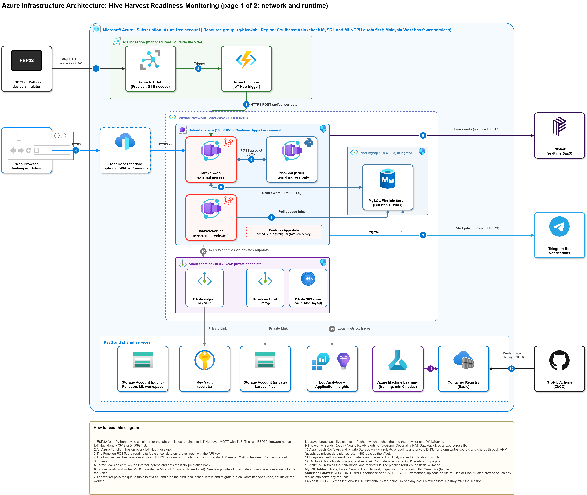

# BuzzyHive on Azure: containers, IoT and ML (Terraform)

This is a learning project. It designs how to run [BuzzyHive 2.0](https://github.com/tttaufiqqq/Kelulut-Hive-Harvest-Readiness-Prediction), a kelulut (stingless bee) harvest readiness platform, on Azure with Docker containers and Terraform, using services such as Azure IoT Hub, Container Apps and Azure Machine Learning.

> [!NOTE]
> This is a personal learning design. It is not official Microsoft guidance. The architecture is drawn and documented, and the Terraform is scaffolded and passes `terraform validate`, but **nothing has been applied to Azure yet**, so this repository has no measured results. Costs and problems in these docs are estimates and expectations, and each one is labelled that way.

*Page 1, network and runtime: how a sensor reading travels from the ESP32 to the dashboard. Source: [`docs/architecture/architecture.drawio`](docs/architecture/architecture.drawio).*

## Summary

- **Goal:** move BuzzyHive from Exabytes shared hosting to containers on Azure, and learn IoT Hub, Container Apps, Azure ML, private networking, governance and CI/CD with OIDC on the way.
- **Approach:** three container apps (`laravel-web`, `laravel-worker`, `flask-ml`) in a VNet, MySQL Flexible Server on a private subnet, IoT Hub with a Function in front of Laravel, and Azure ML for training. Everything is defined in Terraform and deployed from GitHub Actions.
- **Run time:** the environment is meant to run for about a day, then be destroyed.

## 1. Learning goals

- Containerize a Laravel + React app and a Flask ML API, and run them on Azure Container Apps.
- Ingest device data through Azure IoT Hub and an Azure Function.
- Train and register a model with Azure Machine Learning, then rebuild the serving image from it.
- Keep data private with a VNet, a delegated MySQL subnet, private endpoints and private DNS.
- Apply governance (Policy, tags, budget, locks, RBAC) and deploy with Terraform and GitHub OIDC, with no stored secrets.

## 2. What this deploys

| Resource | Purpose |
|---|---|
| IoT Hub (free tier), Azure Function | Receives ESP32 readings over MQTT and forwards them to Laravel |
| Container Apps environment: `laravel-web`, `laravel-worker`, `flask-ml`, plus Jobs | Runs the web app, queue worker, ML API, scheduler and migrations |
| MySQL Flexible Server (Burstable B1ms) in a delegated subnet | Application database, no public endpoint |
| Key Vault, two Storage accounts (one private), private endpoints, private DNS zones | Secrets and Laravel files reached only over Private Link; the Function and ML use the public account |
| Container Registry (Basic) | Holds the three images |
| Azure Machine Learning workspace | Trains the KNN model and registers it |
| Log Analytics, Application Insights, alert rules | Logs, traces and alerts |
| Governance: Policy, tags, budget, locks, Defender free tier | Subscription-scope guardrails |
| Entra groups, managed identity, GitHub OIDC app registration | Access without passwords |
| Optional: Front Door Standard, Azure Load Testing | Edge routing and a load test |

The two container images (Laravel on FrankenPHP and Alpine, 333 MB; flask-ml on Python slim, 452 MB) are built and tested locally with Docker Compose. Why they are built that way, with measurements: [Docker images](docs/docker.md).

*Page 2, governance, identity, DevOps and operations around `rg-hive-lab`.*

For a full explanation, see [Architecture](docs/architecture.md).

### Limitations

- **Scaffolded, not applied.** The three Terraform roots validate, but none of the steps in [Deploy](docs/deploy.md) have been run, so the first apply will likely turn up provider or quota errors.
- **Synthetic ML data.** The KNN model is trained on a synthetic dataset, so Azure ML here is a pipeline exercise, not a modelling one.
- **Simulated device.** The real ESP32 firmware posts plain HTTP with an API key. Talking to IoT Hub needs firmware changes, so the lab uses a Python device simulator.
- **One environment.** There is a single `rg-hive-lab` group with no separate dev or staging.
- **Pusher and Telegram stay external.** They are SaaS and are called over outbound HTTPS.

### Cost

- **Estimate, not measured:** about US$50 to 70 per month if everything is left running, so well under $5 for a one-day lab. The drivers are MySQL B1ms, the always-on worker, two private endpoints and the registry.
- **What can break the budget:** Front Door Premium (WAF managed rules, about $330 per month) and a dedicated Container Apps workload profile (about $140 per month). Neither is in the plan.
- **Credit:** $135.68 remaining at the time of writing, so a one-day run uses only a small part of it. Check the expiry date under Cost Management, then Credits.
- **Keep it low:** destroy the `lab` root when you finish. See [Cost and teardown](docs/cost-and-teardown.md).

## 3. Prerequisites

- An Azure subscription (the free account has a $200 credit for 30 days; $135.68 was left when this was written)
- [Terraform](https://developer.hashicorp.com/terraform/install) >= 1.5
- Azure CLI, Docker, and Git
- Rights to create Entra groups and app registrations in your tenant
- The [BuzzyHive repository](https://github.com/tttaufiqqq/Kelulut-Hive-Harvest-Readiness-Prediction) for the application code and `ml/` folder

## 4. Planned build order

1. Preflight (register resource providers, check quota), then subscription, tags, policy and budget
2. Entra groups and RBAC
3. Terraform state storage and the GitHub OIDC pipeline
4. Network, MySQL, Key Vault, Storage, ACR
5. Container Apps, IoT Hub and Function
6. Monitoring and alerts
7. Azure ML and the optional load test

The commands for each root are in [Deploy, redeploy, and destroy](docs/deploy.md).

> [!WARNING]
> MySQL, the registry and private endpoints bill hourly even with no traffic. Destroy the environment when you finish. See [Cost and teardown](docs/cost-and-teardown.md).

## 5. Design decisions at a glance

| Choice | Reason |
|---|---|
| Container Apps, consumption plan only | Scale to zero, no cluster to run, and no fixed workload-profile cost |
| `schedule:run` and `migrate` as Container Apps Jobs | A worker replica should not run migrations or the scheduler, and several replicas would run them twice |
| Terraform with `azurerm`, plus `azapi` where needed | `azurerm` covers most services. `azapi` writes Key Vault secrets and storage shares through ARM, because private data planes return 403 from outside the VNet |
| Three Terraform roots: `bootstrap`, `foundation`, `lab` | Only `lab` is destroyed after each session, with fewer state files than separate stacks |
| Locks behind a variable, off in the lab | A `CanNotDelete` lock makes `terraform destroy` fail |
| Python simulator in place of the ESP32 | No firmware change, same IoT Hub path |
| Database sessions and cache | Any replica can serve any request |

The reasoning behind each is in [Architecture](docs/architecture.md#6-design-decisions).

## 6. Related resources

- [BuzzyHive 2.0](https://github.com/tttaufiqqq/Kelulut-Hive-Harvest-Readiness-Prediction): the application this infrastructure hosts
- [Azure Container Apps documentation](https://learn.microsoft.com/en-us/azure/container-apps/)
- [Azure IoT Hub documentation](https://learn.microsoft.com/en-us/azure/iot-hub/)
- [Azure Machine Learning documentation](https://learn.microsoft.com/en-us/azure/machine-learning/)
- [Docs index](docs/README.md): Architecture, Deploy, Implementation log, Troubleshooting and Cost, in the order to read them
