# Architecture

This article explains the resources this project plans to deploy and why each one exists. It hosts [BuzzyHive 2.0](https://github.com/tttaufiqqq/Kelulut-Hive-Harvest-Readiness-Prediction), which today runs on Exabytes shared hosting.

## 1. From shared hosting to containers

BuzzyHive is a Laravel 13 + React app backed by MySQL, plus a Flask KNN API that returns a harvest readiness prediction. Live updates go through Pusher and alerts go to Telegram.

The current setup has limits that motivate the move:

- `composer install` is not automated on shared hosting, so a changed `composer.lock` blocks the deploy.
- The Flask API runs under Passenger on the same host, with no isolation or scaling.
- Sensors post HTTP directly to the app, with no managed device ingestion.

Containers fix the first two, and IoT Hub adds a managed ingestion path for the third.

## 2. Data flow

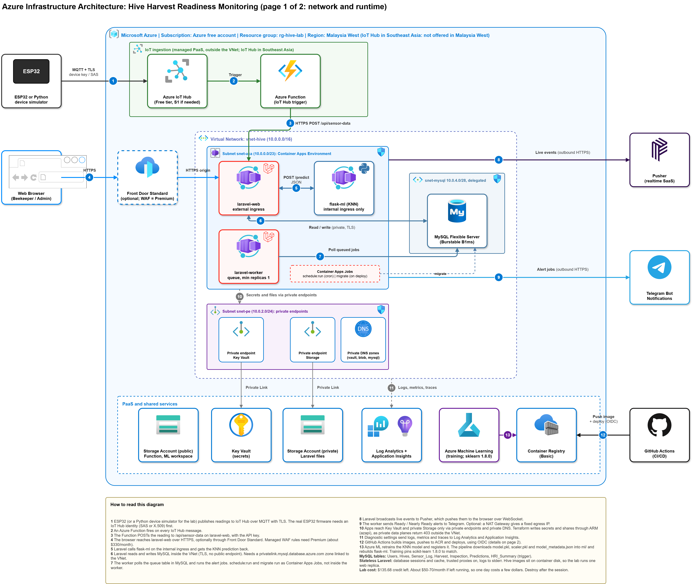
*Page 1. The numbered circles match the steps below.*

| Step | What happens |
|---|---|
| 1 | The ESP32 (or a Python simulator) publishes a reading to IoT Hub over MQTT with TLS, using its own device key |
| 2 | An Azure Function fires on every IoT Hub message |
| 3 | The Function POSTs the reading to `/api/sensor-data` on `laravel-web`, with the API key |
| 4 | The browser reaches `laravel-web` over HTTPS, optionally through Front Door Standard |
| 5 | Laravel calls `flask-ml` on its internal ingress and gets the KNN prediction |
| 6 | Laravel reads and writes MySQL inside the VNet |
| 7 | `laravel-worker` polls the queue table and runs alert jobs |
| 8 | Laravel broadcasts live events to Pusher, which pushes them to the browser |
| 9 | The worker sends Ready and Nearly Ready alerts to Telegram |
| 10 | Apps reach Key Vault and Storage only through private endpoints |
| 11 | Diagnostic settings send logs, metrics and traces to Log Analytics and Application Insights. **Observed on 2026-11-24:** Application Insights showed no data, so the apps do not yet send traces there ([troubleshooting 32](troubleshooting.md#32-application-insights-shows-no-data)) |
| 12 | GitHub Actions builds images, pushes to ACR and deploys using OIDC |
| 13 | Azure ML retrains the KNN model and registers it, and the pipeline rebuilds the `flask-ml` image |

## 3. Resources

| Resource | Notes |
|---|---|
| Azure IoT Hub | Free tier allows 8,000 messages per day and one hub per subscription; S1 if needed |
| Azure Function | IoT Hub trigger on the built-in Event Hub-compatible endpoint; sits outside the VNet and calls the public `laravel-web` ingress with the API key |
| Virtual network `vnet-hive-lab` (10.0.0.0/16) | Three subnets, listed in [Network](#4-network). An earlier version of this table called it `vnet-hive`; the deployed name is `vnet-hive-lab` |
| Container Apps environment | Consumption plan only, in `snet-aca` |
| `laravel-web` | External ingress, scales on HTTP |
| `laravel-worker` | Queue worker, `min_replicas = 1` so alerts are not delayed by a cold start |
| `flask-ml` | Internal ingress only, model and scaler baked into the image |
| Container Apps Jobs | `schedule:run` on a cron trigger, `migrate` on each deploy |
| MySQL Flexible Server, Burstable B1ms | Delegated subnet, private access, TLS |
| Key Vault | Secrets, read through a private endpoint with a managed identity |
| Storage account (private) | Laravel files, reached through a private endpoint |
| Storage account (public) | Function state and the ML workspace. A Functions Consumption plan generally cannot use storage behind a private endpoint, so this one has no private endpoint |
| Container Registry, Basic | Three images, pulled with the managed identity (`AcrPull`) |
| Azure Machine Learning workspace | Training only; the compute cluster has `min_nodes = 0` |
| Log Analytics and Application Insights | Shared workspace for all diagnostics |
| Front Door Standard (optional) | Edge routing; managed WAF rules need Premium |

## 4. Network

| Subnet | Range | Purpose |
|---|---|---|
| `snet-aca` | 10.0.0.0/23 | Container Apps environment |
| `snet-pe` | 10.0.2.0/24 | Private endpoints for Key Vault and Storage |
| `snet-mysql` | 10.0.4.0/28 | MySQL Flexible Server, delegated to `Microsoft.DBforMySQL/flexibleServers` |

Each subnet has an NSG. Three private DNS zones are linked to the VNet:

- `privatelink.vaultcore.azure.net` for Key Vault
- `privatelink.blob.core.windows.net` for Storage
- `privatelink.mysql.database.azure.com` for MySQL, which the delegated subnet needs in place of a private endpoint

IoT Hub, the Function and Azure ML are managed PaaS outside the VNet. The Function reaches Laravel over its public ingress, protected by the API key.

## 5. Governance, identity and operations

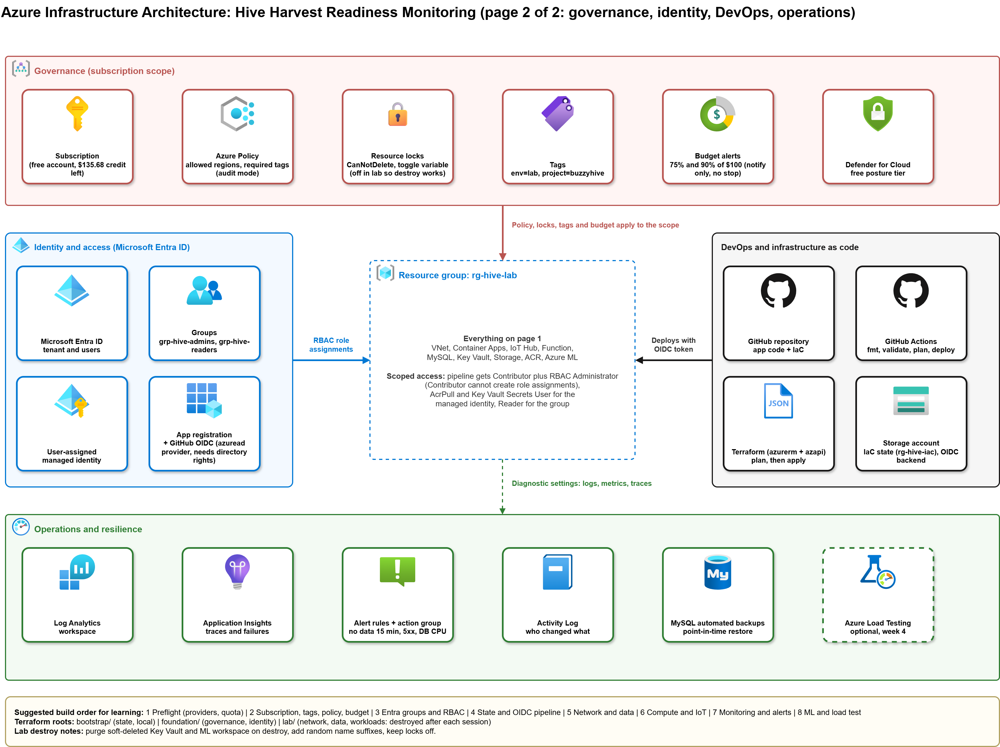
*Page 2. Governance applies to the subscription, identity grants access to the resource group, and the pipeline deploys into it.*

| Area | What it contains |
|---|---|
| Governance | Azure Policy (allowed regions, required tags, in audit mode so it never blocks an apply), resource locks, tags `env=lab` and `project=buzzyhive`, a budget with alerts at 75% and 90% of $100 (below the $135.68 credit left), and Defender for Cloud on the free tier |
| Identity | Entra groups `grp-hive-admins` and `grp-hive-readers`, a user-assigned managed identity for the apps, and an app registration with a GitHub OIDC federated credential |
| DevOps | GitHub repository, GitHub Actions, Terraform with plan before apply, and a storage account holding state in `rg-hive-iac` |
| Operations | Log Analytics, Application Insights, alert rules (no data for 15 minutes, 5xx responses, database CPU), Activity Log, MySQL automated backups, and optional Azure Load Testing |

Role assignments:

- **Pipeline identity:** `Contributor` plus `Role Based Access Control Administrator`, because `Contributor` cannot create role assignments and Terraform needs to create them.
- **Managed identity:** `AcrPull` on the registry and `Key Vault Secrets User` on the vault.
- **Readers group:** `Reader` on the resource group.

## 6. Design decisions

| Decision | Choice | Reason |
|---|---|---|
| Compute | Container Apps, consumption plan | Scales to zero, no cluster to manage, no fixed cost. A dedicated workload profile costs about $140 per month. |
| Scheduler and migrations | Container Apps Jobs, not inside the worker | A worker replica should only process the queue. Running `schedule:run` or `migrate` in every replica would repeat them. |
| Laravel state | `SESSION_DRIVER=database`, `CACHE_STORE=database`, `TRUSTED_PROXIES=*`, `LOG_CHANNEL=stderr` | Any replica can serve any request, URLs are https behind ingress, and logs reach Log Analytics |
| Uploads | Container disk in the lab, one web replica | The app saves hive images and the thesis PDF to `storage/app/public`. They are lost on restart. The durable fix is an Azure Files mount or a Blob disk. |
| Images | One Laravel image for every role, one ML image. See [Docker images](docker.md) | One build, one registry entry, and one thing to scan |
| Device | Python simulator for the lab | The real ESP32 firmware posts HTTP with an API key. IoT Hub needs a device identity (SAS or X.509) and an SDK. |
| Database access | Delegated subnet with private DNS | MySQL Flexible Server in private access cannot also be public |
| Secrets | Key Vault through a private endpoint and a managed identity | No secrets in images or pipeline variables |
| IaC | Terraform with `azurerm`, plus `azapi` where needed | `azurerm` covers Container Apps, Jobs and ML. `azapi` is for control-plane-only writes such as Key Vault secrets and file shares. |
| Private data planes | Write secrets and shares through ARM with `azapi` | With public access off, a laptop or GitHub runner outside the VNet gets 403 on the data plane |
| Storage accounts | One private, one public | The Function and ML workspace need a reachable account |
| Soft delete | Purge Key Vault and ML workspace on destroy, add random name suffixes | Soft-deleted names block recreating the same name the next day |
| Terraform roots | `bootstrap` (state, local), `foundation` (governance, identity), `lab` (network, data, workloads) | Only `lab` is destroyed after each session. Fewer state files than four separate stacks. |
| Locks | Behind a variable, off in the lab | A `CanNotDelete` lock makes `terraform destroy` fail, so keep locks in the `foundation` root |
| ML serving | Keep `flask-ml` in Container Apps, use Azure ML for training | A managed online endpoint bills all the time and a KNN on small data does not need it |
| Region | Malaysia West, with the IoT Hub in Southeast Asia | The provider list for `Microsoft.Devices` has no Malaysia West, so the IoT Hub goes to the nearest region that has it. It sits outside the VNet and devices reach it over the internet, so the split costs only a little cross-region traffic. The other services were listed for Malaysia West. Check MySQL and ML vCPU quota first. Malaysia West is also where the reference project ran, while Southeast Asia had VM capacity limits on the same account. |

## 7. What stays outside Azure

- **Pusher** delivers live events over WebSocket. Replacing it with Azure Web PubSub is possible but needs changes to Laravel Echo, so it is out of scope.
- **Telegram** receives alert calls over outbound HTTPS. A NAT Gateway would give a fixed egress IP but is optional.
- **GitHub** hosts the code and runs the pipeline, reaching Azure through OIDC.

## 8. What the portal showed after the first apply

These screenshots were taken on 2026-11-24, partway through the first `lab` apply, while the Container Apps environment and the IoT Hub were still missing (see [troubleshooting](troubleshooting.md#23-the-container-apps-environment-is-rejected-the-subnet-is-not-delegated)). Rows with `pldns` belong to the sibling reference project that shares the subscription, not to this one.

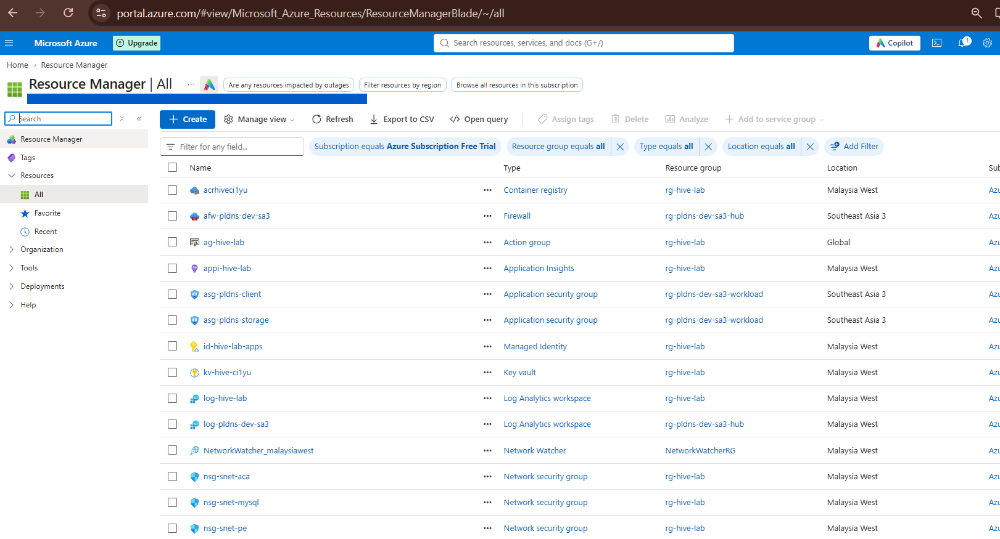
*Figure 8.1. The first part of the list: the registry, action group, Application Insights, managed identity, Key Vault, Log Analytics workspace and the NSGs for the three subnets. All are in `rg-hive-lab` in Malaysia West, apart from the action group, which is global.*

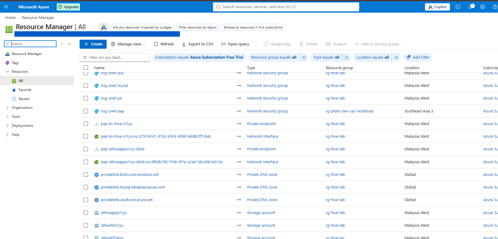
*Figure 8.2. The rest of the list: a private endpoint and network interface for Key Vault and one for blob storage, the three private DNS zones (`blob`, `mysql`, `vaultcore`), and the storage accounts. Only the account with a private endpoint is the private one. The state account `sthivetf2i4ng` sits in `rg-hive-iac`.*

The alert path was checked by hand. Azure emailed the address on the action group to say it had been added, which shows the action group exists and the address is attached to it.

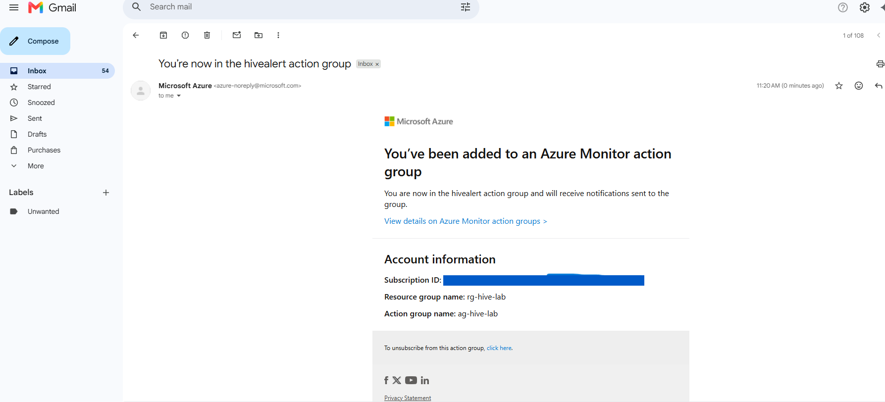
*Figure 8.3. The email Azure sent when `ag-hive-lab` was created. It does not show that an alert rule has fired.*

The figures below were taken later the same day, with the whole lab applied and the app running.

### 8.1 The resource group

The portal's Resource visualizer draws the real resource graph of `rg-hive-lab`. It matches the design: the Container Apps environment sits in `vnet-hive-lab`, MySQL and its private DNS zone attach to the VNet, the Key Vault and the private storage account each have a private endpoint and network interface, and the apps and Jobs use the `id-hive-lab-apps` managed identity. The image is large (14376 by 6782 pixels), so open the file to read the labels.

*Figure 8.3b. The Resource visualizer for `rg-hive-lab`, exported from the portal.*

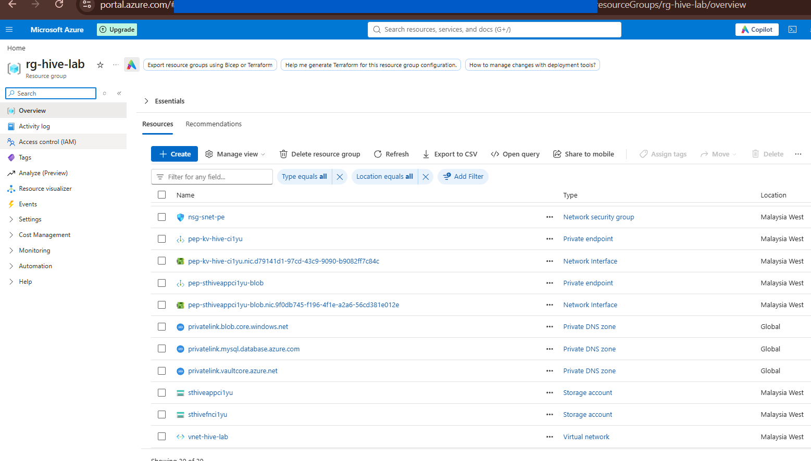
*Figure 8.4. `rg-hive-lab` holds 30 resources. The bottom of the list shows the private endpoints, the three private DNS zones, the two storage accounts and `vnet-hive-lab`.*

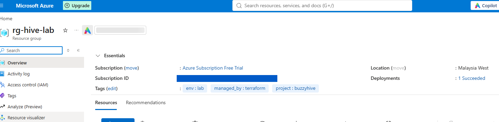
*Figure 8.5. The resource group's tags: `env : lab`, `managed_by : terraform` and `project : buzzyhive`.*

### 8.2 Network

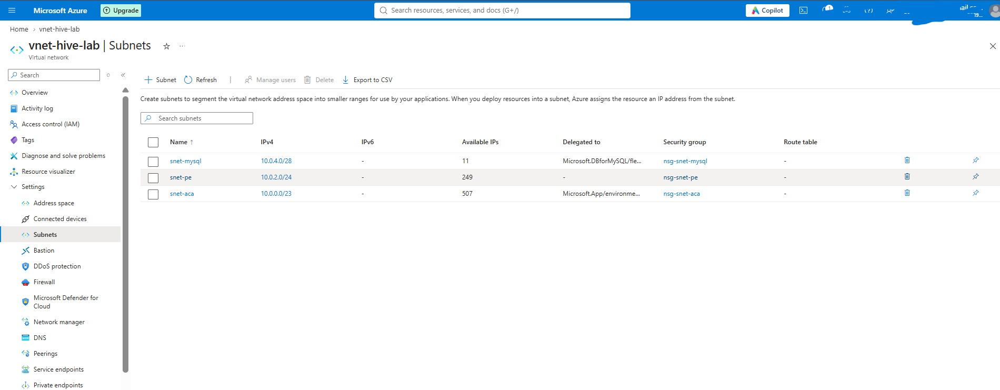
*Figure 8.6. The three subnets match the [Network](#4-network) table. `snet-mysql` and `snet-aca` are delegated, `snet-pe` is not, and each has its own NSG. The `snet-aca` delegation is the fix from [troubleshooting 23](troubleshooting.md#23-the-container-apps-environment-is-rejected-the-subnet-is-not-delegated).*

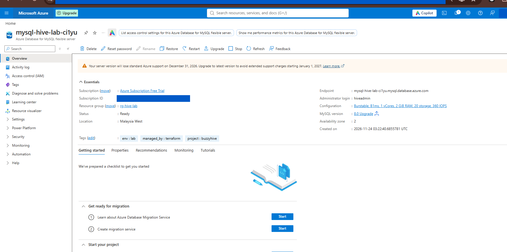
*Figure 8.7. The database: `Ready`, Burstable B1ms (1 vCore, 2 GiB, 20 GB, 360 IOPS), MySQL 8.0. The banner says this version loses standard Azure support on 31 December 2026 and that extended-support charges begin on 1 January 2027. That does not affect a one-day lab.*

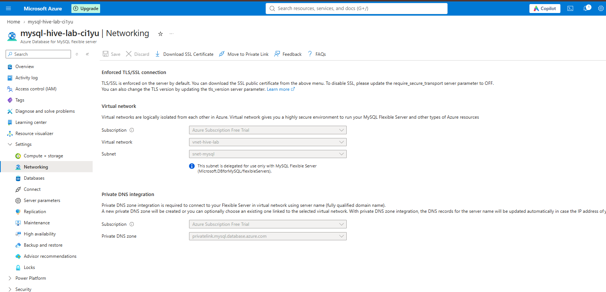
*Figure 8.8. MySQL is reached through the delegated subnet and the `privatelink.mysql.database.azure.com` zone, with TLS enforced. The page offers no public-access setting.*

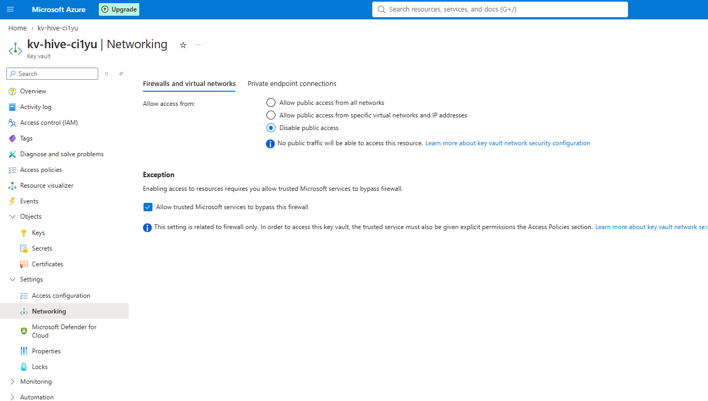
*Figure 8.9. The Key Vault has public access disabled.*

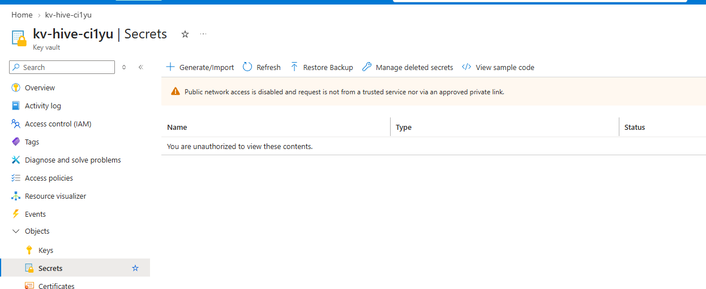
*Figure 8.10. Proof that the closed vault works: from the portal, outside the VNet, even the secret names are refused. This is also why Terraform writes secrets through ARM with `azapi`.*

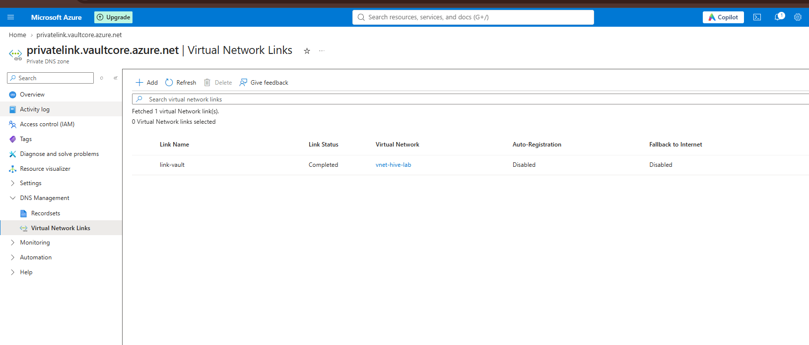
*Figure 8.11. The Key Vault private DNS zone is linked to the VNet (`link-vault`, Completed).*

### 8.3 Ingress

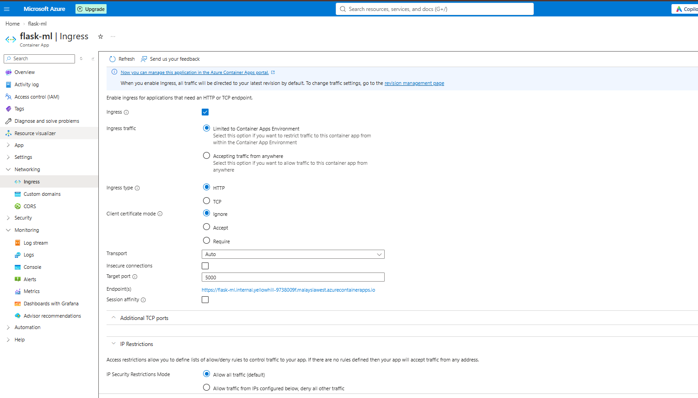
*Figure 8.12. `flask-ml` accepts traffic only from inside the Container Apps environment, on target port 5000, and its endpoint is an `.internal.` name.*

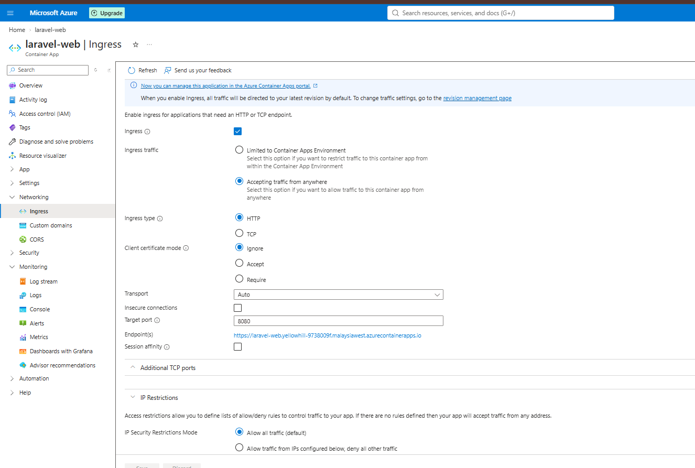
*Figure 8.13. `laravel-web` accepts traffic from anywhere, on target port 8080. Insecure (plain HTTP) connections are off.*

### 8.4 Identity and secrets

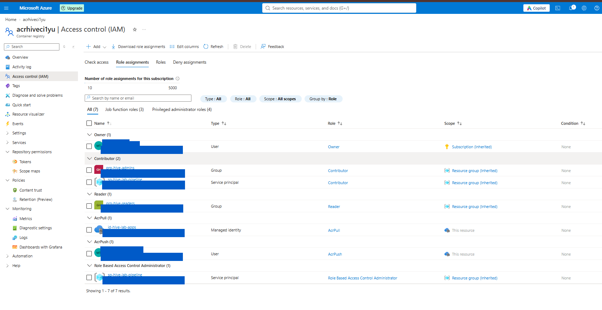
*Figure 8.14. Roles on the registry. The managed identity has `AcrPull`, as designed. The `AcrPush` row for the signed-in user is the assignment made by hand during the image push ([troubleshooting 26](troubleshooting.md#26-docker-login-to-the-registry-returns-unauthorized)); Terraform did not create it.*

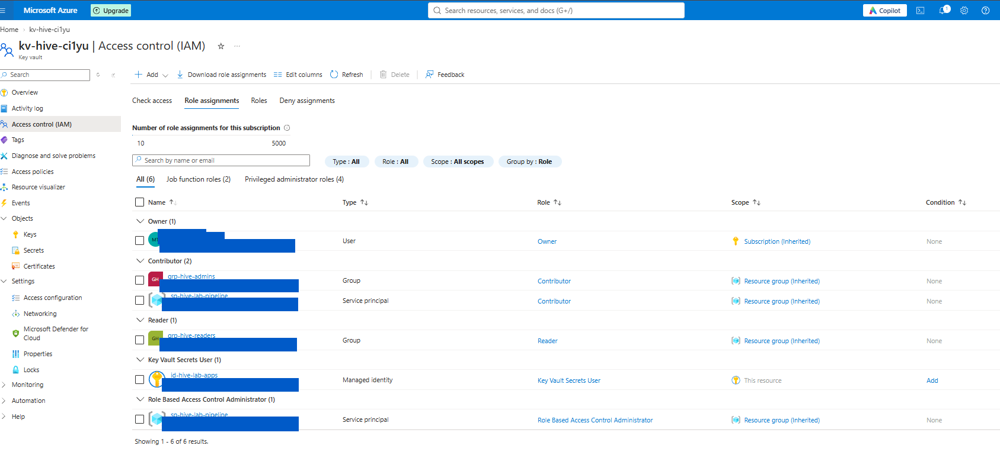
*Figure 8.15. Roles on the vault. The managed identity has `Key Vault Secrets User`, which is what lets the apps read their secrets.*

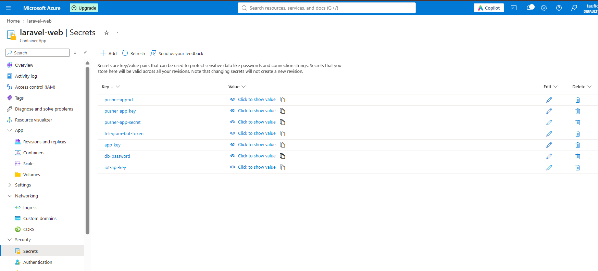
*Figure 8.16. The secret names on `laravel-web`, with every value hidden. Terraform defines these as Key Vault references, so the values live in the vault and not in the app's configuration.*

### 8.5 Alerts, governance and state

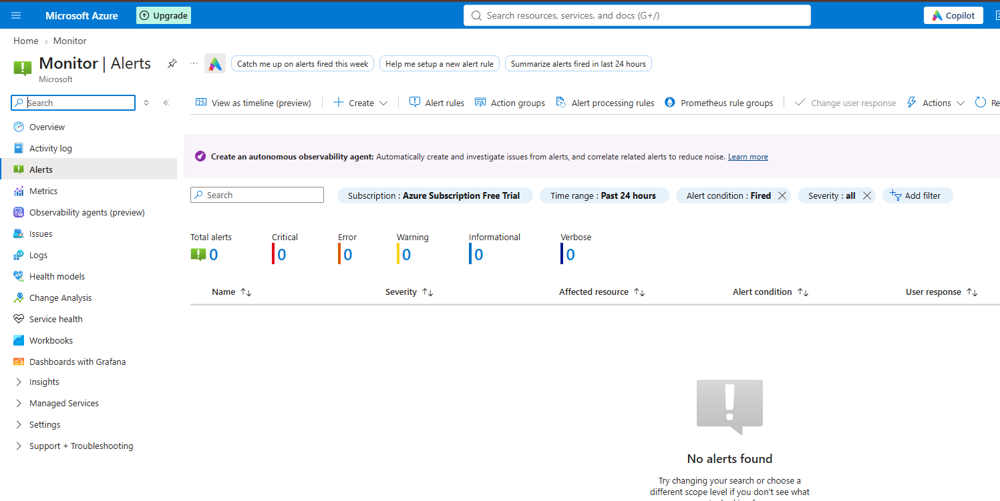
*Figure 8.17. No alert fired in the last 24 hours, which is what a healthy lab should show.*

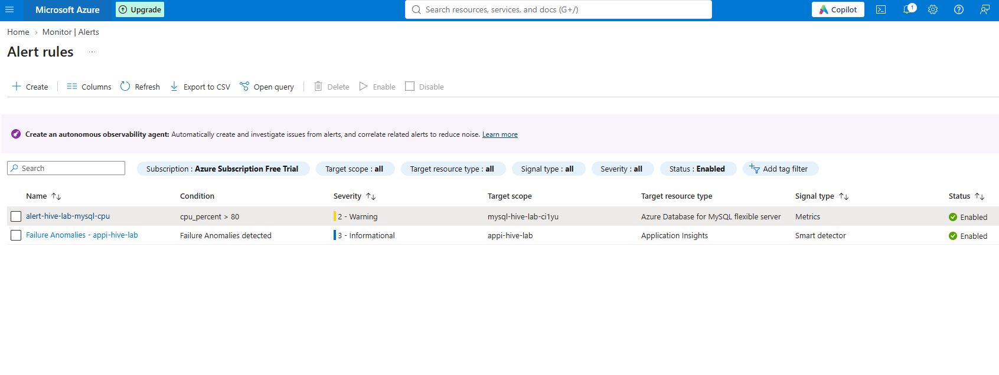
*Figure 8.18. The two enabled alert rules: `alert-hive-lab-mysql-cpu` (CPU above 80%, Warning) and the Application Insights Failure Anomalies detector.*

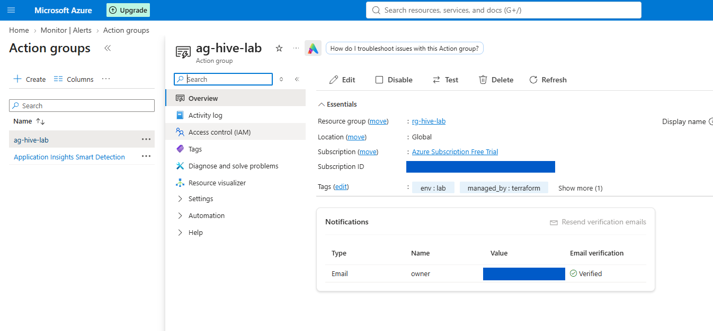
*Figure 8.19. The action group `ag-hive-lab` has one email receiver, `owner`, and its address is verified.*

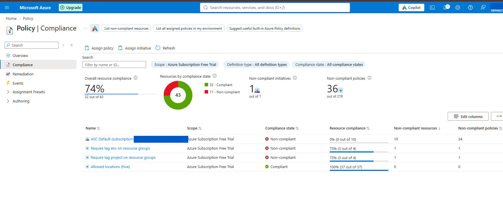
*Figure 8.20. Policy in audit mode. Allowed locations is 100% compliant (37 of 37 resources). The `env` and `project` tag policies each flag one resource group as non-compliant, which the screenshot does not identify. The Defender default initiative flags 10 resources. Nothing was blocked, which is the point of audit mode.*

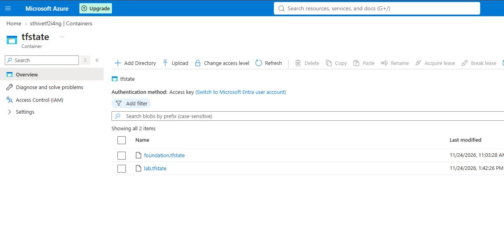
*Figure 8.21. The remote state: `foundation.tfstate` and `lab.tfstate` in the `tfstate` container. `bootstrap` keeps its own state locally, as designed.*

Edit the diagrams in [`architecture/architecture.drawio`](architecture/architecture.drawio) and export the PNGs again after any change.
