# Train the model in Azure ML

<!-- docs-nav:start -->
**[← Previous: Cost and teardown](cost-and-teardown.md) | [Docs index](README.md) | [Next: Load test with k6 →](load-test.md)**
<!-- docs-nav:end -->

This article records how the readiness model was retrained in Azure Machine Learning on 24/11/2026, what the retrained model does differently from the one that was in service, how it was deployed and checked, and what is still unknown.

> [!NOTE]
> **This ran once, on 24/11/2026, in Malaysia West.** The job, the registered model, the comparison and the deployment are measured. The data is synthetic, so this is a pipeline exercise, not a modelling one. Model quality was not measured on held-out data, cost was not measured, and no screenshots have been added to `evidence/` yet.

## 1. What was built

| Piece | Where | State |
|---|---|---|
| Workspace `mlw-hive-lab`, its own Key Vault, compute cluster `train-cpu` (`Standard_DS2_v2`, 0 to 1 nodes, scales down after 15 idle minutes) | `lab/ml.tf` | Applied on 24/11/2026 (3 resources added) |
| Training code | App repo, `ml/train_model.py` | Ran in the job |
| Conda environment | `azureml/environment.yml` | Built on Azure. Python 3.12, `scikit-learn==1.8.0` |
| Command job | `azureml/train-job.yml` | Ran. The first submit failed, see section 3 |
| Submit script | `azureml/submit-training.ps1` | Ran against Azure |
| Register and package script | `azureml/register-and-package.ps1` | Ran (registered and downloaded). `-Build` was not used: the image was built by hand, see section 5 |

The workspace has its own Key Vault because the main one has public access disabled, which a workspace cannot use. Models are served by `flask-ml` in Container Apps, not by a managed online endpoint, because an endpoint bills all the time.

Azure ML in Malaysia West works: the workspace, its own public Key Vault and the compute cluster were all created without errors.

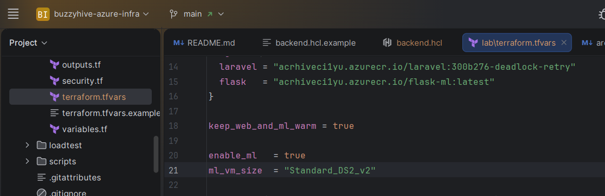
*Figure 1.1. `lab/terraform.tfvars` with `enable_ml = true` and `ml_vm_size = "Standard_DS2_v2"`.*

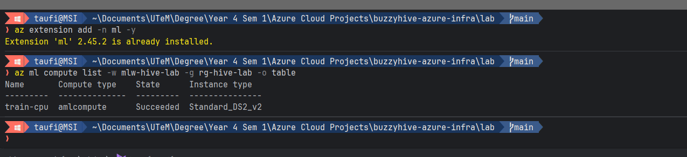
*Figure 1.2. After the apply, `az ml compute list` shows the cluster `train-cpu` (`Standard_DS2_v2`) as `Succeeded`.*

## 2. What the local check found before the run

The model committed in the app repo was not the model its metadata describes. The committed `model.pkl` and `scaler.pkl` were a KNN with `k = 1` and uniform weights on 140 rows, while `model_metadata.json` describes `k = 7` with distance weights on 1,600 rows. The version string in the metadata was identical in both cases, so nothing in the app flagged it. The `flask-ml` image copies the committed pickles, so the deployed model was the older one.

## 3. The run and what went wrong

| Step | Result |
|---|---|
| `terraform apply` with `enable_ml = true` | 3 resources added |
| First submit | **Failed** within about a minute with `Unable to get image details`: the base image `openmpi4.1.2-ubuntu20.04:latest` pinned in `train-job.yml` no longer exists in Microsoft's registry. This was an error in the job file, not a default of the CLI |
| Fix | Base image changed to `openmpi4.1.0-ubuntu22.04:latest`, after checking the tag list at `mcr.microsoft.com` |
| Second submit | **Completed**. The environment image was built by a `prepare_image` job on the cluster in about 6 minutes (not by ACR Tasks), then the training ran. The job finished within about 15 minutes of submitting, most of it environment build and node start |
| Register and download | Model `buzzyhive-knn` version 1 registered, and `model.pkl`, `scaler.pkl` and `model_metadata.json` downloaded |

Two things went wrong that the job did not cause:

- **Log streaming failed.** The CLI could not stream the image-build log: `AuthenticationFailed`, `Signature did not match`, from the storage account. The job carried on and finished. The cause was not investigated.
- **Azure ML created a registry of its own.** On the first build it created an untagged Container Registry in `rg-hive-lab`, with the admin user **enabled**, and attached it to the workspace. It is not in Terraform state, so `terraform destroy` will not remove it and it would keep billing. It must be deleted by hand at teardown, and `scripts/down.ps1` lists leftovers for that reason.

Attaching that registry made the next `terraform plan` propose **replacing the workspace and the cluster** (`container_registry_id` forces replacement). `lifecycle { ignore_changes = [container_registry_id] }` on the workspace fixed it. See troubleshooting entries 37 and 38.

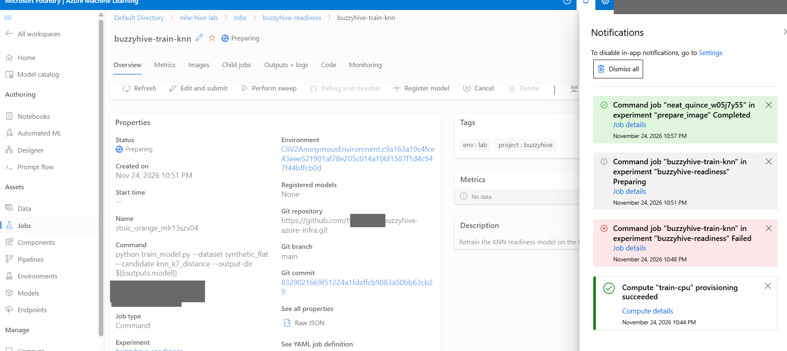
*Figure 3.1. Azure ML Studio: the second job `Preparing`, the `prepare_image` build job reported as completed at 10:57 PM, and the first job `Failed` at 10:48 PM. The account name and the subscription are covered.*

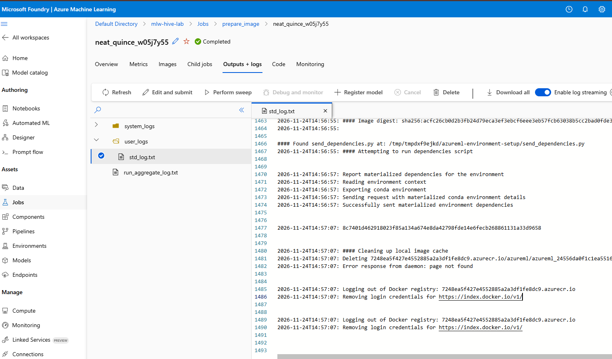
*Figure 3.2. The image-build log in Studio: the image is built and pushed to the registry Azure ML created, then the local cache is cleaned up (the `page not found` line comes from that cleanup).*

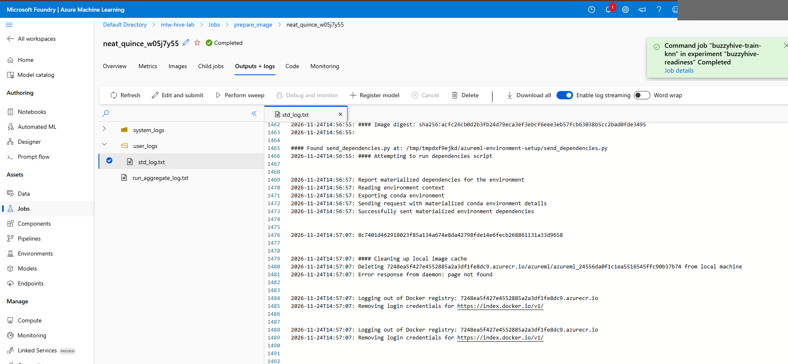
*Figure 3.3. Studio reporting the training job `Completed`.*

## 4. The retrained model compared with the one in service

The comparison was run locally on the downloaded files, with the same scikit-learn version (1.8.0), over the 1,600 training rows.

| | Azure ML (new) | In service (old) |
|---|---|---|
| Algorithm | KNN, `k = 7`, distance weights | KNN, `k = 1`, uniform weights |
| Training rows | 1,600 | 140 |
| Scaler ranges equal the metadata's `feature_bounds` | yes | no |
| Labels over the 1,600 rows | 400 of each class | `ready` 771, `nearly_ready` 520, `approaching` 294, `not_ready` 15 |

*Table 4.1. The retrained model matches its own metadata. The old one does not.*

- **Agreement:** the two models agree on 41.1% of rows and differ on **943**. That equals the figure from the laptop check before the run, so the Azure run reproduced the local result.
- **The old model is strongly over-optimistic.** Even the `not_ready` rows of the training data came out `nearly_ready` in 68% of 1,500 samples, and the rest `approaching`.
- **The new model's 100% accuracy on the training rows is not a quality measure.** A distance-weighted KNN predicts a training point as itself. No held-out evaluation was done.

The app's guardrail cases, run through both models:

| Case | New model | Old model |
|---|---|---|
| In-range baseline | `ready`, confidence 0.86 | `ready`, 1.0 |
| Critical thresholds and out of distribution | `approaching`, `critical` | raw `ready`, downgraded to `not_ready` |
| Out of distribution only | `approaching` | `ready` |
| The k6 load-test reading | `approaching` | raw `ready`, final `nearly_ready` |

*Table 4.2. The old model labels the load-test reading ready or nearly ready on every request, so every request queued a Telegram alert job. The new model queues none.*

## 5. Deployment and the check

1. The `flask-ml` image was built by hand in WSL from a staged copy of the app's `ml/` folder with the three Azure files swapped in. The SHA-256 of each staged file equals the file downloaded from Azure.
2. Run locally before pushing, the image answered `/health` and returned the same labels as the comparison for three readings (to the last digit of the confidence).
3. Pushed as `flask-ml:azureml-<job>`. The registry admin user was switched on only for the push and off again afterwards.
4. Applied with `images.flask` pointing at that tag. The plan first proposed replacing the workspace and the cluster (section 3), and was applied only after the `ignore_changes` fix, when it showed one in-place change.
5. The new revision came up `Healthy` with 100% traffic. One baseline reading sent through the app was stored with raw level `approaching` and final level `approaching`, and **0 Telegram alert jobs** ran since the deploy.

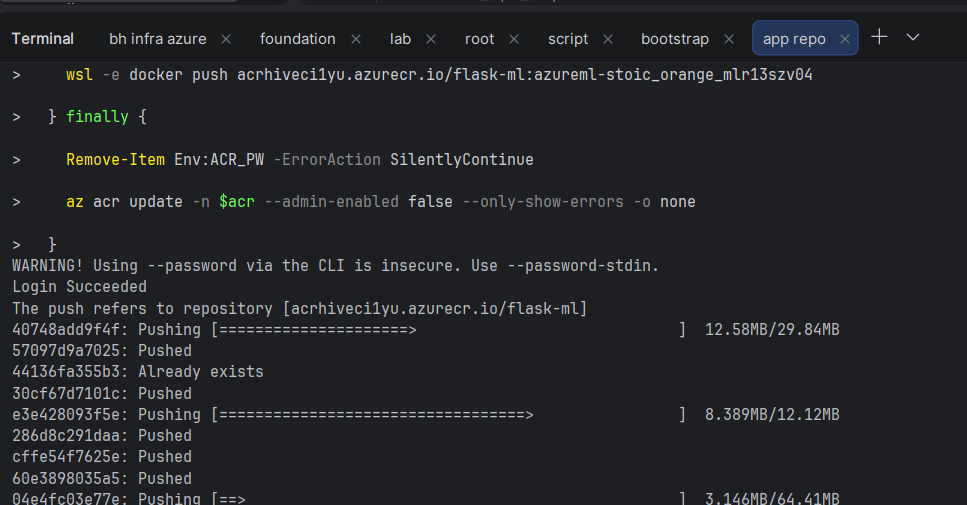
*Figure 5.1. Pushing the `flask-ml` image tagged `azureml-<job>`. The login succeeded.*

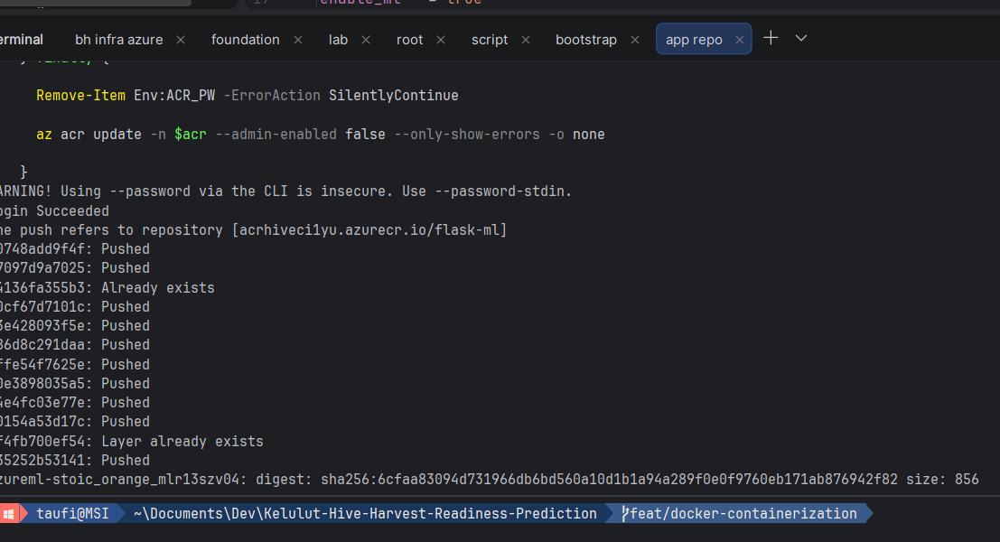
*Figure 5.2. The end of the push, with the digest.*

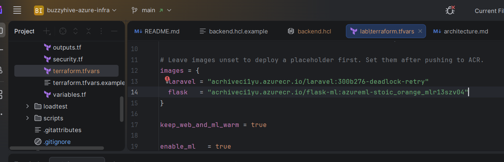
*Figure 5.3. `lab/terraform.tfvars` with `flask` set to the new tag.*

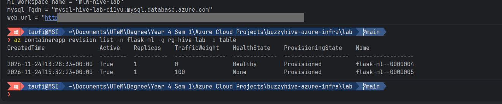
*Figure 5.4. Right after the apply: the new `flask-ml` revision has 100 % of the traffic and its health is still `None`. The lab URL is covered.*

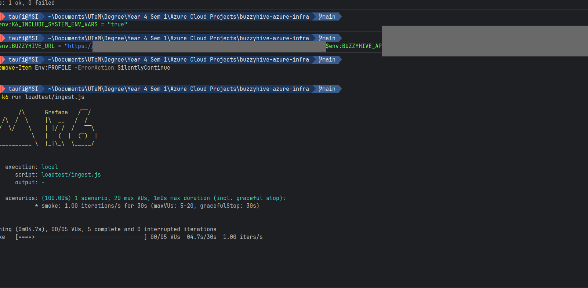
*Figure 5.5. The smoke profile starting against the retrained model. The lab URL and the API key are covered.*

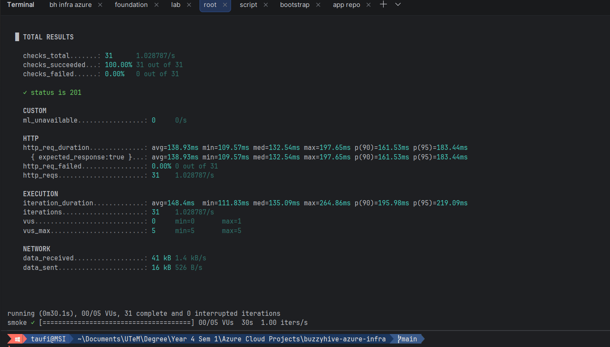
*Figure 5.6. The smoke run on the retrained model: 31 requests, none failed, p95 183 ms.*

A k6 ramp at 10 requests per second then showed 0 failed requests and 0 alert jobs. See [the load test](load-test.md) for its latency result.

## 6. What changed for the Telegram check

The `ready` and `nearly_ready` profiles of `scripts/simulate_sensor.py` were found against the **old** model, and the alerts delivered on 24/11/2026 came from it. Under the new model they are only partly reliable:

| Profile | `ready` | `nearly_ready` | `approaching` | `not_ready` |
|---|---|---|---|---|
| `ready` range, 1,000 samples | 63.0% | 22.1% | 14.6% | 0.3% |
| `nearly_ready` range, 1,000 samples | 10.0% | 77.3% | 12.7% | 0% |

*Table 6.1. Final label of the simulator's two alert profiles under the retrained model.*

Both profiles still reach the alert levels most of the time, but a single reading is not guaranteed to. If a deterministic alert is needed, re-tune the ranges against the new model with the same local method, or use the app's diagnostic endpoint.

## 7. What is not known or not done

- **Model quality.** No held-out evaluation. The data is synthetic.
- **The app repository still holds the old pickles.** A build of `ml/Dockerfile` from the repo's `main` produces the old model, while the lab runs the new one. Committing the retrained files there is the app owner's decision and has not been made.
- **The training log was not read.** The evidence for the Azure run is the downloaded model files and metadata.
- **Cost.** The cluster bills only while a job runs, and storage and the vault are small. This is an estimate. Check Cost analysis after the destroy.
- **The log-streaming error** from the CLI was not investigated.
- **Screenshots** have not been added to `evidence/`. Blur the subscription, tenant and user details before adding any.
- **Teardown.** `terraform destroy` removes the workspace, its vault and the registered model, but not the auto-created registry. Delete it by hand.

---

<!-- docs-nav:start -->
**[← Previous: Cost and teardown](cost-and-teardown.md) | [Docs index](README.md) | [Next: Load test with k6 →](load-test.md)**
<!-- docs-nav:end -->
