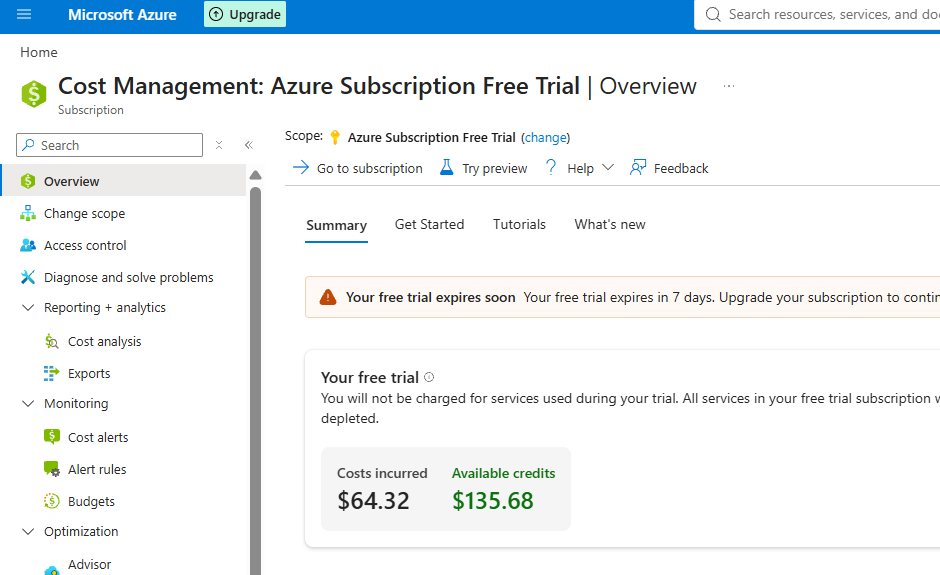
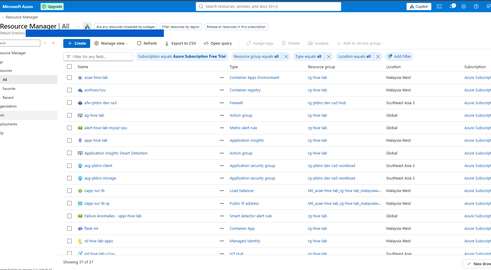
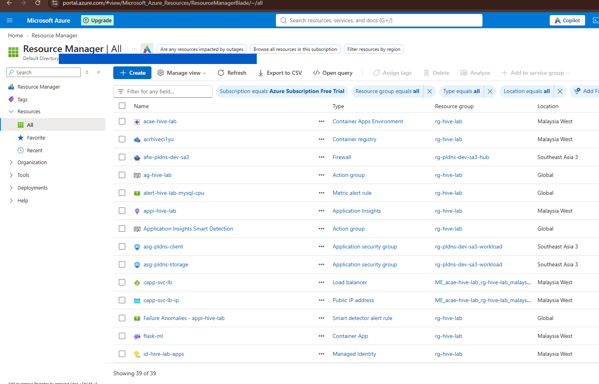

# Cost and teardown

This article shows what the environment is expected to cost, how to check your own cost, and where to find the teardown steps.

> [!NOTE]
> The service prices below are still estimates from published price lists, not measurements. `lab` was applied on 24/11/2026, but its real cost is not in Cost Management yet (data lags by 8 to 24 hours, and the environment had not been destroyed). Replace the estimates with measured figures after the destroy. The credit balance and expiry date in section 1 are read from the portal. Prices vary by region and change over time; the [Azure pricing calculator](https://azure.microsoft.com/en-us/pricing/calculator/) gives current rates.

## 1. Estimated cost

The free account gives a $200 credit that lasts 30 days. **$135.68 remained** on 24/11/2026, and it **expires on 02/12/2026**, 8 days later. The portal says services are paused when the credit runs out or expires. The plan is to run the environment for about one day, so the real spend is a small fraction of the monthly figures below.


*Figure 1.1. The portal home page on 24/11/2026, before anything in this repository had been applied: $135.68 of credit left, expiring 02/12/2026, with $64.32 already incurred this month.*

That $64.32 was spent before the first `bootstrap` apply, so it did not come from this project. See section 1.3.

The same Cost Management overview later that day, with the lab running. It warns that the free trial **expires in 7 days**. Costs incurred and available credit still read $64.32 and $135.68, because cost data lags by hours, so the lab's own spend had not appeared yet.


*Figure 1.1b. Cost Management on 24/11/2026, with the free trial expiring in 7 days. The spend had not caught up with the lab yet.*

### 1.1 By service

| Service | Monthly estimate | Notes |
|---|---|---|
| MySQL Flexible Server B1ms with 20 GB storage | about $15 | Bills while the server exists, even stopped storage |
| Container Apps (consumption) | about $5 to 15 | The worker has `min_replicas = 1`; web and ML scale to zero |
| Container Registry Basic | about $5 | Flat daily rate |
| Two private endpoints | about $15 | About $7 each, plus data processed |
| Log Analytics | $0 to a few dollars | The first 5 GB per month is free |
| IoT Hub free tier, Functions consumption | $0 | Within the free quotas |
| Key Vault, Storage | under $1 | Light use |
| Azure ML compute | only while training | Cluster has `min_nodes = 0` |

**Total: about $50 to 70 per month** if left running, or under $5 for a one-day run.

### 1.2 What can break the budget

- **Front Door Premium** is about $330 per month. Managed WAF rules need Premium, so the plan uses Standard or none.
- **A dedicated Container Apps workload profile** is about $140 per month. The plan uses consumption only.
- **An Azure ML compute cluster left with `min_nodes > 0`** bills every hour.
- **A resource that survives the destroy,** such as a stuck resource group, keeps billing after the rest is gone.

The budget in the `foundation` root alerts at 75% and 90% of $100, which sits below the remaining credit. A budget only sends a notification and does not stop spending.

Two budgets exist on the subscription. `budget-hive-lab` ($100 a month, from 01/11/2026 to 01/11/2036) is this project's and stood at 64.32%. `budget-lab-monthly` ($5 a month, forecast $66.81) is not defined anywhere in this repository (the only budget here is named `budget-${project}-${env}`), so it was most likely created for the sibling project, and it sat at 100%. Both read the same $64.32 evaluated spend, which confirms that figure is subscription-wide and not this project's.


*Figure 1.1c. The two budgets. `budget-hive-lab` is this project's.*

MySQL 8.0 loses standard Azure support on 31/12/2026, and extended-support charges begin on 01/01/2027 (see [architecture, figure 8.7](architecture.md#82-network)). That is after the planned one-day run, so it adds no cost here, but a long-lived copy of this lab should use a newer MySQL version.

### 1.3 What else is in the subscription

The Resource Manager list shows more than this project. The rows named `pldns` (for example `afw-pldns-dev-sa3`, an Azure Firewall in `rg-pldns-dev-sa3-hub`, plus a Log Analytics workspace and application security groups) belong to the sibling reference project, `azure-private-link-dns`. They are in the same subscription and draw on the same credit.


*Figure 1.2. All 37 resources in the subscription after the second `lab` apply. Rows with `hive` or `ci1yu` are this project; rows with `pldns` are the sibling project.*


*Figure 1.3. The same list later, with 39 resources after the two Jobs (`laravel-migrate` and `laravel-schedule`) were added. The `pldns` rows are unchanged.*

- **Check before blaming this project for the spend.** Group Cost analysis by resource group. `rg-hive-lab` and `rg-hive-iac` are this project, and `rg-pldns-*` is the other one.
- **An Azure Firewall bills for every hour it exists.** I have not checked whether that one is running or what it costs. If that project is finished, deleting it is likely the largest saving available, but it is not mine to delete from here.

## 2. How to check your own cost

1. In the Azure Portal, open **Cost Management**, then **Cost analysis**.
2. Set the scope to your subscription and a date range that covers your deployment.
3. Group by **Resource group**, then by **Service name** and **Location**.
4. Filter on the tag `project = buzzyhive` to show only this project.
5. Data lags by 8 to 24 hours, so a deployment you just destroyed may not show its full cost yet.

## 3. Teardown

MySQL, the registry and private endpoints bill hourly, so delete the environment as soon as you finish testing. The steps are in [Deploy, redeploy, and destroy](deploy.md#6-destroy).

After the destroy, confirm nothing is left:

```bash
az resource list --tag project=buzzyhive -o table
az group list -o table
```

Both should show no `rg-hive-lab` resources. If the free account is about to expire, also delete `rg-hive-iac` so the state storage stops billing.

Things changed by hand during the first run, outside Terraform:

- **Registry admin user and the `AcrPush` role assignment.** Both live on the registry, so `terraform destroy` removes them with it. Turn the admin user off sooner if the lab stays up (`az acr update -n <registry> --admin-enabled false`). See [troubleshooting](troubleshooting.md#26-docker-login-to-the-registry-returns-unauthorized).
- **Seeded database rows.** They live in MySQL and are deleted with it, so a new lab needs the migration and the seeder again (see [Deploy](deploy.md#46-seed-the-database)).
- **State storage and the managed identity** are kept on purpose, because `bootstrap` and `foundation` are not destroyed after a session.
