# Deploy, redeploy, and destroy

This article shows the steps to deploy the infrastructure, change it, and delete it, with what happened when they were run on 24/11/2026.

> [!NOTE]
> All three roots (`bootstrap`, `foundation`, `lab`) have been applied once, the images were pushed, the database was migrated and seeded, and a Python simulator posted readings that produced stored predictions. The first `lab` apply hit two errors and the image step hit several more; each is in [troubleshooting](troubleshooting.md) (entries 23 to 32). Screenshots are in [`evidence/`](evidence/). The environment had not been destroyed when this was written.

## 1. Before you begin

- Sign in with `az login`, and select your subscription with `az account set --subscription "<name>"`.
- Run the preflight script (planned: `scripts/preflight.sh`). It should do three things:
  - Register the resource providers a new subscription often lacks: `Microsoft.App`, `Microsoft.Devices`, `Microsoft.DBforMySQL`, `Microsoft.MachineLearningServices`, `Microsoft.OperationalInsights` and `Microsoft.Cdn`.
  - Check quota with `az vm list-usage --location malaysiawest -o table`.
  - Confirm MySQL B1ms is offered with `az mysql flexible-server list-skus --location malaysiawest -o table`.
- Check that you can create Entra groups and app registrations in your tenant. A university tenant may block this.
- Check your remaining credit and its expiry date in Cost Management, then Credits ($135.68 when this was written, expiring 02/12/2026; see [Cost and teardown](cost-and-teardown.md#1-estimated-cost)).
- On PowerShell, quote any Terraform argument that contains a dot, for example `terraform init -reconfigure "-backend-config=backend.hcl"`. Unquoted, PowerShell splits it and Terraform fails with `No positional arguments are expected`. The same applies to `-var-file=...`.
- Build the app images locally first (see [Build the images](#3-build-the-images)).

## 2. Planned layout

```
buzzyhive-azure-infra/
├── docs/
├── bootstrap/          # state storage account (rg-hive-iac), local state
├── foundation/         # governance (Policy, tags, budget, Defender, locks toggle) + identity (Entra, managed identity, GitHub OIDC)
├── lab/                # network, MySQL, Key Vault, Storage, ACR, Container Apps, Jobs, IoT Hub, Function, Azure ML
├── scripts/            # preflight.sh, simulate_sensor.py (the device simulator and smoke test)
└── .github/workflows/  # terraform.yml: fmt, validate and tflint on every root
```

Each root is a flat set of `.tf` files. Pull a block into `modules/` only when something is reused. Three roots, not four stacks: only `lab` is destroyed after each session, so governance and identity share one root and one state file.

- **`bootstrap`** keeps its state locally, because it creates the storage account the other roots use for remote state.
- **`foundation` and `lab`** use the `azurerm` backend in `rg-hive-iac`, authenticated with OIDC.
- **Provider settings for the lab:** purge soft-deleted Key Vaults and ML workspaces on destroy, and add a random suffix to globally unique names (ACR, Key Vault, storage, Function). Otherwise recreating the same name the next day fails.
- **Private data planes:** the lab writes Key Vault secrets and file shares through ARM with `azapi`, because a laptop or runner outside the VNet gets 403 from a private data plane.

## 3. Build the images

The Docker files live in the application repository, because they build the app, and its `docs/docker/docker.md` lists what the app needs from its host. Why each image is built the way it is: [Docker images](docker.md).

| Image | Build | Role |
|---|---|---|
| `laravel` | `docker build -t buzzyhive/laravel:local .` | Web (default), worker, scheduler and migrate. Only the command changes |
| `flask-ml` | `docker build -t buzzyhive/flask-ml:local ml` | The KNN API, served by gunicorn |

Run the whole stack locally first, from WSL or any Docker host:

```bash
cp .env.docker.example .env.docker      # set APP_KEY: docker compose run --rm --no-deps app php artisan key:generate --show
docker compose up --build               # app on http://localhost:8080
```

The Pusher key and cluster are compiled into the JavaScript, so they are build arguments (`VITE_PUSHER_APP_KEY`, `VITE_PUSHER_APP_CLUSTER`), not runtime settings.

Push to ACR with `docker push`. `az acr build` does not work in Malaysia West, because ACR Tasks is not offered there ([troubleshooting 25](troubleshooting.md#25-az-acr-build-fails-in-malaysia-west)). The registry does not exist until the first `lab` apply, so the push happens in step 4.5. The commands are in [Docker images, section 7](docker.md#7-push-the-images-to-the-registry).

## 4. Deploy

Run these in order. Each step says what to check before moving on, and what usually goes wrong.

### 4.1 Preflight

```bash
az login
az account set --subscription "<name>"
scripts/preflight.sh malaysiawest southeastasia
```

Run it again until every resource provider says `ok` (registration takes a few minutes). A quota or SKU line showing `0` or no result means that feature will fail. Switch it off with an `enable_*` variable, or request quota.

The subscription was an Azure Subscription Free Trial:

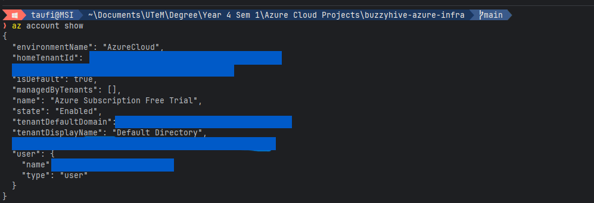
*Figure 4.1. `az account show` on the Free Trial subscription (identifiers blurred).*

The preflight on its second run, after the checks were fixed (the first run is in the [implementation log](implementation-log.md#4-problems-found-before-deployment)): every provider `ok`, MySQL `Standard_B1ms` offered in Malaysia West, 4 vCPUs of quota, and the IoT Hub listed for Southeast Asia.

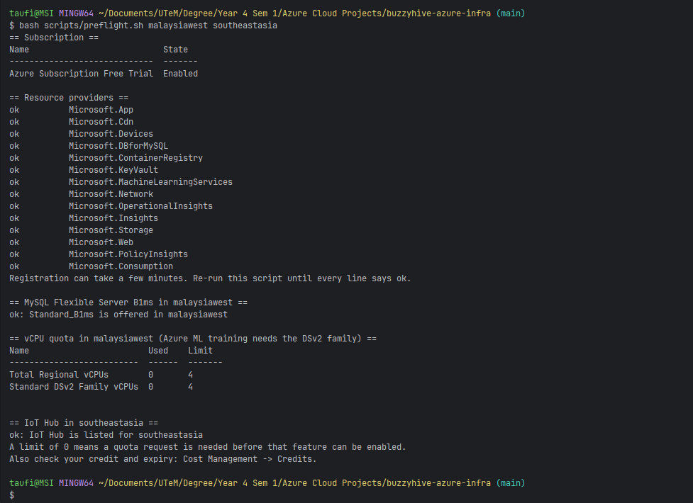
*Figure 4.2. The clean preflight run.*

### 4.2 bootstrap (state storage)

```bash
cd bootstrap
cp terraform.tfvars.example terraform.tfvars      # set subscription_id
terraform init && terraform plan
terraform apply
terraform output -raw backend_hcl
```

It also gives your signed-in user `Storage Blob Data Contributor` on the state account. The other roots read state with Azure AD auth, and Owner or Contributor alone cannot. The assignment can take several minutes to take effect, so `terraform init` in the next step may fail with a 403 at first. Wait and retry.

**What happened.** The plan was 5 to add, 0 to change, 0 to destroy. The apply took roughly two minutes (the container and the role assignment ran in parallel), and the storage account was the slow part:

| Resource | Time |
|---|---|
| Resource group `rg-hive-iac` | 26 s |
| Storage account | 1 min 22 s |
| Container `tfstate` | 11 s |
| Role assignment for the deployer | 27 s |

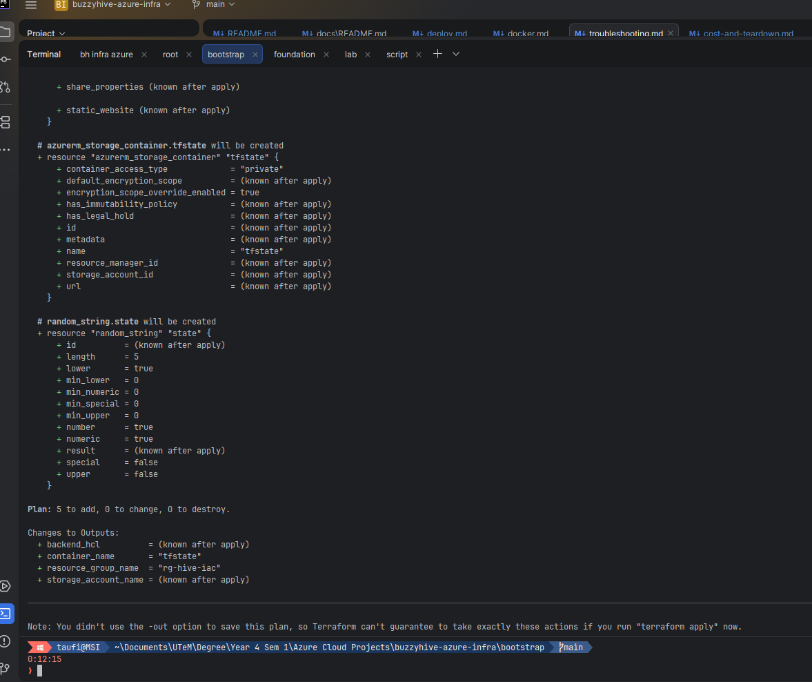
*Figure 4.3. The `bootstrap` plan: 5 to add, in `rg-hive-iac`.*

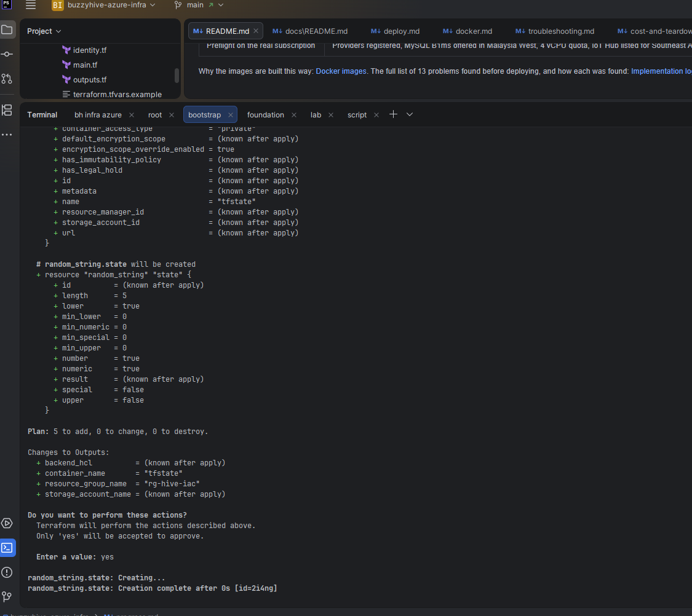
*Figure 4.4. The apply confirmed, starting with the random suffix (`2i4ng`) that makes the storage account name unique.*

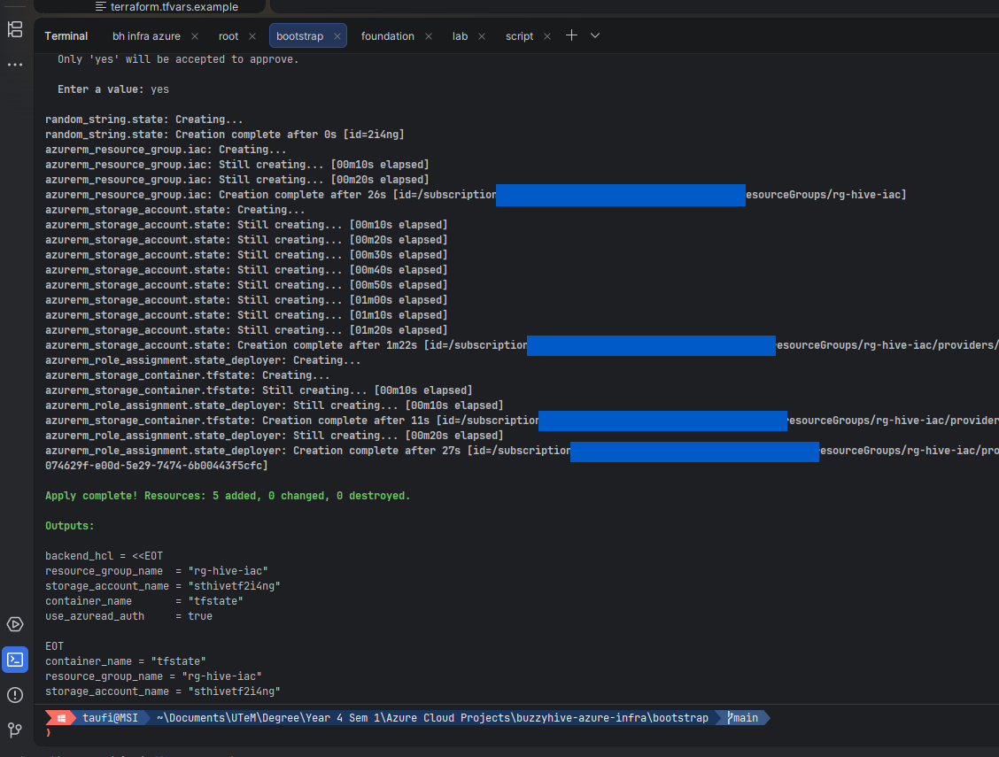
*Figure 4.5. The `bootstrap` apply: 5 added, with the creation times above and the `backend_hcl` output.*

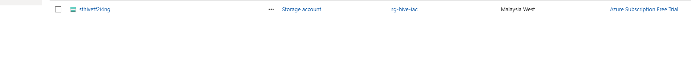
*Figure 4.6. The state storage account in the portal, in `rg-hive-iac` and Malaysia West.*

The `backend_hcl` output has no `key` line, so add one per root. Use `key = "foundation.tfstate"` in `foundation` and `key = "lab.tfstate"` in `lab`, and exactly one `key` line per file.

### 4.3 foundation (resource group, governance, identity)

```bash
cd ../foundation
cp terraform.tfvars.example terraform.tfvars      # set alert_emails, budget_start_date, github_owner, github_repo
cp backend.hcl.example backend.hcl                # paste the bootstrap output, keep key = "foundation.tfstate"
terraform init -backend-config=backend.hcl
terraform plan
terraform apply
```

- `budget_start_date` must be the first day of a month, for example `2026-11-01T00:00:00Z`. If the apply says budgets are not supported on your subscription type, set `enable_budget = false` ([troubleshooting](troubleshooting.md#22-the-budget-cannot-be-created)).
- Entra groups and the app registration need directory rights. If the plan fails on `azuread`, see [troubleshooting](troubleshooting.md#5-entra-groups-or-app-registration-cannot-be-created).
- Save the three outputs as GitHub repository variables (`AZURE_CLIENT_ID`, `AZURE_TENANT_ID`, `AZURE_SUBSCRIPTION_ID`). Nothing uses them until a plan or apply job is added to the workflow. This has not been done yet.
- `alert_emails` is a list, so it needs brackets: `["you@example.com"]`. Without a `terraform.tfvars`, Terraform prompts for each variable, and a list typed at the prompt is awkward. Create the file first.

**What happened.** The plan was 17 to add, 0 to change, 0 to destroy, and the apply completed without errors. With `enable_budget` left at its default, the budget was created on the Free Trial subscription. The two Azure Policy definition IDs, which were written from memory, were accepted. The slowest resources were the policy assignments, which took about 1 min 41 s each; the role assignments took about 23 to 24 s.

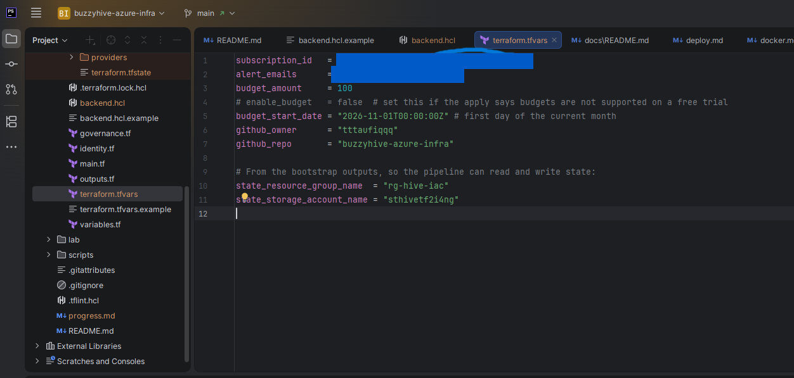
*Figure 4.7. `foundation/terraform.tfvars` (subscription ID blurred).*

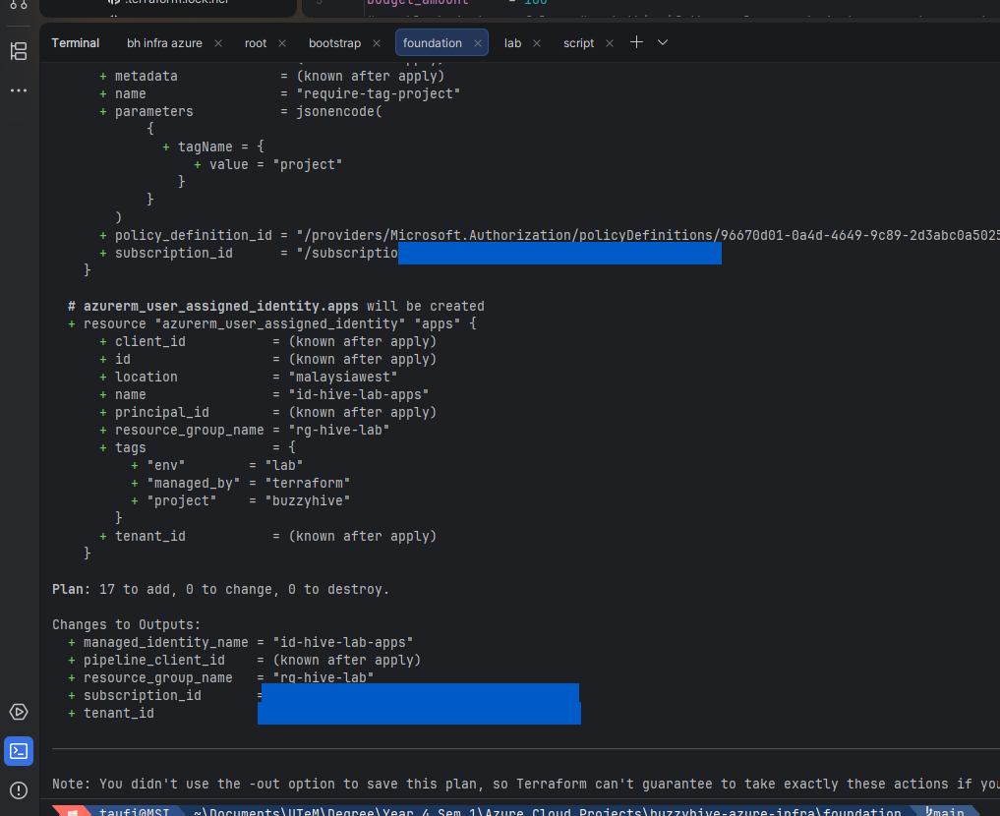
*Figure 4.8. The `foundation` plan: 17 to add, including the managed identity `id-hive-lab-apps` with `project = "buzzyhive"`.*

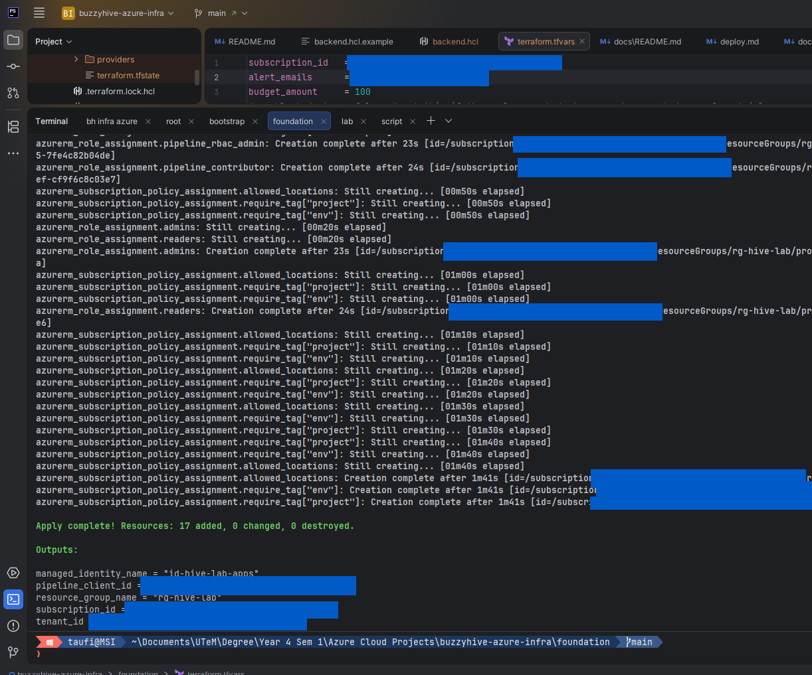
*Figure 4.9. The `foundation` apply: 17 added. The policy assignments finished last, at 1 min 41 s.*

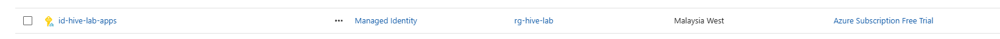
*Figure 4.10. The managed identity in the portal, in `rg-hive-lab`.*

### 4.4 lab, first apply (placeholder images)

```bash
cd ../lab
cp terraform.tfvars.example terraform.tfvars      # set subscription_id, alert_email
cp backend.hcl.example backend.hcl                # key = "lab.tfstate"
terraform init -backend-config=backend.hcl
terraform plan
terraform apply
```

With `images` unset, the apps run Microsoft's quickstart image, so the platform can be checked before the real images exist. The scheduler and migrate Jobs are not created yet, because the placeholder never exits.

Measured durations, from the apply output: the IoT Hub took 4 min 9 s, and each Container App took 40 to 48 s. The MySQL server and the Container Apps environment are slow too, but their times were not captured, so they are not recorded here.

The first `lab` apply needs the `app_secrets` values already in `terraform.tfvars` (steps below), because Key Vault gets them in that apply. Uncomment the whole `app_secrets` block, including its closing brace. A `#` at the start of a line makes Terraform ignore it.

- **`app-key`** is Laravel's `APP_KEY`: `base64:` followed by 32 random bytes, base64-encoded. The app repository has no `vendor/` folder on the host, so `php artisan key:generate --show` does not run there.
- **`iot-api-key`** is the app's own shared secret. The sender passes it as the `X-API-Key` header, and the Laravel app compares it with `IOT_API_KEY`. It is not an Azure IoT Hub key, so there is nothing to fetch from Azure. Any long random string works.
- On Windows PowerShell 5.1 use `[Security.Cryptography.RandomNumberGenerator]::Create().GetBytes($b)`. The newer `RandomNumberGenerator.Fill` does not exist there, and the call fails silently into a buffer of zeros. The first attempt printed `base64:AAAA...`, which is not a key.

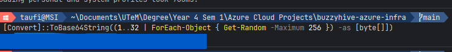
*Figure 4.11. Generating the `iot-api-key` value (output blurred).*

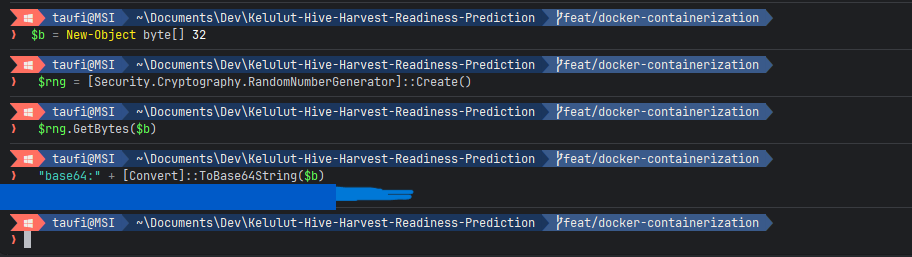
*Figure 4.12. Generating the `app-key` value with `Create().GetBytes` (output blurred).*

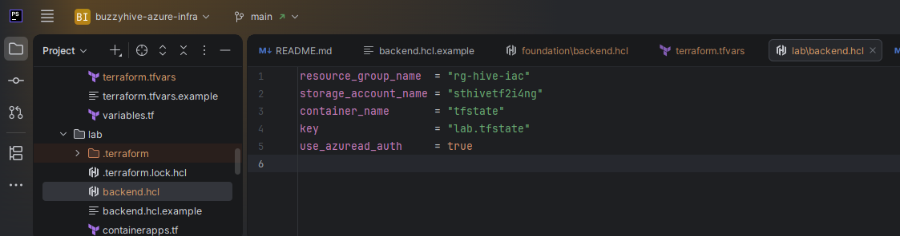
*Figure 4.13. `lab/backend.hcl`, with the key `lab.tfstate`.*

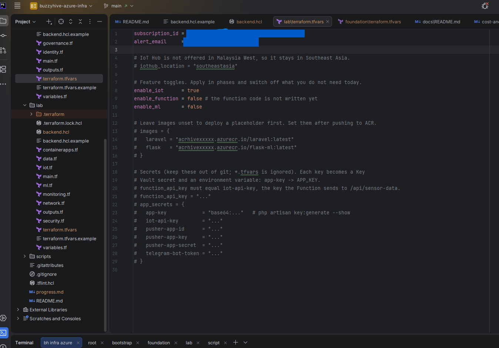
*Figure 4.14. `lab/terraform.tfvars` before the first apply: IoT on, Function and ML off, no images yet (subscription ID blurred).*

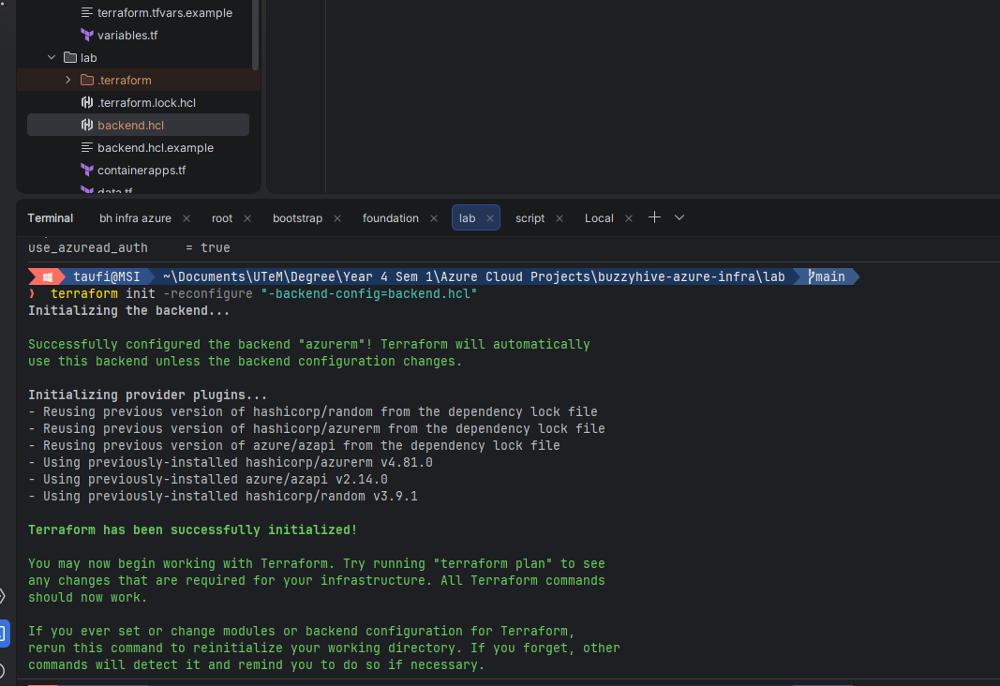
*Figure 4.15. `terraform init -reconfigure "-backend-config=backend.hcl"` in `lab`, with the argument quoted.*

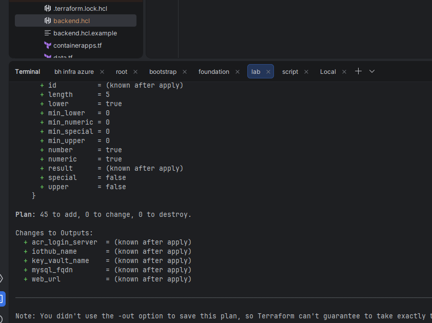
*Figure 4.16. The first `lab` plan: 45 to add, 0 to change, 0 to destroy.*

Things that commonly fail here, and the fix:

- **A Container App cannot read a Key Vault secret** right after the role assignment. Role assignments take minutes to propagate. Re-run `terraform apply`.
- **IoT Hub free tier already exists.** Only one `F1` hub is allowed per subscription. Set `enable_iot = false` or delete the other hub.
- **A SKU or quota error** on MySQL. Check the preflight output, change region or request quota.
- **The Container Apps environment is rejected** because its subnet is not delegated to `Microsoft.App/environments` ([troubleshooting 23](troubleshooting.md#23-the-container-apps-environment-is-rejected-the-subnet-is-not-delegated)). This was hit.
- **IoT Hub creation fails on the partition count**, because the F1 tier allows exactly 2 ([troubleshooting 24](troubleshooting.md#24-iot-hub-creation-fails-on-the-partition-count-ih400016)). This was hit.

**What happened.** The first apply created most of the 45 resources and then stopped with those last two errors, in the environment and the IoT Hub (figure 23.1 in troubleshooting). I fixed both in the Terraform and planned again: 5 to add (the environment, the IoT Hub and the three apps that depend on the environment) and 1 to change (the subnet gaining its delegation), with nothing destroyed. The second apply completed: 5 added, 1 changed, 0 destroyed. With `images` unset, the apps ran Microsoft's quickstart placeholder, and the Jobs were not created yet, as designed.

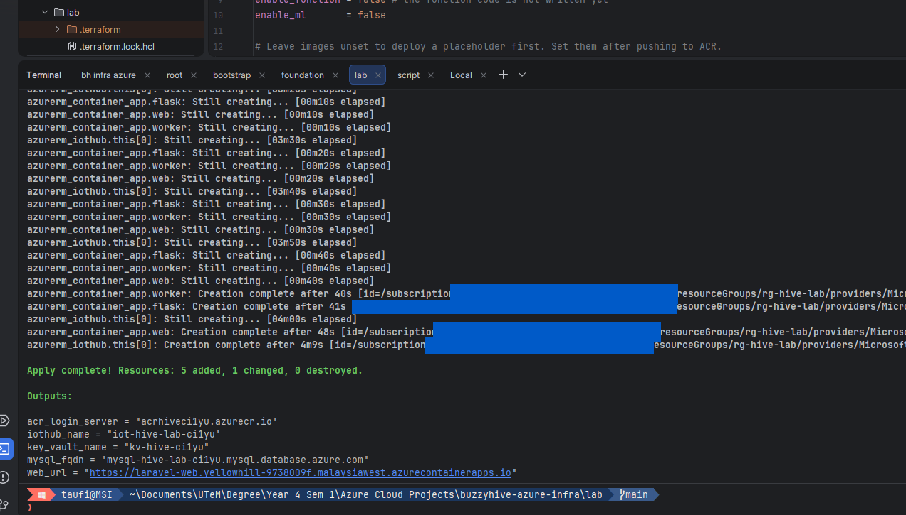
*Figure 4.17. The second `lab` apply: 5 added, 1 changed, 0 destroyed. The IoT Hub took 4 min 9 s.*

The Container Apps read their Key Vault secrets without a second apply, so the role-assignment timing problem from [troubleshooting 7](troubleshooting.md#7-container-app-cannot-pull-the-image-or-read-a-secret) was not hit.

### 4.5 lab, second apply (real images)

Build and push the images (see section 3), set `images`, `app_secrets` and `function_api_key` in `terraform.tfvars`, then:

```bash
terraform apply
```

This switches the apps to the real images and creates the scheduler and migrate Jobs. Start the migrate Job once before opening the site:

```bash
az containerapp job start --name laravel-migrate --resource-group rg-hive-lab
```

**What happened.** The registry is in Malaysia West, so `az acr build` was not available and the images were built and pushed from WSL with a workaround for the registry login ([Docker images, section 7](docker.md#7-push-the-images-to-the-registry), troubleshooting [25](troubleshooting.md#25-az-acr-build-fails-in-malaysia-west) to [27](troubleshooting.md#27-docker-build-fails-in-wsl-the-daemon-is-stopped-or-requires-1-argument)). A state-lock error cost a few minutes on the next plan ([troubleshooting 28](troubleshooting.md#28-terraform-cannot-take-the-state-lock-after-a-dropped-connection)).

The apply with images set completed with 2 added (the `laravel-migrate` and `laravel-schedule` Jobs, each about 20 s) and 4 changed (the three apps, about 18 s each, and one more resource above the visible part of the screenshot). One thing was wrong in it: the `flask` image tag in `terraform.tfvars` had a typo, `flask-ml:lates`. Terraform accepted it, the new `flask-ml` revision failed to activate, and the problem only showed later as `ml_unavailable` in the simulator output ([troubleshooting 29](troubleshooting.md#29-readings-return-201-with-ml_unavailable-a-typo-in-the-image-tag)). After an apply like this, always check `az containerapp revision list` for each app.

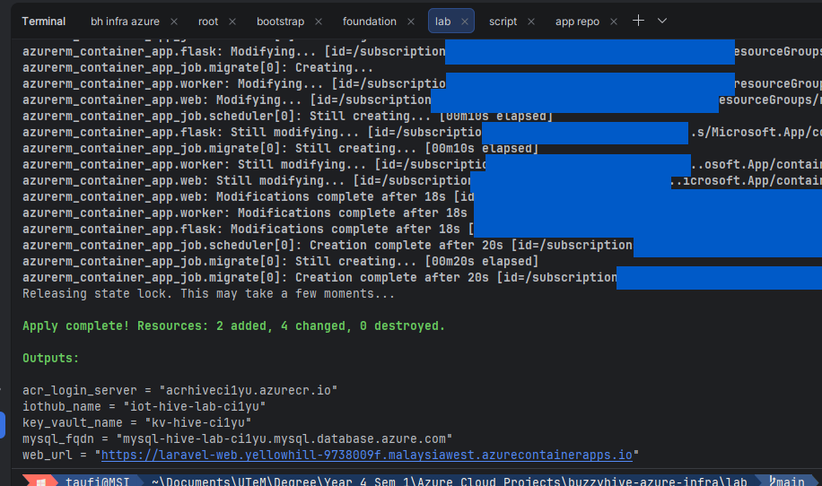
*Figure 4.18. The apply with images set: 2 added (the Jobs), 4 changed.*

The first `laravel-migrate` start ran to `Succeeded`. That also shows the Job could reach MySQL over the private subnet with TLS and read its secrets from Key Vault.

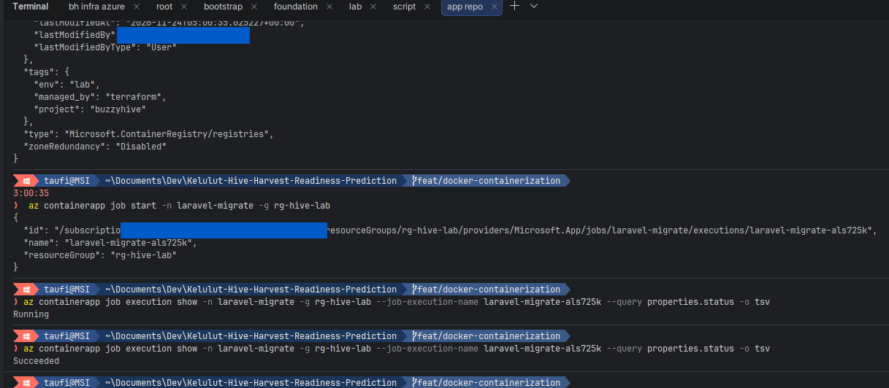
*Figure 4.19. `az containerapp job start`, then `Running`, then `Succeeded`.*

The site served the landing page from the Container Apps URL:

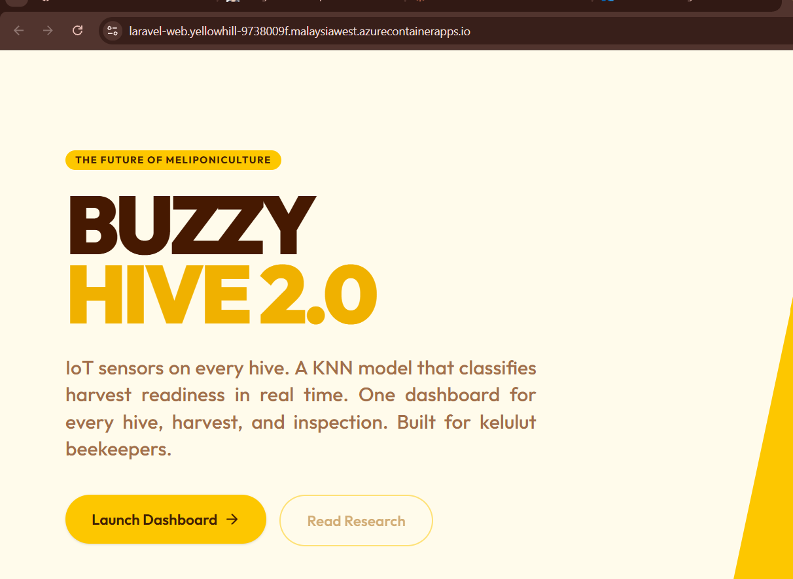
*Figure 4.20. The BuzzyHive 2.0 landing page on the Container Apps URL.*

### 4.6 Seed the database

The migration only creates empty tables, so the sensor API answers `422` (no such hive) until there is data ([troubleshooting 30](troubleshooting.md#30-the-simulator-gets-422-and-seeding-the-database-through-the-migrate-job)). The app's `DatabaseSeeder` creates the master data, an admin user, five beekeepers and hives with active IoT nodes. Set your own seed passwords, because the defaults are in the app repository and this app is on the internet.

```powershell
$pw = "Lab-" + [guid]::NewGuid().ToString("N")     # note it; it is the admin password
az containerapp job update -n laravel-migrate -g rg-hive-lab --container-name migrate --args php artisan db:seed --set-env-vars APP_ENV=staging "ADMIN_SEED_PASSWORD=$pw" "BEEKEEPER_SEED_PASSWORD=$pw"
az containerapp job start -n laravel-migrate -g rg-hive-lab
az containerapp job execution list -n laravel-migrate -g rg-hive-lab --query "[0].{name:name,status:properties.status}" -o table
```

- **No dashes in `--args`.** `az` treats separate `--force` or `--class=` tokens as its own options, and a quoted string becomes one argument. `php artisan db:seed` with no options runs `DatabaseSeeder`.
- **`APP_ENV=staging`** only skips the production confirmation that `--force` would answer, for this run.
- **Restore the Job afterwards** with `terraform apply` in `lab`, which sets its args and environment back. Until then it is no longer a migration Job.
- **Sign in** as the admin user, `admin@buzzyhive.urban-alert.com`, with the password you chose. If only the default password works, the override did not reach the seeder, so change the admin password in the app.

The run took the Job from `Running` to `Succeeded`:

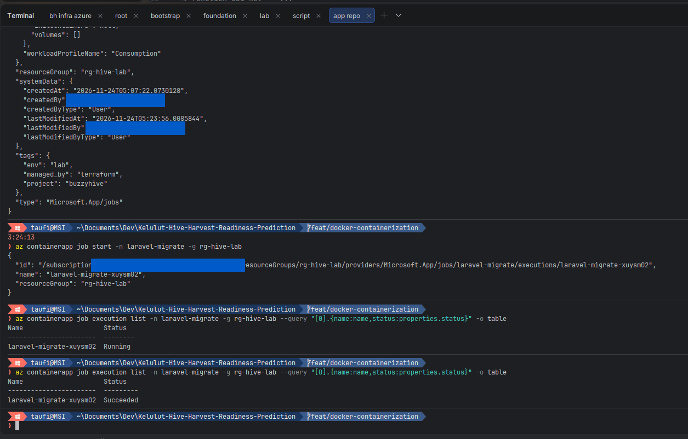
*Figure 4.21. The seeder run through the migrate Job: `Running`, then `Succeeded`.*

The seeded hives have random node identifiers (`NODE-` plus six characters). To get a hive id and its node, open the `laravel-web` app in the portal, then **Monitoring**, then **Console**, choose `/bin/sh`, and query from inside the app:

```
php artisan tinker
App\Models\IotNode::where('device_status','active')->limit(5)->get(['hive_id','node_identifier']);
```

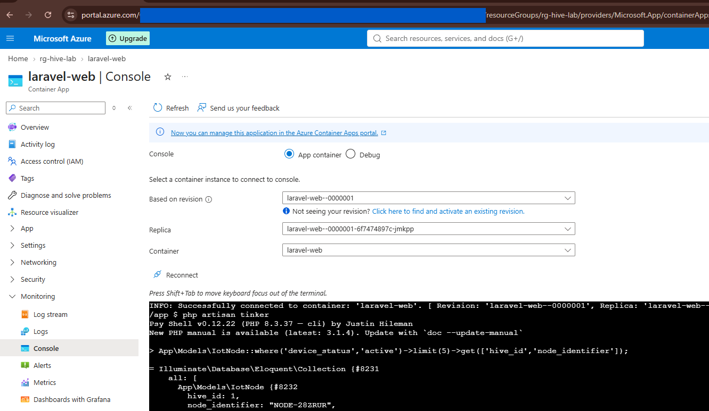
*Figure 4.22. Finding a hive id and its node identifier from the portal console. The database is private, so it cannot be queried from a laptop.*

### 4.7 Send readings through IoT Hub

`scripts/simulate_sensor.py` (section 5) posts straight to Laravel and never touches the hub. `scripts/simulate_device.py` sends the same readings as device-to-cloud telemetry, so the hub's Devices list and message metrics have something to show. Nothing forwards those messages to Laravel yet, because the Function code is not written. They stop at the hub.

1. **Install the SDK and the CLI extension:** `pip install azure-iot-device`, and `az extension add --name azure-iot`.
2. **Check the hub starts empty.** Terraform creates the hub but no devices.
3. **Register the device, silently.** Use `-o none`. Without it, `az iot hub device-identity create` prints the device's primary and secondary keys, and a screenshot of that output leaks them (see the figure below). Use a node identifier from the app as the device ID, so the payload's `device_id` matches an active node:

   ```powershell
   az iot hub device-identity create -n <hub name> -d <node identifier> -o none
   $env:IOTHUB_DEVICE_CONNECTION_STRING = az iot hub device-identity connection-string show -n <hub name> -d <node identifier> --query connectionString -o tsv
   ```

4. **Send readings,** and watch them arrive from a second terminal with `az iot hub monitor-events -n <hub name>`:

   ```powershell
   python scripts/simulate_device.py --hive-id <id> --count 10 --interval 5
   ```

Ten messages were sent in 0.10 to 0.31 s each, and `monitor-events` printed each payload with the device as its origin. The device is not managed by Terraform, so it disappears when the hub is destroyed and has to be registered again in a new lab.

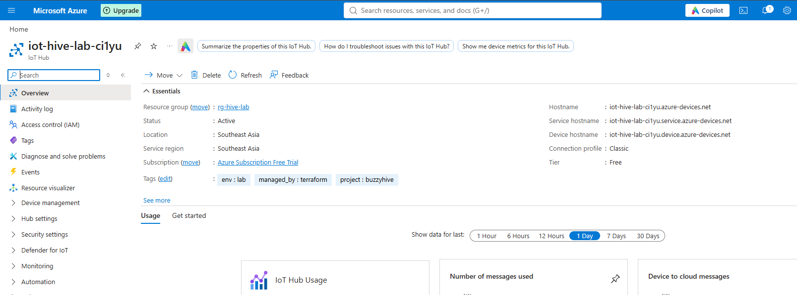
*Figure 4.23. The hub: Active, Free tier, Southeast Asia, tagged like the rest of the lab.*

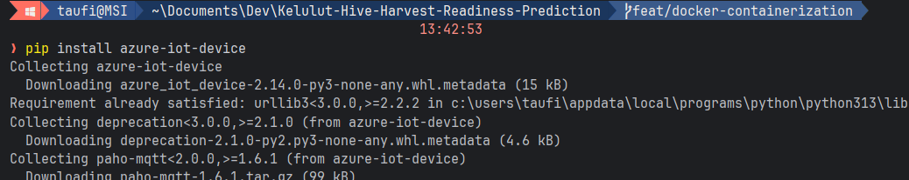
*Figure 4.24. Installing the SDK (`azure-iot-device` 2.14.0).*

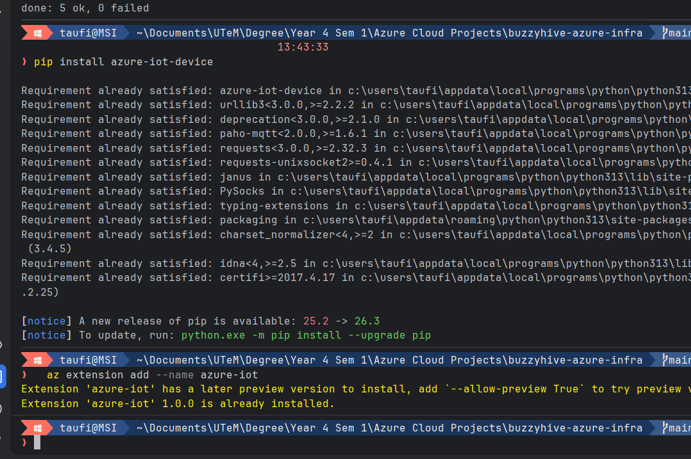
*Figure 4.25. A second run of the install, and the `azure-iot` CLI extension (version 1.0.0) already present.*

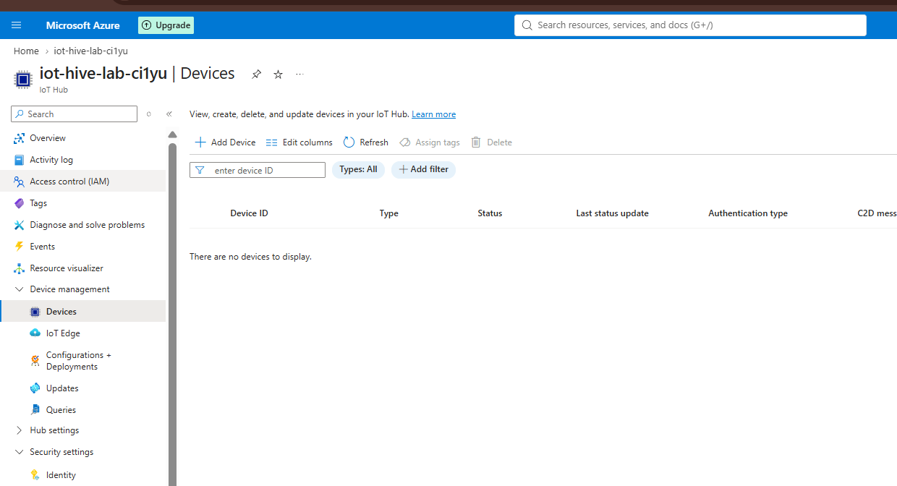
*Figure 4.26. Before: the hub has no devices. Terraform never created one.*

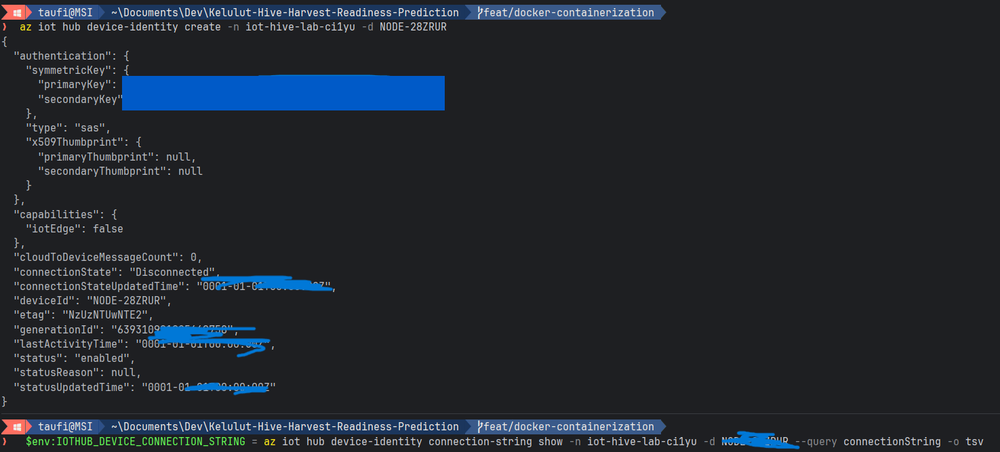
*Figure 4.27. The mistake to avoid: `device-identity create` without `-o none` prints both device keys. This screenshot must be blurred before it is committed, and the device keys should be treated as exposed.*

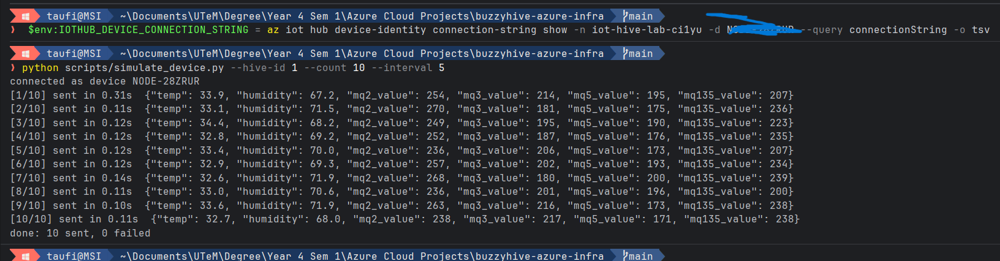
*Figure 4.28. `simulate_device.py` sends 10 readings through the hub: 10 sent, 0 failed.*

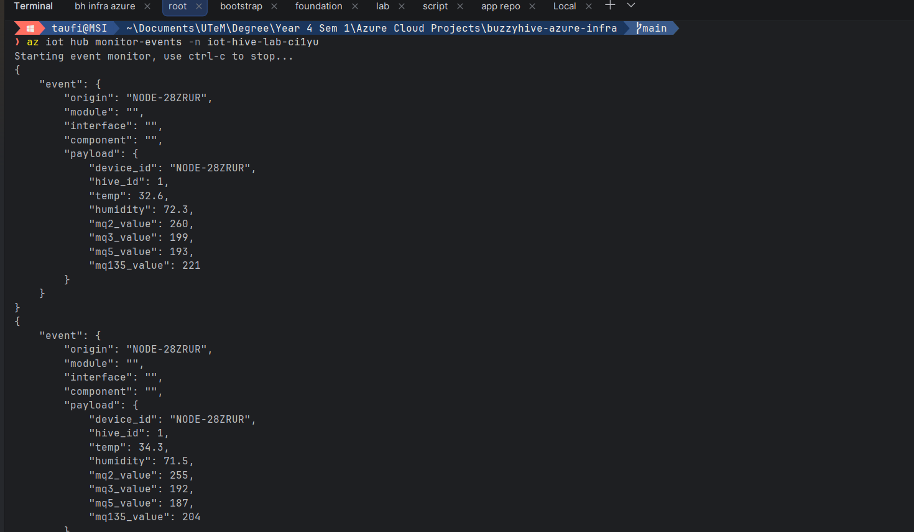
*Figure 4.29. `az iot hub monitor-events` shows the readings arriving at the hub, with the device as `origin`.*

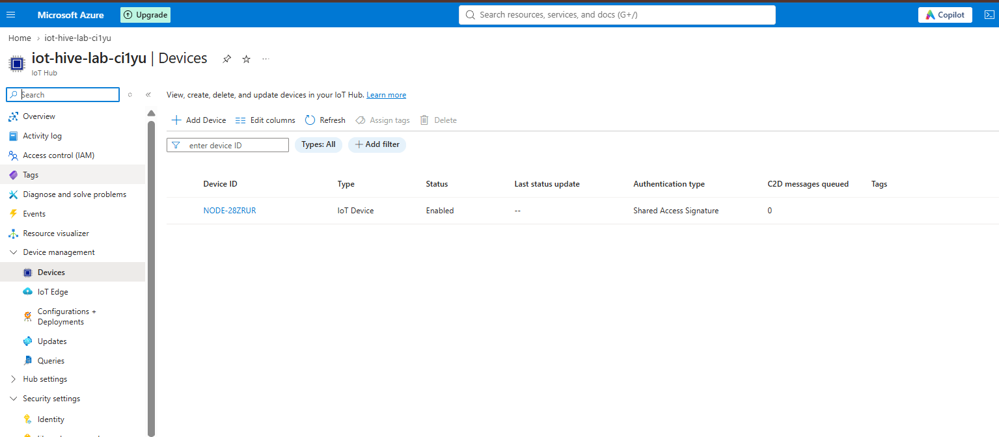
*Figure 4.30. After: the device is in the list, `Enabled`, authenticating with a shared access signature.*

### 4.8 Not built yet

- **Function code.** `enable_function` creates the Function app, but this repository does not contain the function that forwards IoT Hub messages to Laravel. It is off by default. Until it exists, readings reach Laravel only through the app's own HTTP endpoint, so the simulator should post there.
- **Azure ML training.** The job files exist and were checked locally, but nothing has run on Azure. See [Train the model in Azure ML](azure-ml.md).
- **Front Door, the load test and the plan and apply jobs in CI.**

After the first deploy, the GitHub Actions workflow runs `terraform fmt -check`, `validate` and `tflint`. Plan and apply jobs are not added yet.

Use `enable_*` variables to apply in phases and skip parts you do not need that session.

Record the duration of each apply, and the real errors you hit, in the [implementation log](implementation-log.md) and [troubleshooting](troubleshooting.md).

## 5. Test

`scripts/simulate_sensor.py` stands in for the ESP32. It posts a reading straight to the app's `/api/sensor-data` with the shared key. It does not go through IoT Hub, because the Function code does not exist yet. It uses only the Python standard library, and it takes the URL and key from environment variables so the key stays out of the command line:

```powershell
$env:BUZZYHIVE_URL     = "https://<your laravel-web URL>"
$env:BUZZYHIVE_API_KEY = "<the iot-api-key value>"
python scripts/simulate_sensor.py --hive-id <id> --device-id <node identifier> --count 5
```

It prints one line per reading with the HTTP status and time. `201` is success. `401` means the key is wrong, `404` means the node is not active on that hive, and `422` means a value is out of range or the hive does not exist.

What happened, in order:

1. Before seeding, every reading returned `422` ("The selected hive id is invalid").
2. After seeding, with the placeholder `flask-ml` still serving, every reading returned `201` with an `ml_unavailable` warning ([troubleshooting 29](troubleshooting.md#29-readings-return-201-with-ml_unavailable-a-typo-in-the-image-tag)).
3. After the image tag was fixed, five readings returned `201` in 0.17 to 0.29 s with no warning.

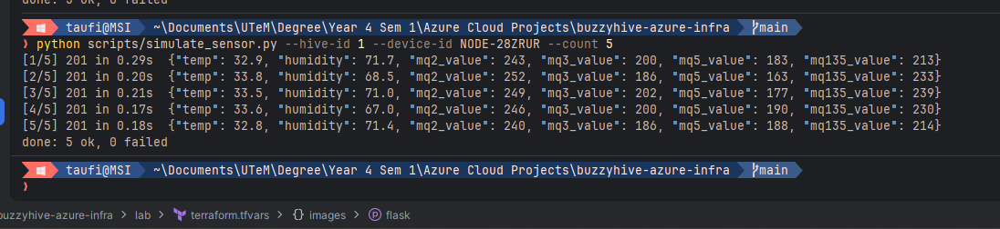
*Figure 5.1. The passing smoke test: 5 ok, 0 failed, with no `ml_unavailable` warning.*

The sensors dashboard renders stored readings: gas gauges for MQ-2, MQ-3, MQ-5 and MQ-135, a status label on each, and temperature and humidity charts. The screenshot is for hive 10, with a single chart point at 13:15. That time is before the simulator runs, so these are most likely seeded rows and not the simulator's. I have not confirmed that a simulator reading appears on the dashboard, and live updates through Pusher are not tested yet.

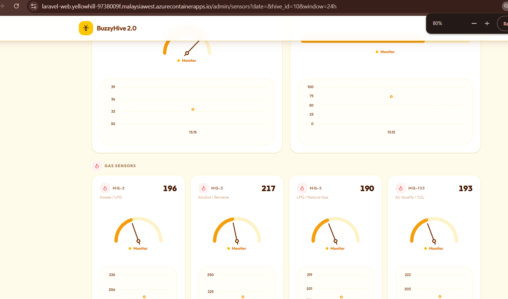
*Figure 5.2. The sensors dashboard on the Container Apps URL, showing stored readings for hive 10.*

This shows the API, the database and the ML service working together. A `201` means the reading was stored, and a response with no warning means the app got a prediction from `flask-ml`. I did not open the dashboard after it, so what is still unchecked, from the [data flow](architecture.md#2-data-flow):

- The Function logs show one invocation per message. (There is no Function code yet.)
- The stored `predictions` row, and the dashboard updating live through Pusher.
- A Ready prediction sends a Telegram alert from the worker.

## 6. Destroy

Destroy only the `lab` root after each session. Keep `foundation` and `bootstrap` unless you are finished with the project.

```bash
cd lab && terraform destroy
```

If locks were ever enabled, set `enable_locks = false` and apply `foundation` first, or the destroy fails. When you are completely done, destroy `foundation`, then `bootstrap`, in that order, after deleting anything Terraform did not create (such as the registry Azure ML makes). See [Teardown and redeploy](teardown-and-redeploy.md) and [Cost and teardown](cost-and-teardown.md).
