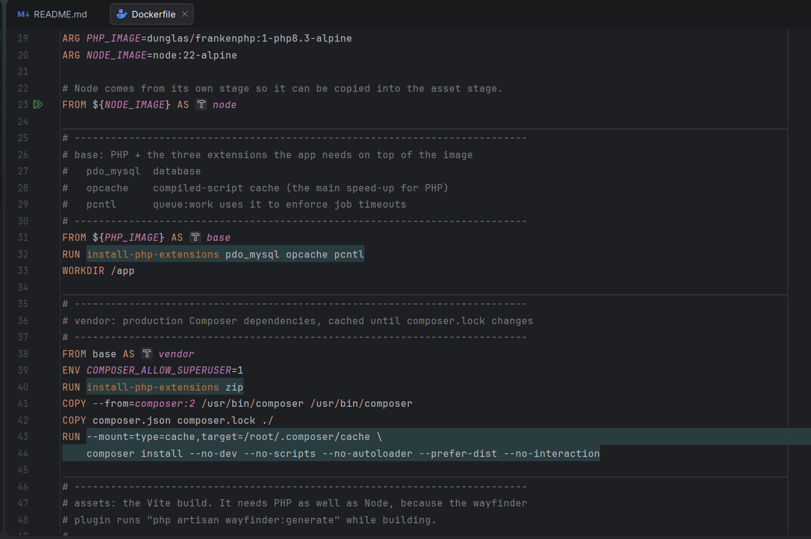
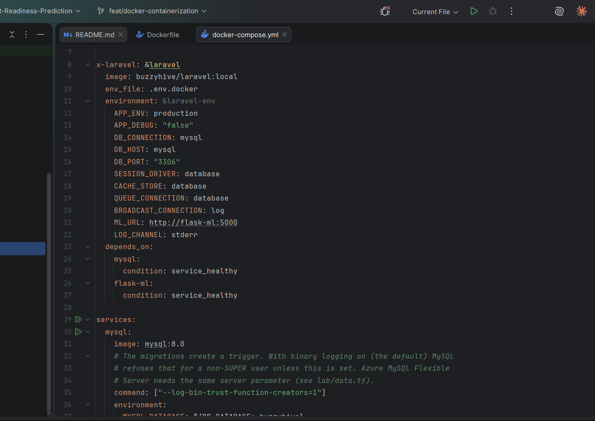
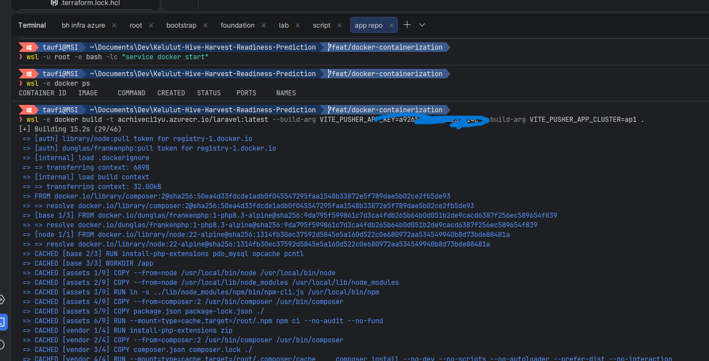
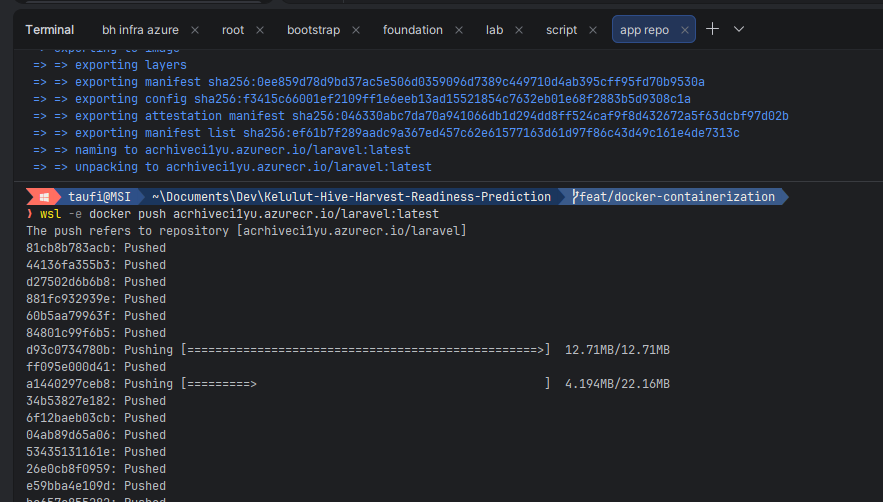
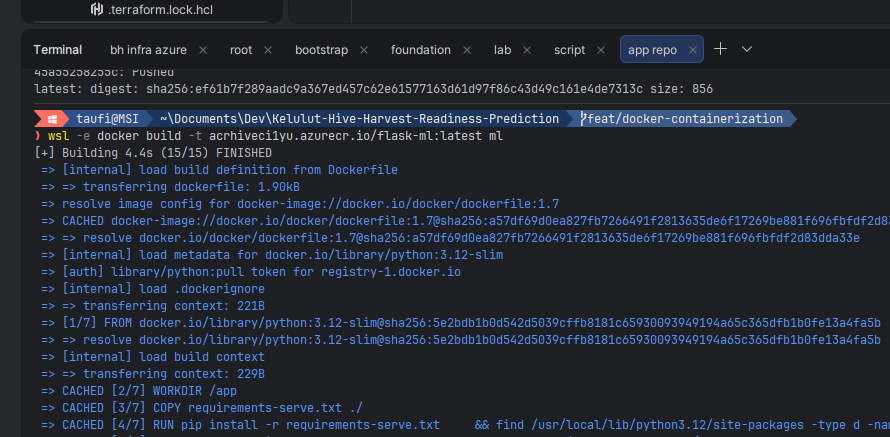
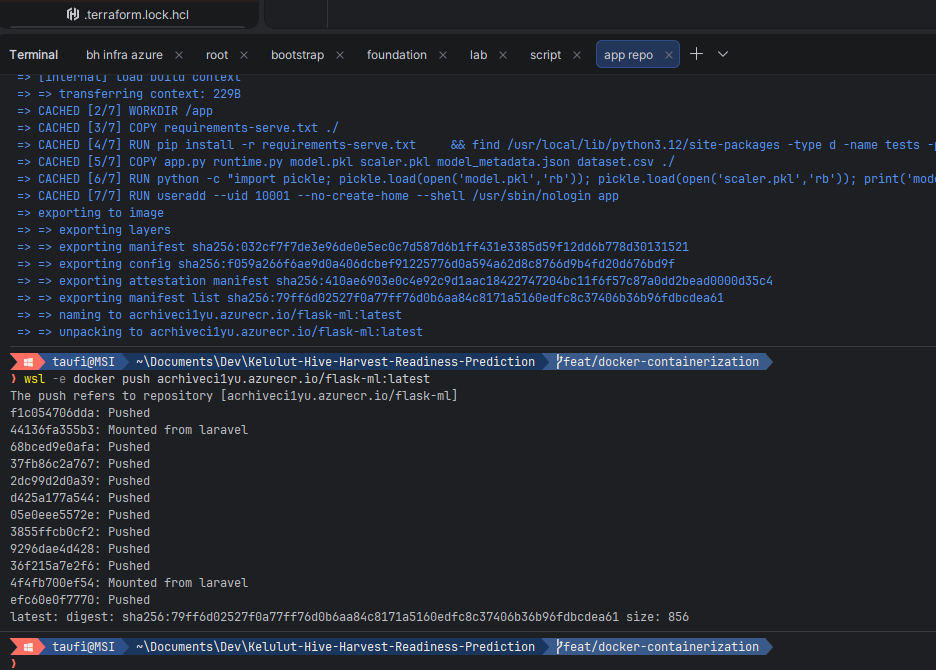
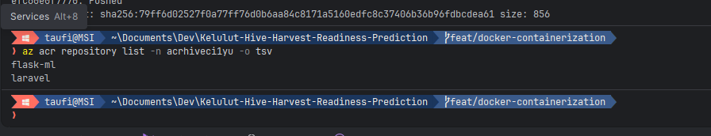

# Docker images

<!-- docs-nav:start -->
**[← Previous: Architecture](architecture.md) | [Docs index](README.md) | [Next: Deploy, redeploy, and destroy →](deploy.md)**
<!-- docs-nav:end -->

This article explains why each choice in the two container images was made, with measurements, and how they run on Azure. The Docker files and the app's own requirements live in the [application repository](https://github.com/tttaufiqqq/Kelulut-Hive-Harvest-Readiness-Prediction) (`docs/docker/docker.md`), because they belong to the app. This repository only runs the result.

> [!NOTE]
> Everything here was built and run with Docker 29.7 in WSL2 (Ubuntu) on a laptop, and the numbers are from that machine. Throughput figures come from one 15-second run per case, so treat differences of a few percent as noise. On 24/11/2026 the same images were also pushed to the registry and ran on Container Apps; section 7 records how, and section 5 what that did and did not show.

## 1. What the app needs, and where this repository provides it

The app's own requirements are documented in the application repository, in `docs/docker/docker.md` ("Running in containers"), which is the source of truth. They are not repeated here, so they cannot drift. This table only records what this repository must provide for each one.

| App requirement (see the app doc, section) | What this repository provides |
|---|---|
| The migrations create a MySQL trigger (5.1) | `lab/data.tf` sets the server parameter `log_bin_trust_function_creators` to `ON` |
| The Vite build needs PHP, and Pusher values are build-time (4.1, 5.2) | The pipeline passes `VITE_PUSHER_APP_KEY` and `VITE_PUSHER_APP_CLUSTER` as build arguments to the image build |
| The app reads `ML_URL` (4.2) | `lab/containerapps.tf` sets `ML_URL=http://flask-ml`. An earlier draft of this repository said `ML_API_URL`, which the app never reads |
| Behind a proxy, set `TRUSTED_PROXIES` (5.3) | `lab/containerapps.tf` sets `TRUSTED_PROXIES=*` on the Laravel apps |
| Uploads are on local disk (5.4) | The web app runs at most one replica. Durable storage is not built; see [troubleshooting](troubleshooting.md#18-hive-images-and-the-thesis-pdf-disappear) |
| The model needs a matching scikit-learn (5.5) | The Azure ML training environment must pin the same version. See [architecture](architecture.md) |
| The database requires TLS (4.2) | `lab/containerapps.tf` sets `MYSQL_ATTR_SSL_CA` to the image's CA bundle |
| Container logs are collected (4.2) | `lab/containerapps.tf` sets `LOG_CHANNEL=stderr`, so logs reach Log Analytics |

## 2. Laravel image

One image runs every Laravel role. Only the command changes.

| Role | Command | Azure |
|---|---|---|
| Web (default) | `frankenphp run`, port 8080 | `laravel-web` container app |
| Queue worker | `php artisan queue:work` | `laravel-worker` container app |
| Scheduler | `php artisan schedule:run` | `laravel-schedule` Job (compose uses `schedule:work`) |
| Migrations | `php artisan migrate --force` | `laravel-migrate` Job |

### 2.1 Stages

| Stage | Purpose |
|---|---|
| `base` | FrankenPHP plus `pdo_mysql`, `opcache` and `pcntl` (queue timeouts need it) |
| `vendor` | Production Composer dependencies, cached until `composer.lock` changes |
| `assets` | PHP and Node, runs `npm run build`. Node is copied in from its own stage |
| `runtime` | Only what serves requests: no Node, no Composer, no tests, no JavaScript sources |

Dependencies are copied before the source, so a code change reuses the cached `vendor` and `npm ci` layers.

### 2.2 FrankenPHP in classic mode

- **One process per container.** Container Apps runs one process per container. PHP-FPM with nginx needs two processes and a supervisor. FrankenPHP serves PHP and HTTP from one binary.
- **Not Octane.** Worker mode would be faster, but it needs the Octane package and a review of state that leaks between requests (Spatie permissions, Fortify, Inertia shared data). That is a code change, so it is out of scope.
- **Not measured against PHP-FPM.** This choice rests on the single-process argument, not a benchmark.

### 2.3 Alpine, measured

I built both bases and ran the same routes with the same limits as the Azure container (0.5 CPU, 1 GB).

| | Debian | Alpine |
|---|---|---|
| Image size | 900 MB | **333 MB** |
| `/up` requests per second | 88.9 | 77.5 |
| `/login` requests per second | 35.7 | 32.2 |
| `/login` median latency | 214 ms | 232 ms |
| Memory under load | 51 MB | 51 MB |

Debian is about 10 to 13 percent faster. The Debian base is 840 MB because it ships `gcc`, `make` and headers (about 120 MB of compilers alone).

**Choice: Alpine.** One hive posts a reading every few minutes, so throughput is not the limit. The web app scales to zero, so every cold start pulls the image, and the registry stores every tag. A 2.7 times smaller image helps both. The Debian build is one build argument away if the load ever changes:

```bash
docker build --build-arg PHP_IMAGE=dunglas/frankenphp:1-php8.3-bookworm \
             --build-arg NODE_IMAGE=node:22-bookworm-slim .
```

The Node image must use the same C library as the PHP image, because Node is copied into the PHP stage.

### 2.4 Speed and safety settings

| Setting | Why |
|---|---|
| `opcache.validate_timestamps=0` | The code in the image never changes, so PHP never needs to stat files |
| `route:cache`, `view:cache`, `event:cache` at build | They depend on code, not on environment variables |
| `config:cache` at container start | It must run after Azure injects the secrets. Baked in at build, it would put secrets in the image |
| Hashed assets with a one-year `immutable` cache header | Vite fingerprints the file names |
| zstd and gzip in Caddy | Smaller transfers, checked with a gzip request |
| Runs as `www-data`, port 8080 | No root process, no extra capability. The `Server` header is removed |
| `LOG_CHANNEL=stderr` | Container logs reach Log Analytics |
| `.dockerignore` | Keeps `.env`, `vendor/`, tests, docs and `ml/` out of the build context |
| ACA `args`, not `command`, in Terraform | `command` would replace the entrypoint that caches the config |

## 3. ML image

| Choice | Reason |
|---|---|
| `python:3.12-slim` | glibc wheels exist for numpy, scipy and scikit-learn |
| `requirements-serve.txt` | Only Flask, gunicorn, numpy and scikit-learn. The training stack (pandas, matplotlib) stays in `requirements.txt` |
| `scikit-learn==1.8.0` | Must match the version that wrote `model.pkl` |
| A build step that unpickles the model and scaler | A version mismatch fails the build, not the first prediction |
| Strip the `tests/` folders from site-packages | Measured: 533 MB down to 452 MB |
| gunicorn with 1 worker and 4 threads | The container gets a fraction of a CPU, the model is tiny, and one process keeps memory low. Scale with replicas |
| Non-root user, health check on `/health` | Same reasons as above |

**Alpine does not work here.** I tried `python:3.12-alpine`. The build failed because pip fell back to compiling from source (`Unknown compiler(s)`), which means a musl wheel is missing for one of the numeric packages. A compiler in the image would cost more than the base saves.

The scientific stack is the floor: scipy, scikit-learn and numpy are about 260 MB on their own.

## 4. Measured results

| Check | Result |
|---|---|
| Cold build, Laravel image (no cache) | 4 min 2 s (Debian base). A rebuild after a code change reuses the dependency layers |
| Laravel image | 333 MB |
| ML image | 452 MB |
| Web container memory, idle | about 55 MB |
| ML container memory, idle | about 105 MB |
| Web container ready (image already local) | 1.4 s |
| `/up` | 200 in about 30 ms |
| Sensor POST through Laravel, ML and MySQL | 201 in 0.16 s warm (1.6 s on the very first request) |
| Wrong API key | 401 |
| Redirect behind a proxy | `https://hive.example.com/login` with `TRUSTED_PROXIES=*`, `http://localhost:8080/login` without |

Compose started the whole stack: MySQL 8.0, flask-ml, the one-shot migrate step, web, worker and scheduler. The migrate step failed on the trigger until `log_bin_trust_function_creators` was set.

## 5. What is not done

- **No vulnerability scan.** Run a scanner such as Trivy before relying on the images.
- **Base images are not pinned by digest.** They use floating tags (`1-php8.3-alpine`, `python:3.12-slim`).
- **Only amd64.** Container Apps runs amd64, and the build machine is amd64.
- **The first request is slow.** 1.6 s while opcache and the database connection warm up. A readiness probe on `/up` does not warm them.
- **Uploads are not durable.** See [troubleshooting](troubleshooting.md#18-hive-images-and-the-thesis-pdf-disappear).
- **Run on Azure, mostly.** Both images were pulled from the registry by the managed identity and ran on Container Apps. The `laravel-migrate` Job read its database settings and secrets from Key Vault and succeeded, and the ingress served the site. Image pull time from the registry and cold-start time are not measured. Cold start is suspected in a slow first page load that is still unexplained; see [troubleshooting](troubleshooting.md#31-the-first-page-load-is-slow).

## 6. Build and run

```bash
# from the application repository
cp .env.docker.example .env.docker
docker compose run --rm --no-deps app php artisan key:generate --show   # put the key in .env.docker
docker compose up --build        # http://localhost:8080
```

Build the images alone:

```bash
docker build -t buzzyhive/laravel:local .
docker build -t buzzyhive/flask-ml:local ml
```

`az acr build` is not an option for this lab. ACR Tasks is not offered in Malaysia West, and the command fails with `NoRegisteredProviderFound` (see [troubleshooting](troubleshooting.md#25-az-acr-build-fails-in-malaysia-west)). Build locally and push, as in the next section.

The two files below are the ones the commands above build and run. They live in the application repository, not this one. The first shows the top of the Laravel `Dockerfile`: the base images as build arguments, a separate Node stage, the `base` stage that adds `pdo_mysql`, `opcache` and `pcntl`, and the `vendor` stage that caches Composer dependencies until `composer.lock` changes. The comment on the asset stage explains why it needs PHP as well as Node: the Wayfinder plugin runs `php artisan wayfinder:generate` during the Vite build.


*Figure 6.1. The top of the Laravel `Dockerfile` (lines 19 to 48): Alpine base images, the Node stage, the `base` and `vendor` stages.*

The second shows the start of `docker-compose.yml`. The shared `x-laravel` block runs the same image for every Laravel role. It sets `APP_ENV: production`, database sessions, cache and queue, and `ML_URL: http://flask-ml:5000`. `BROADCAST_CONNECTION` is `log` in this file, so the local stack never calls Pusher. The `mysql` service starts with `--log-bin-trust-function-creators=1`, with a comment that Azure Flexible Server needs the same setting (`lab/data.tf`).


*Figure 6.2. The start of `docker-compose.yml` (lines 7 to 37): the shared Laravel settings and the MySQL service with the trigger parameter.*

## 7. Push the images to the registry

Docker runs only inside WSL on this machine, so these run from Windows PowerShell through `wsl`. Each command must stay on one line, and the build needs its context (the final `.`).

1. **Start the engine if it has stopped:** `wsl -u root -e bash -lc "service docker start"`, then `wsl -e docker ps` to check it answers.
2. **Log in to the registry.** The token login failed here, and so did piping the admin password. What worked was passing the password in an environment variable (`$env:WSLENV = "ACR_PW"`) and `docker login <registry>.azurecr.io -u <user> -p "$ACR_PW"`. The full story, and why the admin user must be turned off again afterwards, is in [troubleshooting](troubleshooting.md#26-docker-login-to-the-registry-returns-unauthorized).
3. **Build and push the Laravel image** with the Pusher build arguments, which are compiled into the JavaScript:

   ```powershell
   wsl -e docker build -t <registry>.azurecr.io/laravel:latest --build-arg VITE_PUSHER_APP_KEY=<key> --build-arg VITE_PUSHER_APP_CLUSTER=ap1 .
   wsl -e docker push <registry>.azurecr.io/laravel:latest
   ```

4. **Build and push the ML image:**

   ```powershell
   wsl -e docker build -t <registry>.azurecr.io/flask-ml:latest ml
   wsl -e docker push <registry>.azurecr.io/flask-ml:latest
   ```

5. **Check the registry:** `az acr repository list -n <registry> -o tsv` lists `flask-ml` and `laravel`.

Both builds were fast because most layers were cached from the earlier local builds. The Laravel build took 15.2 seconds, and the ML build 4.4 seconds. A first build on a clean machine will take longer. The ML push mounted two layers from the Laravel repository, because the registry already held them.


*Figure 7.1. The engine started, an empty `docker ps`, and the Laravel build under way (15.2 s, most layers cached).*


*Figure 7.2. The Laravel image is named for the registry and pushed layer by layer.*


*Figure 7.3. The ML image build: 4.4 s, every layer cached. It includes the check that loads the model and scaler.*


*Figure 7.4. The ML push. Two layers are mounted from the Laravel repository instead of uploaded.*


*Figure 7.5. The registry now holds both repositories.*

---

<!-- docs-nav:start -->
**[← Previous: Architecture](architecture.md) | [Docs index](README.md) | [Next: Deploy, redeploy, and destroy →](deploy.md)**
<!-- docs-nav:end -->
