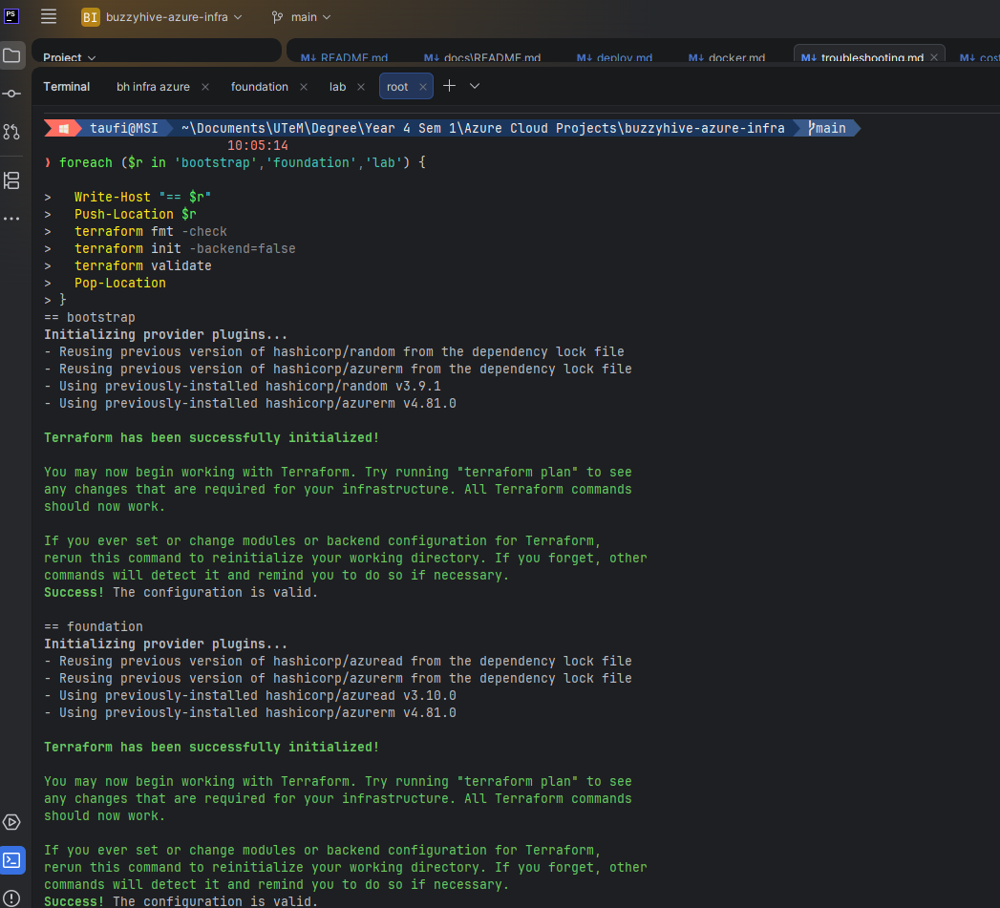
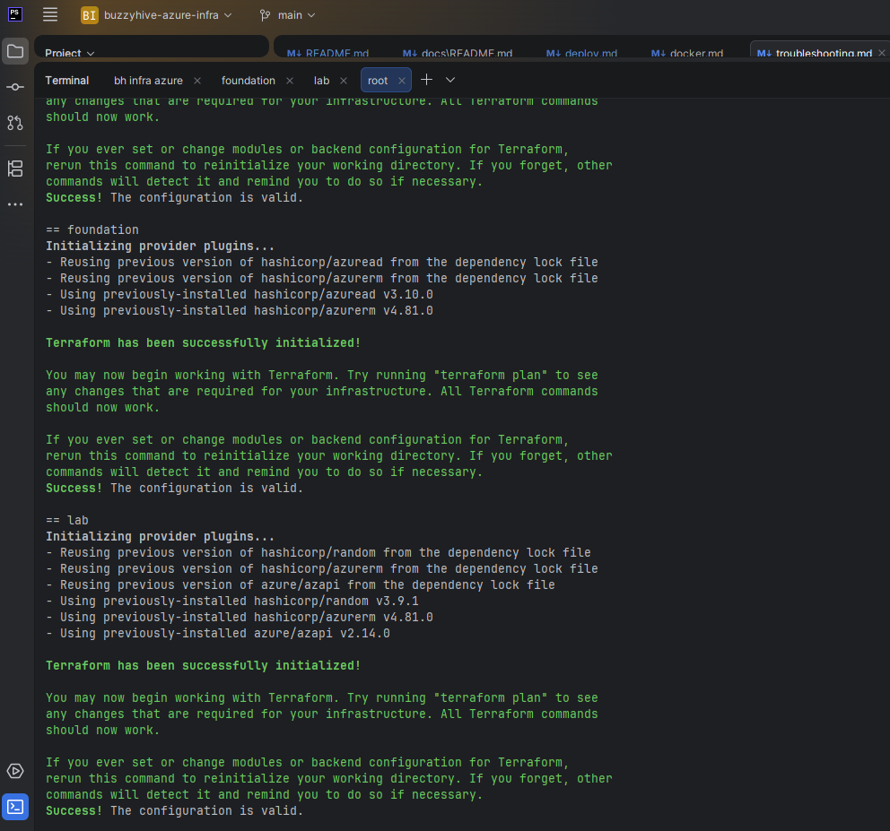
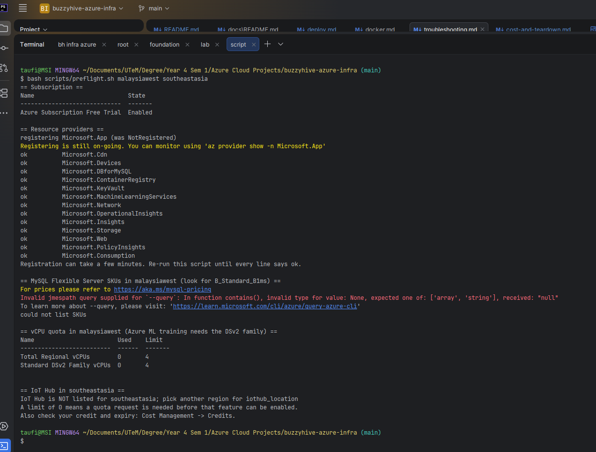

# Implementation log

This log records how the infrastructure was planned, deployed, and fixed. It lists what happened, what failed, and why each decision was made.

> [!NOTE]
> On 24/11/2026 all three Terraform roots were applied to a Free Trial subscription, the images were pushed, the database was migrated and seeded, and a simulated device posted readings that came back with predictions. The apply and the checks after it turned up ten problems, listed in section 5, and each has a write-up in [troubleshooting](troubleshooting.md). The Azure ML training run, the IoT Hub forwarder Function and CI plan and apply jobs are not done. The lab had not been destroyed when this was written, and real costs are not measured yet.

## 1. Goal

Host [BuzzyHive 2.0](https://github.com/tttaufiqqq/Kelulut-Hive-Harvest-Readiness-Prediction) on Azure as a learning project. The requirements were:

- Containerize the Laravel app and the Flask ML API.
- Use Azure IoT Hub, Container Apps and Azure Machine Learning.
- Define everything in Terraform so the environment can be destroyed and recreated at any time.
- Use the free account credit, and run the environment for about a day.

## 2. Decisions

| Decision | Choice | Reason |
|---|---|---|
| Compute | Container Apps, consumption plan | Scales to zero and has no fixed cost |
| Scheduler and migrations | Container Apps Jobs | Replicas would otherwise run them more than once |
| Device | Python simulator | The ESP32 firmware does not speak IoT Hub |
| IaC tool | Terraform with `azurerm`, plus `azapi` where needed | `azurerm` covers most services; `azapi` writes to private data planes through ARM |
| Terraform roots | bootstrap, foundation, lab | Only `lab` is destroyed. Fewer state files than four stacks. |
| Storage | Two accounts, one private | The Function and ML workspace need a reachable account |
| Resource group | `rg-hive-lab` | `rg-hive-prod` contradicted the `env=lab` tag |
| Policy effect | Audit, not deny | Deny can block the apply for resources Azure creates itself |
| Budget | $100 | Credit remaining is $135.68 |
| Laravel runtime | FrankenPHP in classic mode, Alpine, non-root | One process per container, no supervisor. Details in [Docker images](docker.md). An earlier version of this row said Debian; the measured choice below is Alpine |
| ML runtime | `python:3.12-slim`, gunicorn, serving requirements only | No training stack in the image. scikit-learn pinned to match the pickle |
| Config cache | At container start, not at build | Secrets from Key Vault must not be baked into the image |
| Container command | `args`, not `command`, in Terraform | `command` would replace the entrypoint that caches the config |
| Uploads | Container disk, one web replica | Durable storage is a later change; see troubleshooting 18 |
| Laravel base image | Alpine, not Debian | Measured: 333 MB against 900 MB, for about 10 to 13% less throughput |
| ML base image | `python:3.12-slim`, not Alpine | The Alpine build failed: no musl wheel, so pip tried to compile |
| MySQL parameter | `log_bin_trust_function_creators = ON` | The migrations create a trigger, which failed locally with error 1419 |
| Locks | Behind `enable_locks`, off in the lab | Locks block `terraform destroy` |
| Pipeline roles | Contributor plus RBAC Administrator | Contributor cannot create role assignments |
| Region | Malaysia West, IoT Hub in Southeast Asia | `az provider show -n Microsoft.Devices` lists no Malaysia West for IoT Hubs. An earlier draft chose Southeast Asia on an unchecked assumption that Malaysia West had fewer services |
| Edge | Front Door Standard, optional | WAF managed rules need Premium at about $330 per month |
| Image build | Docker in WSL, then `docker push` | `az acr build` fails in Malaysia West because ACR Tasks is not offered there (troubleshooting 25) |
| Registry login for the push | Temporary admin user, password passed in an environment variable | Token login and a piped password both returned unauthorized (troubleshooting 26). The apps pull with the managed identity, so the admin user is only a build-time workaround |
| Seeding the database | A one-off run of the migrate Job with `php artisan db:seed` and `APP_ENV=staging` | `az` cannot pass `--force` or `--class=` as separate arguments (troubleshooting 30). The Job is restored with `terraform apply` afterwards |
| Smoke test | `scripts/simulate_sensor.py` posting to `/api/sensor-data` | The Function code does not exist, so the IoT Hub path is not tested. The script uses the standard library only |

## 3. Timeline

| Date | Step | Outcome |
|---|---|---|
| 22/11/2026 | First architecture drawn in draw.io, two pages | Network and runtime, then governance and DevOps |
| 24/11/2026 | Design reviewed against free-account limits and Azure behaviour | Added Jobs for the scheduler and migrations, the MySQL private DNS zone, a device simulator, lock toggle, and RBAC Administrator role |
| 24/11/2026 | Design compared with the reference Terraform project | Split the storage accounts, three roots, soft-delete purge, preflight script, audit-mode Policy, `rg-hive-lab`, $100 budget |
| 24/11/2026 | Documentation written | This repository |
| 24/11/2026 | Dockerfiles, compose file and `.dockerignore` written in the app repository | Found while doing it: the `ML_URL` name was wrong in Terraform, `VITE_PUSHER_*` must be build arguments, `TRUSTED_PROXIES` was needed, and uploads use local disk |
| 24/11/2026 | Both images built and run with Docker Compose in WSL2 | Whole stack works end to end. The migrate step failed on a trigger until `log_bin_trust_function_creators` was set. See [Docker images](docker.md) for sizes and the Alpine comparison |
| 24/11/2026 | Region changed after checking the `Microsoft.Devices` provider list | Malaysia West for everything except the IoT Hub, which has no Malaysia West and goes to Southeast Asia |
| 24/11/2026 | Terraform scaffolded: `bootstrap`, `foundation`, `lab`, `scripts/preflight.sh`, CI workflow | `terraform fmt` and `validate` pass. Not planned or applied. |
| 24/11/2026 | First push to GitHub triggered CI | `terraform fmt -check`, `validate` and `tflint` passed for all three roots (4 jobs, 17 seconds) |
| 24/11/2026 | App test suite run in a throwaway container against the changed app code | 168 tests, 842 assertions, all pass |
| 24/11/2026 | `scripts/preflight.sh` run against the real Free Trial subscription | Providers registered, MySQL B1ms offered in Malaysia West, quota 4 vCPUs (4 for DSv2), IoT Hub listed for Southeast Asia. Two checks had bugs of their own (see section 4), fixed and re-run clean |
| 24/11/2026 | Root 1: `bootstrap`, first apply | 5 added in about two minutes. State storage account in `rg-hive-iac`, Malaysia West. See [Deploy 4.2](deploy.md#42-bootstrap-state-storage) |
| 24/11/2026 | Root 2: `foundation`, first apply | 17 added, no errors. The budget and both policy definition IDs were accepted. See [Deploy 4.3](deploy.md#43-foundation-resource-group-governance-identity) |
| 24/11/2026 | Root 3: `lab`, first apply | Stopped on two errors, the Container Apps subnet delegation and the IoT Hub partition count. Both were Terraform bugs and are fixed (troubleshooting 23, 24) |
| 24/11/2026 | Root 3: `lab`, second apply, placeholder images | 5 added, 1 changed. The IoT Hub took 4 min 9 s and each Container App 40 to 48 s |
| 24/11/2026 | Images built in WSL and pushed to the registry | `az acr build` is unavailable in this region; the registry login needed a workaround (troubleshooting 25 to 27) |
| 24/11/2026 | Root 3: `lab`, third apply, real images | 2 added (the Jobs), 4 changed. A state-lock error delayed the plan (troubleshooting 28). A typo in the `flask` image tag went unnoticed (troubleshooting 29) |
| 24/11/2026 | `laravel-migrate` Job started | Succeeded on the first run. Landing page served from the Container Apps URL |
| 24/11/2026 | Database seeded through the migrate Job | Failed twice on how `az` passes arguments, then succeeded with `php artisan db:seed` (troubleshooting 30) |
| 24/11/2026 | Simulator run against the app | `422` before seeding, `201` with `ml_unavailable` after, because of the image-tag typo |
| 24/11/2026 | `flask-ml` tag fixed and applied | 0 added, 6 changed. New revision `Running` and `Healthy`. Five readings returned `201` in 0.17 to 0.29 s with no warning |
| 24/11/2026 | Portal walk-through of the deployed lab | Network, ingress, identity, alerts, policy and state all matched the design, apart from Application Insights, which showed no data. The VNet is named `vnet-hive-lab`, not `vnet-hive` as the docs said. See [Architecture, section 8](architecture.md#8-what-the-portal-showed-after-the-first-apply) |
| 24/11/2026 | Device simulator through IoT Hub | A device was registered and `scripts/simulate_device.py` sent 10 readings that reached the hub. Nothing forwards them to Laravel yet. The create command printed the device keys. See [Deploy 4.7](deploy.md#47-send-readings-through-iot-hub) |
| 24/11/2026 | Azure ML job files written and the training command run locally | Not run on Azure. The local run showed the model.pkl committed in the app repo is stale against its own model_metadata.json (k=1 on 140 rows, against k=7 on 1600 rows). See [Train the model in Azure ML](azure-ml.md) |
| | Azure ML training run on Azure | Not started |
| | IoT Hub forwarder Function | Not written |
| | `terraform destroy` in `lab` | Not run when this was written |

### 3.1 Offline checks before the first apply

Before any apply, `terraform fmt -check`, `init -backend=false` and `validate` ran in each root. All three passed.

*Figure 3.1. The offline checks in `bootstrap` and the start of `foundation`.*

*Figure 3.2. The end of the same run: `foundation` and `lab` valid. Everything these checks missed is in section 5.*

## 4. Problems found before deployment

Found before any resource existed in Azure, mostly by building and running the images. "Running" means reproduced. "Code read" means found by reading the app, then confirmed or fixed in a build. "Review" means reasoned from documented behaviour and not yet confirmed. Entries with a troubleshooting number have a symptom-to-fix write-up.

| Problem | Found by | Effect if missed | Fix |
|---|---|---|---|
| The migrations create a MySQL trigger. MySQL refuses it for a non-SUPER user when binary logging is on (error 1419) | Running (Compose) | The migrate Job fails on Azure the same way, because Flexible Server keeps binary logging on | Compose flag, and `log_bin_trust_function_creators` in `lab/data.tf` (troubleshooting 21) |
| `VITE_PUSHER_*` is compiled into the JavaScript at build time | Code read, confirmed in the build | Live updates silently stop in the browser | Docker build arguments (troubleshooting 16) |
| The app reads `ML_URL`, but the Terraform and four lines of the app docs said `ML_API_URL` | Code read | Laravel would never reach the ML API | Fixed in both repos |
| The app does not trust proxies | Running, before and after | Behind the ingress a redirect went to `http://localhost:8080/login`. With the fix it went to `https://...` | Env-gated `TRUSTED_PROXIES` in `bootstrap/app.php` (troubleshooting 17) |
| Hive images and the thesis PDF are written to local disk | Code read | Uploads are lost on restart and not shared between replicas | One web replica in the lab. Durable storage not built (troubleshooting 18) |
| The Vite build needs PHP, not only Node | Running | A Node-only build stage fails | The asset stage has both |
| The region was chosen on an unchecked assumption that Malaysia West has fewer services | Running a provider query, plus the reference project's history | Wrong region for a reason that was never tested | Malaysia West, with only the IoT Hub, which is not offered there, in Southeast Asia |
| The Alpine base fails for the ML image | Running | pip tries to compile numpy and scipy and fails | `python:3.12-slim` |
| The preflight said "IoT Hub not listed" for a region that does list it, and its MySQL check errored | Running it on the real subscription | A false blocker and a check that told nothing | Names compared without spaces or case, and a plain text search for the SKU |
| Private Key Vault and Storage return 403 to Terraform from outside the VNet | Review | Secrets and shares fail to create | `azapi` writes through ARM (troubleshooting 11) |
| Terraform state with Azure AD auth needs a data-plane role that Owner does not include | Review | The first `init` in the next root fails with 403 | `bootstrap` assigns the role |
| A placeholder image never exits, so a per-minute Job would pile up runs | Review | Runaway executions and cost | Jobs are created only once real images are set |
| A Functions Consumption plan generally cannot use storage behind a private endpoint | Review, from memory | The Function fails to start | A separate public storage account (troubleshooting 15) |

The first run of the preflight, on the real subscription, gave two wrong answers. Its MySQL check crashed on a JMESPath error (`contains()` was given `null`) and printed `could not list SKUs`, and it said the IoT Hub was **not** listed for Southeast Asia, which is false. It also registered `Microsoft.App`, which was `NotRegistered`. Both checks were fixed and re-run clean (the clean run is in [Deploy 4.1](deploy.md#41-preflight)).

*Figure 4.1. The first preflight run against the real subscription, with both wrong results.*

## 5. Problems found while applying

Found by running the Terraform and the steps after it on 24/11/2026. Every one of these passed `terraform validate`, so none could have been found by the offline checks. "Running" means it happened. Each has a symptom-to-fix write-up.

| Problem | Effect | Fix | Troubleshooting |
|---|---|---|---|
| The Container Apps subnet had no delegation to `Microsoft.App/environments` | The environment was rejected with a 400, which stopped the first `lab` apply | `delegation` block on `snet-aca` | [23](troubleshooting.md#23-the-container-apps-environment-is-rejected-the-subnet-is-not-delegated) |
| The provider's IoT Hub default of 4 partitions is invalid for the F1 tier | The hub was rejected with IH400016 | `event_hub_partition_count = 2` | [24](troubleshooting.md#24-iot-hub-creation-fails-on-the-partition-count-ih400016) |
| ACR Tasks is not offered in Malaysia West | `az acr build` failed, and the docs had said to use it | Build with Docker in WSL and push | [25](troubleshooting.md#25-az-acr-build-fails-in-malaysia-west) |
| `docker login` returned unauthorized three ways | No push possible | Password passed to WSL in an environment variable. The exact cause was not found | [26](troubleshooting.md#26-docker-login-to-the-registry-returns-unauthorized) |
| The Docker engine in WSL had stopped, and one build command had no context | Build failed | Start the service as root, end the build with `.` | [27](troubleshooting.md#27-docker-build-fails-in-wsl-the-daemon-is-stopped-or-requires-1-argument) |
| A dropped connection left the state blob leased with no lock metadata | The plan could not take the lock | `az storage blob lease break` | [28](troubleshooting.md#28-terraform-cannot-take-the-state-lock-after-a-dropped-connection) |
| A typo in the image tag (`flask-ml:lates`) | `flask-ml` stayed on the placeholder revision, and readings returned `ml_unavailable` | Correct the tag and apply | [29](troubleshooting.md#29-readings-return-201-with-ml_unavailable-a-typo-in-the-image-tag) |
| The migration creates tables only, and `az` mangles `--args` | The simulator got `422`, and the first two seeding attempts failed | `php artisan db:seed` with `APP_ENV=staging` | [30](troubleshooting.md#30-the-simulator-gets-422-and-seeding-the-database-through-the-migrate-job) |
| Application Insights showed no data, though the apps carry its connection string | The Application map was empty and Live metrics could not connect. Likely no SDK in the images (unverified) | Not fixed | [32](troubleshooting.md#32-application-insights-shows-no-data) |
| The first page load was slow | Cause not found (open) | Not fixed. `/up` answered in 0.06 s once warm | [31](troubleshooting.md#31-the-first-page-load-is-slow) |

The items on the "not verified" list written before the first apply came out like this:

| Expected to need fixing | What happened |
|---|---|
| The two Azure Policy definition IDs, written from memory | Accepted. The `foundation` apply completed |
| The NSG rule on the Container Apps subnet (marked "verify") | The environment was created, and the site and Jobs worked. I did not test the rule on its own |
| Budgets on a Free Trial | Created without errors, with `enable_budget` at its default |
| A Functions Consumption plan in Malaysia West | Not tested. The Function is off |
| Azure ML with its own public Key Vault, and the purge flags | Not tested. `enable_ml` is off |
| Container Apps reading Key Vault secrets right after the role assignment | Worked on the first apply, with no retry |
| Cost figures in the cost doc | Still estimates. The lab had not been destroyed, so there is no measured cost yet |
| No vulnerability scan on the images | Still not done |

## 6. Open questions

- Did the MySQL B1ms server have capacity? Yes: it was created in Malaysia West during the first `lab` apply, so this is answered.
- Is 4 vCPUs of DSv2 enough? One `Standard_DS3_v2` training node uses all of it. Not tested, because the ML workspace is off.
- Do budgets work on a Free Trial subscription? Yes, as above. Answered.
- Can the tenant create Entra groups and app registrations with Terraform? Yes. The `foundation` apply created the groups, the managed identity and the OIDC app registration, with no errors.
- Is the Function better placed in the VNet (Flex Consumption) so it can call an internal ingress? Still open, and the Function code is not written.
- Why is the first page load slow, and does `min_replicas = 1` on `laravel-web` fix it? Open (troubleshooting 31).
- Should the stale `model.pkl` and `scaler.pkl` in the app repo be replaced by the retrained pair, and does the retrained model pass the guardrail check? Open ([Azure ML](azure-ml.md)).
- Should Application Insights get an SDK in each image, or should the docs drop the claim? Open (troubleshooting 32).
- What did the day cost? Open until the destroy and a Cost analysis run. About $64.32 of this month's spend predates this project (see [Cost and teardown](cost-and-teardown.md#13-what-else-is-in-the-subscription)).
- Is the exact cause of the registry login failure the PowerShell-to-`wsl` pipe? Probably, but not proven.

## 7. Lessons

- **Run it before reasoning about it.** Building and running the images exposed several problems that a design review had missed, such as the MySQL trigger, the build-time Pusher values and the missing proxy trust.
- **Check an assumption before writing it into a diagram.** The region claim sat in the diagram and the docs until a one-line provider query disproved it.
- **Test the checking tools too.** Both preflight checks had bugs that only showed against the real subscription, and one produced a false blocker.
- **Measure what can be measured.** The Alpine choice rests on a size and throughput comparison. The ML base choice rests on a failed build, not on a guess.
- **Document an app's needs in the app.** The findings above are properties of the code, so they live in the app repository and this one links to them.

From the first apply:

- **`validate` passing means little for Azure.** Both Terraform errors (the subnet delegation and the IoT Hub partitions) are rules Azure enforces at create time, and neither shows up offline.
- **Check each app's revision after an apply.** A typo in an image tag was accepted by Terraform. The failed revision was hidden by an older one that kept serving, and the symptom surfaced three steps later as a 404 from the wrong service.
- **A region can lack a service you assumed.** ACR Tasks is not offered in Malaysia West. The docs I had written said to use it, and I had not tried it. The same lesson as the IoT Hub region, one level down.
- **A tool's quirk can look like a service failure.** The registry login failed three different ways, and a `curl` with the same credentials returned 200. Testing the credential outside the tool that failed separated "wrong credential" from "the tool mangled it".
- **Read what an error says it is not.** A dropped connection and a stuck lock looked like the same lock error. The empty `terraformlockid` in the message is what ruled out `force-unlock`.
- **Be careful with screenshots.** Some of the terminal and editor captures in `evidence/` show an email address, subscription identifiers or secret values that were typed into `terraform.tfvars`. Check each one before it is committed.

Symptom-to-fix reference for expected problems: [Troubleshooting](troubleshooting.md).
