# Load test with k6

<!-- docs-nav:start -->
**[← Previous: Train the model in Azure ML](azure-ml.md) | [Docs index](README.md) | [Next: Teardown and redeploy →](teardown-and-redeploy.md)**
<!-- docs-nav:end -->

This article records the k6 ingest test run against the lab on 24/11/2026: what was sent, what failed, what the logs showed, what was changed, and what is still unknown.

> [!NOTE]
> **Four runs, one laptop, one lab.** Each run was a single execution from a laptop on a home connection, so the latencies include that network path. No run was repeated. Runs 1 to 3 failed or passed because of a probe restart and a database deadlock, not CPU. Run 4, after the retrained model was deployed, showed the web replica reaching its CPU limit at 10 requests per second, with no failed requests. The highest rate tried was 10 requests per second.

## 1. What was tested

| Item | Value |
|---|---|
| Script | `loadtest/ingest.js` (k6 2.1.0) |
| Target | `POST /api/sensor-data` on `laravel-web`, which validates, saves the reading, calls `flask-ml`, stores a prediction and sends two Pusher events |
| Hives | Eight seeded hives, picked at random per request |
| Readings | The baseline reading with a little noise. Under the model in service it is labelled `ready` or `nearly_ready`, so **every request queued an alert job** (3,299 in run 3). Each job returned without sending, because the hive owner had no valid `telegram_id` yet. Corrected on 24/11/2026: an earlier version of this page said the readings were `not_ready` |
| Profile `ramp` | Arrival rate from 1 per second up to 10 per second over 6 minutes, held for 2 minutes, then down. About 8.5 minutes and about 3,300 requests |
| Thresholds | Error rate under 1%, p95 under 500 ms (the app's `NFR-PERF-01`), and no `ml_unavailable` responses |
| Deployment | One `laravel-web` replica (0.5 vCPU) and one `flask-ml` replica, both with `min_replicas = 1` |

A smoke run of 30 requests at 1 per second passed first (p95 187 ms, no failures).

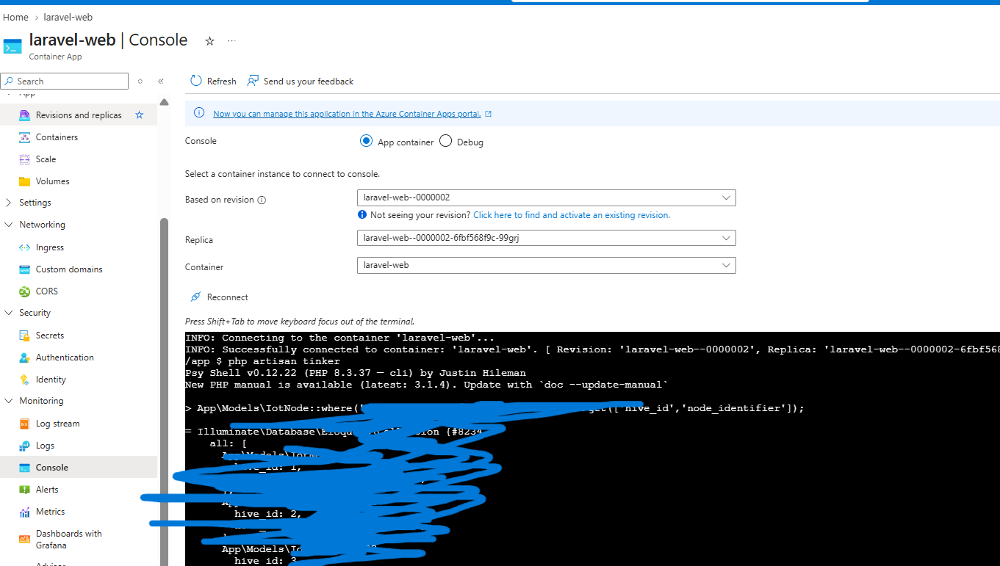
*Figure 1.1. The hive and node pairs were read from the database through the portal console. The IDs are covered.*

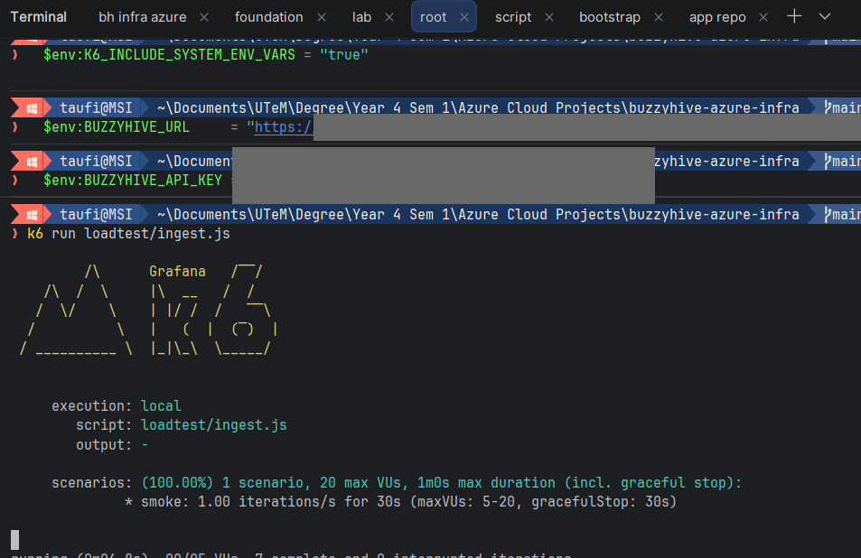
*Figure 1.2. The smoke profile starting. The lab URL and the API key are covered.*

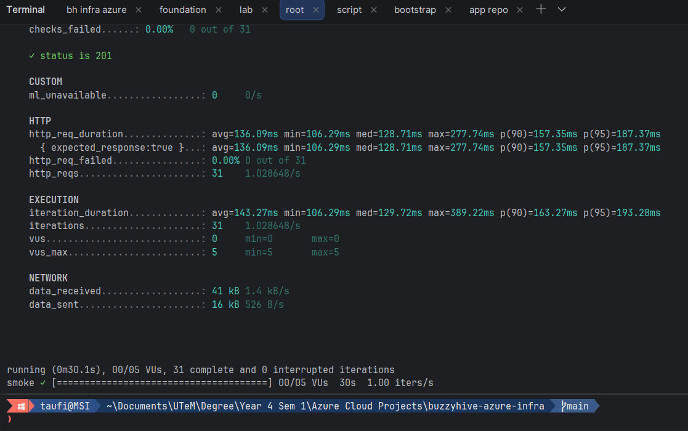
*Figure 1.3. The smoke run: 31 requests, none failed, p95 187 ms.*

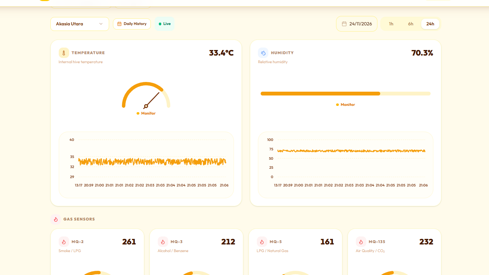
*Figure 1.4. The sensors dashboard for one hive, showing the readings k6 had just posted (33.4 °C, 70.3 % humidity).*

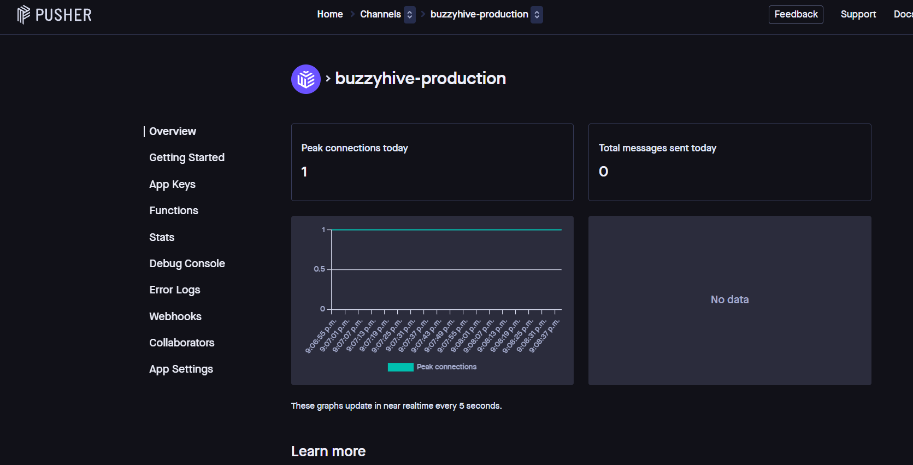
*Figure 1.5. The Pusher app dashboard at about 21:08 local time, after the first ramp: 1 peak connection and 0 messages sent today. The live websocket path was not tested, and this reading was not investigated.*

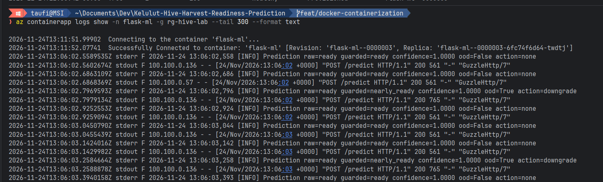
*Figure 1.6. `flask-ml` log during the first ramp: `raw=ready guarded=ready` for most requests, and `raw=ready guarded=nearly_ready ... ood=True action=downgrade` for some. The model then in service labelled the test reading ready.*

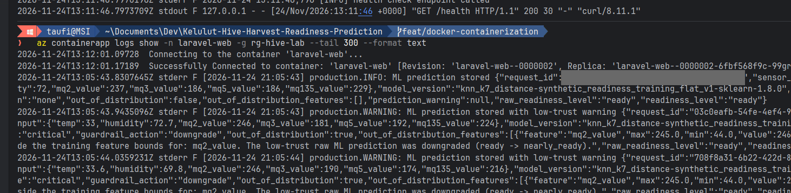
*Figure 1.7. `laravel-web` log of the same period: `ML prediction stored` with `raw_readiness_level` `ready`, and low-trust warnings where the guardrail downgraded the result.*

## 2. Results

| | Run 1 | Run 2 | Run 3 |
|---|---|---|---|
| What was different | First ramp | Liveness probes lengthened | Deadlock retry in the app |
| Requests | 3,292 | 3,251 | 3,299 |
| Failed (no `201`) | 50 (1.51%) | 149 (4.58%) | **0 (0.00%)** |
| `ml_unavailable` | 16 | 0 | 0 |
| Median latency | 122 ms | 150 ms | 131 ms |
| p95 latency | 151 ms | **6.89 s** | 154 ms |
| Max latency | 15.11 s | 15 s | 303 ms |
| Thresholds | 3 of 4 failed | 3 of 4 failed | **All passed** |

*Table 2.1. Run 1 and run 2 failed their thresholds. Run 3 passed all four.*

The median stayed near 130 ms in every run. In runs 1 and 2 the failures came from short stalls where requests waited until k6's 15-second timeout, not from a gradual slowdown.

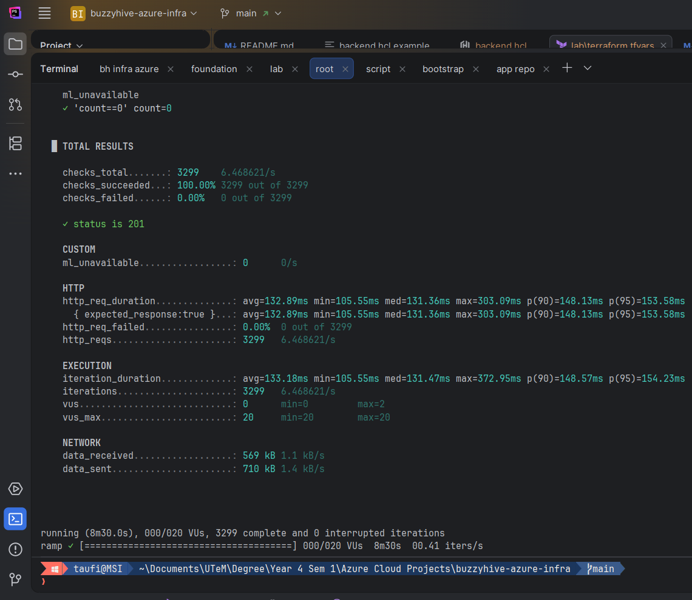
*Figure 2.1. Run 3 (old model, after the deadlock retry): 3,299 requests, none failed, p95 154 ms.*

### 2.1 Run 4: the retrained model, and the web replica's CPU limit

After the retrained model was deployed ([Azure ML article](azure-ml.md)), the same ramp was run again.

| | Run 3 (old model) | **Run 4 (new model)** |
|---|---|---|
| Requests | 3,299 | 3,293 |
| Failed | 0 | **0** |
| Median | 131 ms | 133 ms |
| p90 / p95 | 148 ms / 154 ms | **2.1 s / 2.22 s** |
| Max | 303 ms | 2.79 s |
| Thresholds | all passed | p95 failed, the rest passed |

*Table 2.2. Run 4 had no failed requests, but its p95 was far above the 500 ms target.*

Per-minute maximum CPU during run 4 (portal metrics, UTC):

| Resource | Peak | Limit | Note |
|---|---|---|---|
| `laravel-web` | **0.49 to 0.50 cores** at 15:55 and 15:56 | 0.5 vCPU | At the cap during the 10-requests-per-second hold |
| `flask-ml` | 0.03 cores | 0.25 vCPU | Far from the cap |
| MySQL host CPU | 33.6% | alert at 80% | Fine |

*Table 2.3. The web replica's CPU climbed with the arrival rate and reached its limit during the hold.*

- **The tail is queueing.** `laravel-web` CPU rose steadily from 0.03 cores at 15:48 to the cap at 15:55. Once it was capped, requests waited, which is the roughly 2-second tail above a 133 ms median. At about 10 requests per second, one 0.5 vCPU web replica is CPU-bound.
- **No alerts.** The k6 reading is `approaching` under the retrained model, so 0 Telegram alert jobs ran.
- **Two lost predictions.** 2 of 3,293 requests logged `prediction_persist_failed` with a deadlock after all 3 retries. The requests still returned `201`.
- **No restarts.** Fifteen probe timeouts occurred on each of `laravel-web` and `flask-ml` between 15:48 and 15:55, but no container was terminated.
- **Not explained:** run 3 had the same rate on the old model without reaching the cap. Two things changed since then: the model (k=7 over 1,600 rows) and the number of readings stored in the database. Which of them raised the web CPU was not determined. `flask-ml` itself used little CPU.
- **Not done:** raising `laravel-web` to 1.0 vCPU and rerunning, which would show whether p95 recovers.

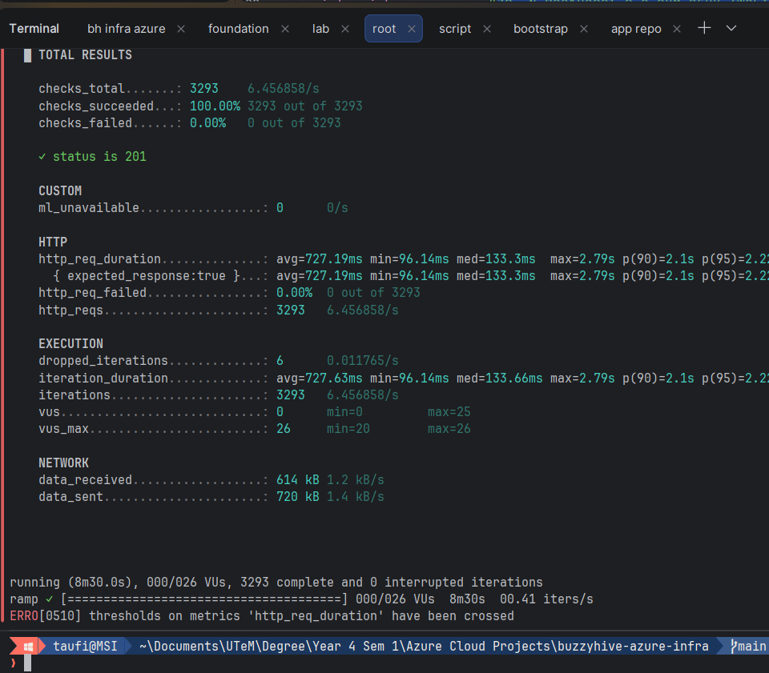
*Figure 2.2. Run 4 (retrained model): 3,293 requests, none failed, but p95 2.22 s, and k6 reports the latency threshold crossed.*

## 3. What the logs showed

Times are UTC in the logs; the lab's local time is UTC+8.

### 3.1 Run 1: web restarted after `flask-ml` was unreachable

- A `flask-ml` replica was started at 12:57:55.
- From 12:58:09, nearly every request logged `ml_unavailable` with a `ConnectionException` for about 20 seconds: the web app could not connect to `flask-ml`.
- The `laravel-web` liveness probe failed three times with its **1-second default timeout**, and the container was killed and restarted at 12:58:28. Requests in flight at that moment never got an answer.
- Why `flask-ml` was unreachable is **not confirmed**. A replica replacement with no overlap is the likely cause.
- Resource use during this run (portal charts): `laravel-web` peaked at 0.30 cores of 0.5, `flask-ml` at 0.06 cores, MySQL host CPU at 29.25% with 13 connections at most. Nothing was saturated.

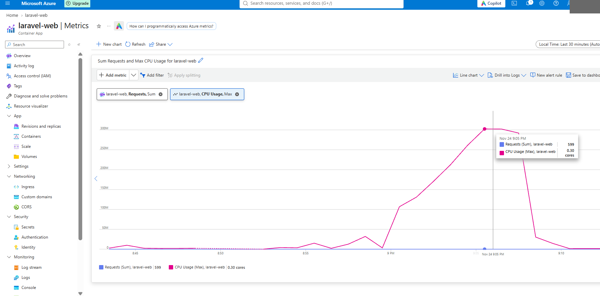
*Figure 3.1. Run 1, `laravel-web` requests and maximum CPU (portal): CPU peaked at 0.30 cores.*

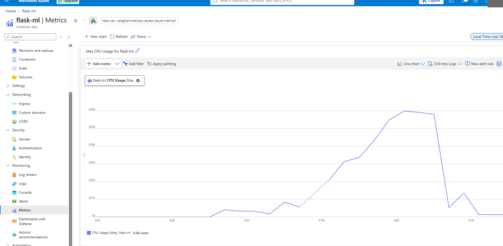
*Figure 3.2. Run 1, `flask-ml` maximum CPU: it peaked at 0.06 cores.*

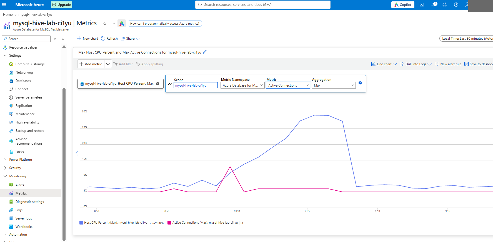
*Figure 3.3. Run 1, MySQL host CPU peaked at 29.25 % and active connections at 13.*

### 3.2 Run 2: MySQL deadlocks, then another restart

- 81 requests logged `prediction_persist_failed`, all with the same MySQL error: `SQLSTATE[40001] 1213 Deadlock found when trying to get lock` on `insert into predictions`.
- They began at 13:37, when the ramp reached its 10-per-second hold, and rose from 20 to 28 to 33 per minute.
- The web liveness probe (now with a 5-second timeout) failed five times in a row from 13:39:00 and the container was restarted at 13:39:37. That is when k6's timeouts appeared.
- `flask-ml` caused no errors in this run.

### 3.3 Why the deadlock happens

The trigger `trg_predictions_after_insert` runs on every prediction insert. It re-aggregates **all of that hive's `sensor_logs` for the day** and upserts the result into `hri_summary`. Concurrent readings for one hive therefore read and lock the same rows while each other's inserts are in flight, and InnoDB aborts one of them. This is read from the trigger code and the error message. It was not reproduced in isolation.

## 4. What was changed

| Change | Where | Effect |
|---|---|---|
| `min_replicas = 1` on `laravel-web` and `flask-ml` (variable `keep_web_and_ml_warm`) | `lab/` | Removes scale-from-zero cold starts from the test |
| Liveness probes set to a 5-second timeout, 5 failures, 10-second initial delay | `lab/containerapps.tf` | A short stall no longer gets the container killed |
| `DB::transaction(..., 3)` in `persistPrediction` | App repo, `MlPredictionService.php` | Laravel retries the save up to 3 times when MySQL reports a deadlock |

The retry and the image built from it were deployed under the tag `300b276-deadlock-retry`. The change was built from a working tree with the edit uncommitted at the time.

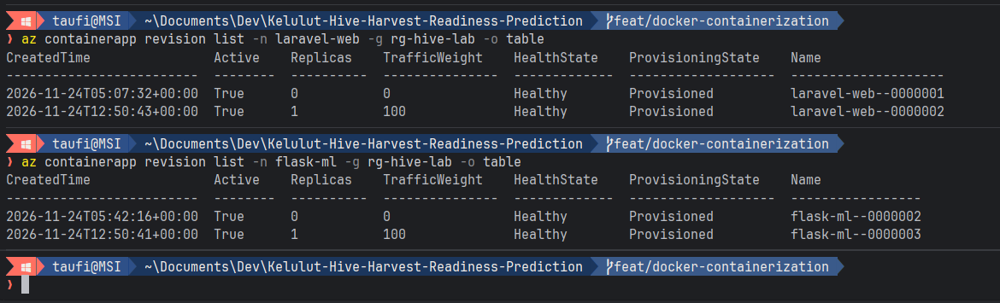
*Figure 4.1. After the `min_replicas` change, each app had a new revision with 1 replica and 100 % of the traffic, and the previous one with 0 replicas.*

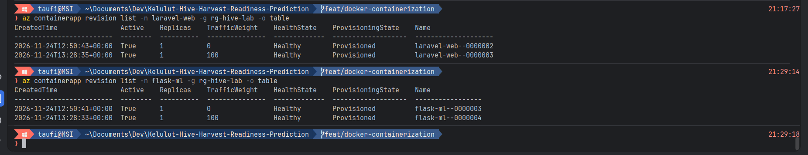
*Figure 4.2. After the probe change: the new revisions serve all the traffic while the old ones still show a replica.*

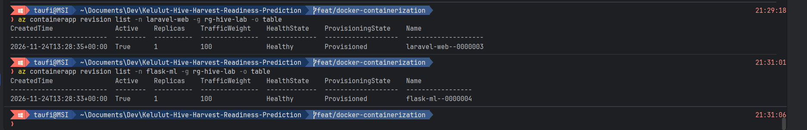
*Figure 4.3. A little later only the new revisions are left.*

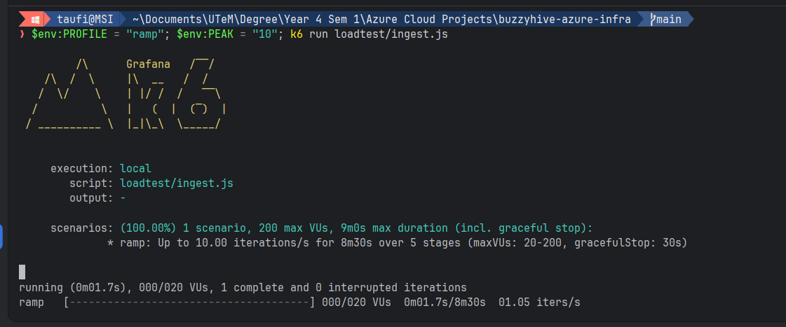
*Figure 4.4. Run 2 starting.*

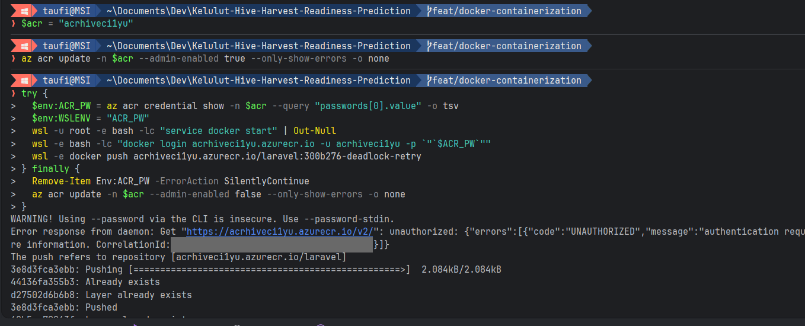
*Figure 4.5. Pushing the Laravel image that carries the deadlock retry. The output includes an `unauthorized` line before the layers were pushed, which then completed. It was not investigated.*

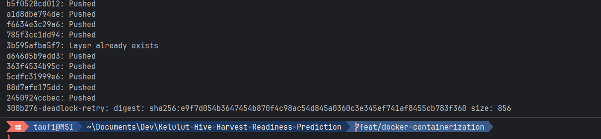
*Figure 4.6. The end of the push, with the digest of the new tag.*

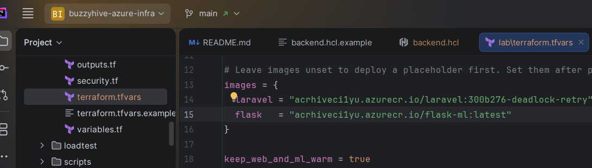
*Figure 4.7. `lab/terraform.tfvars` pointing `laravel` at the new tag.*

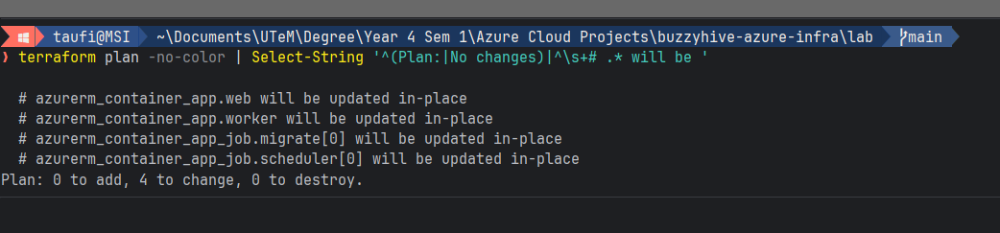
*Figure 4.8. The plan: 4 in-place changes (web, worker, migrate and scheduler), which all run the Laravel image.*

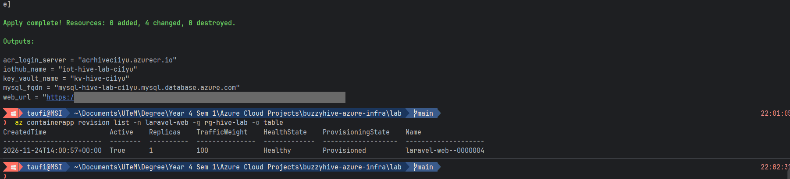
*Figure 4.9. Apply complete (4 changed), and the new `laravel-web` revision serving 100 % of the traffic. The lab URL is covered.*

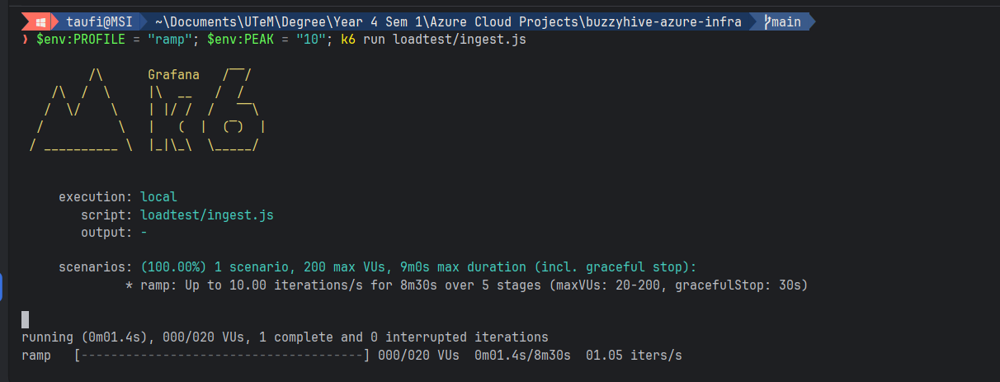
*Figure 4.10. Run 3 starting.*

## 5. What is not known

- **The retry may be hiding the deadlocks.** Laravel retries silently, so "no `1213` lines in the log" means no deadlock survived three attempts, not that none occurred. The server counter `Innodb_deadlocks` would show the real number. It was not read.
- **The trigger is still the cause.** It still scans the whole day on every insert, so latency can still climb as a hive's day fills. The proper fix is to update the summary incrementally, which was not done.
- **Probe failures still happened in run 3.** Seventeen `laravel-web` and seven `flask-ml` probe events timed out at 5 seconds between 14:08:58 and 14:15:50, even though every request in that run succeeded in under 303 ms. No liveness probe failed five times in a row, so no container restarted. Whether the longer probe settings are what prevented a restart is plausible but **not proven**, and why the probes timed out while requests were fast is **not explained**.
- **The limit above 10 requests per second is unknown.** Run 4 reached the web replica's CPU cap at 10 requests per second, so a higher rate was not tried, and the effect of more CPU was not measured.
- **Run 3 charts were not captured.** CPU and connection figures above come from run 1 only.
- **Pusher and Telegram were not stressed.** The readings stay `not_ready`, and live websocket delivery was not tested.

## 6. How to repeat it

See [`loadtest/README.md`](../loadtest/README.md). Set `K6_INCLUDE_SYSTEM_ENV_VARS=true` first, because k6 2.x ignores shell variables otherwise, and pass the key through an environment variable, never `-e`. Run the smoke profile before the ramp.

Related troubleshooting entries: [34](troubleshooting.md#34-a-short-stall-restarts-laravel-web-the-default-1-second-liveness-probe) and [35](troubleshooting.md#35-under-load-predictions-fail-to-save-a-mysql-deadlock-in-the-predictions-trigger).

---

<!-- docs-nav:start -->
**[← Previous: Train the model in Azure ML](azure-ml.md) | [Docs index](README.md) | [Next: Teardown and redeploy →](teardown-and-redeploy.md)**
<!-- docs-nav:end -->
