# Teardown and redeploy

This article is the runbook for removing everything this project created in Azure, proving nothing is left, and then building it again from an empty subscription.

> [!NOTE]
> **The teardown (sections 1 to 4) and the redeploy from empty (sections 5 to 7) each ran once, on 25/11/2026, and sections 9 and 10 record what happened.** Both now have a one-command form: `scripts/down-all.ps1` and `scripts/up-all.ps1`. `up-all.ps1` ran for real. `down-all.ps1` ran once for real at the end of the day (section 11). Commands marked as run were run, and the rest must be read before they are run. Record what actually happens in [troubleshooting](troubleshooting.md).

## 1. Who owns what

| Layer | Created by | Contains | Destroyed by |
|---|---|---|---|
| `lab` | `lab/` Terraform | Container Apps and Jobs, MySQL, Key Vaults, registry, IoT Hub, storage accounts, networking, Log Analytics, Application Insights, alerts, the Azure ML workspace and cluster | `scripts/down.ps1` (or `terraform destroy` in `lab/`) |
| `foundation` | `foundation/` Terraform | The resource group `rg-hive-lab`, the managed identity, two subscription policy assignments, a subscription budget, two Entra groups, the pipeline app registration and service principal with two federated credentials, role assignments, an optional lock | `terraform destroy` in `foundation/` |
| `bootstrap` | `bootstrap/` Terraform | The resource group `rg-hive-iac` with the storage account that holds the state of `foundation` and `lab`, and one role assignment | `terraform destroy` in `bootstrap/` |
| Outside Terraform | Azure, or by hand | The registry Azure ML created and attached to the workspace, any IoT Hub devices, the `ME_*` group of the Container Apps environment, resource provider registrations | By hand, see section 4 |

The order is forced by the dependencies:

1. `foundation` and `lab` keep their state in the `bootstrap` storage account, so `bootstrap` goes **last**.
2. `foundation` owns `rg-hive-lab`, so it goes after `lab`, and the resource group must be **empty** first. The azurerm provider refuses to delete a resource group that still contains resources, so a leftover registry blocks it.

## 2. Before you destroy anything

1. **Back up the files that are not in git.** They are git-ignored on purpose, and nothing else holds them:
   - `foundation/terraform.tfvars` and `lab/terraform.tfvars`. The second holds the application secrets.
   - `foundation/backend.hcl` and `lab/backend.hcl` (they change on a redeploy, but keep them until the state storage is gone).
   - **`bootstrap/terraform.tfstate`.** It is local state and the only record of the state storage account. Without it, `bootstrap` cannot be destroyed with Terraform.

   Copy them somewhere outside the repository, such as a password manager or an encrypted folder. Do not commit them.
2. **Push the application repository's branch** that holds the Dockerfiles (`feat/docker-containerization`). The images are built from it, and it is not merged. If the branch exists only on one laptop, a redeploy depends on that laptop.
3. **Collect the evidence you still want.** The lab will not exist afterwards: a Cost analysis view, a final resource list, anything else for the write-up. Blur identifiers before adding screenshots to `docs/evidence/`.
4. **Prove the lab is idempotent before destroying it.** In each of `bootstrap`, `foundation` and `lab`, run `terraform plan -detailed-exitcode`. Exit code `0` means "No changes". Anything else is drift to explain first. (Known: the `lab` root ignores, on purpose, the Consumption workload profile, the Azure ML registry attachment, and two read-back differences on the Function app: its Application Insights tag and `AzureWebJobsStorage`. On 25/11/2026 all three roots returned `No changes` once those were declared.)
5. **Turn off the admin user** of the registry Azure ML created, if it is still on: `az acr update -n <name> -g rg-hive-lab --admin-enabled false`.

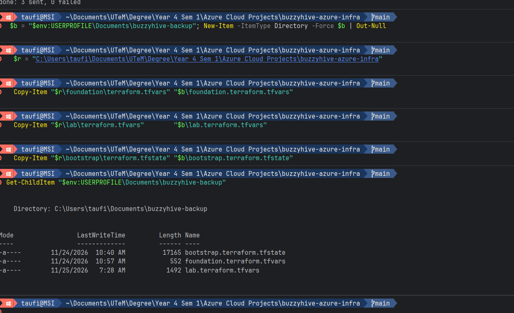
*Figure 2.1. The three git-ignored files copied to a backup folder, and the listing of their names, sizes and dates. Their contents are not shown.*

## 3. Teardown

Run these in Windows PowerShell, in this order. Each step touches your subscription, so you run them yourself.

### 3.1 The lab

```powershell
.\scripts\down.ps1 -DryRun     # read what it would do
.\scripts\down.ps1             # asks you to type the resource group name
```

The script lists what is in `rg-hive-lab`, takes the Key Vault secrets out of the state (Azure cannot delete them, see [troubleshooting 43](troubleshooting.md)), plans a destroy of the `lab` root, applies it after you type the group name, and lists anything still inside the group. On 25/11/2026 the first run stopped on those secrets, and the rerun finished. It never touches `bootstrap` or `foundation`. If it fails with `ScopeLocked`, set `enable_locks = false` in `foundation`, apply `foundation`, and run it again (troubleshooting 3).

The `lab` provider is configured to purge soft-deleted Key Vaults and Azure ML workspaces on destroy, so their names are not left reserved.

### 3.2 Delete what Terraform never owned

```powershell
az resource list -g rg-hive-lab -o table
```

After the destroy, this should hold the managed identity `id-hive-lab-apps` and little else. The identity sits in this group but belongs to `foundation`, which removes it in step 3.3, so leave it. `down.ps1` prints it as "expected to remain".

Anything else is something Terraform never owned. Before the destroy, the group held 38 resources, and the likely leftovers are:

- **The registry Azure ML created** (untagged, admin user on). Certain.
- **A second action group and a `smartDetectorAlertRules` entry** that Azure creates itself for Application Insights. Confirmed on 25/11/2026: they were `Application Insights Smart Detection` and `Failure Anomalies - appi-hive-lab`. Read the names before deleting anything.

`scripts/down.ps1` now deletes these three itself, from an allowlist, after a y/N question. Anything else it finds is only reported, and the managed identity is left alone. If the lab is already destroyed, run only that step with `.\scripts\down.ps1 -CleanupOnly`. The first real run on 25/11/2026 deleted the three leftovers but also the managed identity that `foundation` owns, because of a Windows PowerShell 5.1 quirk with JSON arrays ([troubleshooting 44](troubleshooting.md)). That is fixed, and the selection was re-tested under Windows PowerShell 5.1.

To do it by hand instead, check what each one is, then delete it:

```powershell
az acr delete -n <registry name> -g rg-hive-lab --yes
az resource delete --ids <resource id>        # for each other leftover, with the id from: az resource list -g rg-hive-lab --query "[].{name:name, id:id}" -o table
```

Run `az resource list -g rg-hive-lab -o table` again until only the identity is left. Only then continue. A resource group that still holds anything blocks its own deletion in step 3.3.

### 3.3 `foundation`

```powershell
cd foundation
terraform init -reconfigure "-backend-config=backend.hcl"
terraform destroy
```

This removes the resource group, the identity, the policy assignments, the budget, the Entra groups and the pipeline app registration. Quote any argument that contains a dot (PowerShell splits it otherwise).

### 3.4 `bootstrap`

Only after `foundation` is gone and you have confirmed it:

```powershell
cd ..\bootstrap
terraform destroy
```

It uses local state, so it needs `bootstrap/terraform.tfstate` from section 2. This deletes the state storage account and `rg-hive-iac`, so nothing can manage `foundation` or `lab` afterwards.

## 4. Check that nothing is left

Run each and read the output. The expectation is in the right-hand column.

| Command | Expect |
|---|---|
| `az group list -o table` | No `rg-hive-lab`, no `rg-hive-iac`, no `ME_*` group. Groups that Azure creates by itself (such as `NetworkWatcherRG`) and the groups of the sibling `pldns` project are not part of this project: leave them |
| `az resource list --tag project=buzzyhive -o table` | Nothing |
| `az keyvault list-deleted -o table` | No `kv-hive-*`. If one is listed: `az keyvault purge -n <name>` |
| `az monitor log-analytics workspace list-deleted-workspaces -o table` | No workspace of this project. A deleted workspace is kept for a few days and does not bill. If the command is missing, look in the portal under Log Analytics workspaces, Manage deleted workspaces |
| `az policy assignment list -o table` | None of the project's two assignments |
| `az consumption budget list -o table` | No budget of this project |
| `az ad group list --query "[?starts_with(displayName,'grp-hive')].displayName" -o tsv` | Nothing |
| `az ad app list --display-name sp-hive-lab-pipeline -o table` | Nothing |
| `az identity list -o table` | No `id-hive-lab-apps` |

What legitimately remains, and cannot be removed cleanly:

- **Resource provider registrations.** The preflight script registered about 14 providers. They are free and harmless, and unregistering them can fail while anything uses them.
- **Cost history,** and the part of the month's spend that predates this project.
- **Deleted Entra objects,** which sit in the directory's recycle bin for a while.
- **Local files:** the backups from section 2, and any `terraform.tfstate` files.

## 5. Redeploy from empty

Prerequisites: `az login`, Terraform, Docker in WSL, the application repository on the branch with the Dockerfiles, and the backed-up `terraform.tfvars` files.

0. **Check for a reserved name.** The Log Analytics workspace `log-hive-lab` was left soft-deleted by the first teardown, and its name may be reserved for a few days ([troubleshooting 45](troubleshooting.md)). The workaround is in that entry. This has not been tried.
1. **Preflight.** From Git Bash in the repo root: `bash scripts/preflight.sh malaysiawest southeastasia`. It checks providers, the MySQL SKU, the quota and the IoT Hub region.
2. **`bootstrap`.** Delete the old local state first (`bootstrap/terraform.tfstate*`), then:
   ```powershell
   cd bootstrap
   terraform init
   terraform apply
   terraform output -raw backend_hcl
   ```
   The state storage account gets a new name. Write the output into `foundation/backend.hcl` and `lab/backend.hcl`, and give each file **exactly one `key` line** (`foundation.tfstate` and `lab.tfstate`).
3. **`foundation`.** Check `budget_start_date` in `foundation/terraform.tfvars` first. It is a date that Azure validates, and an old value may be refused. Then:
   ```powershell
   cd ..\foundation
   terraform init -reconfigure "-backend-config=backend.hcl"
   terraform apply
   ```
   This recreates the Entra objects with new IDs. Nothing uses the old ones.
4. **`lab`.** The registry is created inside `lab`, but the apps need images that only exist after it does, so `up.ps1` runs two applies. With the environment variables set:
   ```powershell
   $env:BUZZYHIVE_APP_REPO   = "<path of the application repository>"
   $env:BUZZYHIVE_PUSHER_KEY = "<Pusher app key>"
   .\scripts\up.ps1 -DryRun
   .\scripts\up.ps1 -Seed -RegisterDevice NODE-28ZRUR
   ```
   It builds both images in WSL, pushes them with the admin user switched on only for the push, applies again, runs the migration Job, seeds the database and registers the IoT device. If it fails, fall back to the manual order in [Deploy](deploy.md).
   The `flask-ml` image already carries the retrained model, because the model files are in the application repository's `ml/` folder.
   If `enable_function = true`, also run `.\scripts\deploy-function.ps1` once the apply has finished. Terraform creates the Function app, but the code is uploaded separately. On this subscription the settings that worked are `function_hosting = "flex"` and `function_location = "eastus"`, and they live in the git-ignored `lab/terraform.tfvars`, so keep them in the backup.
5. **Azure ML, if wanted.** Set `enable_ml = true` and follow [the Azure ML article](azure-ml.md). Delete the registry it creates at the next teardown.

## 6. What proves it worked

| Check | Pass |
|---|---|
| `terraform plan -detailed-exitcode` in all three roots | Exit code `0`, "No changes" |
| `<web url>/up` | 200 |
| `laravel-migrate` Job | `Succeeded` |
| `python scripts/simulate_sensor.py` with the baseline profile | `201`, a stored prediction, and no Telegram message (the baseline is `approaching` under the retrained model) |
| k6 smoke profile | 31 of 31 `201` |
| A reading sent with `scripts/simulate_device.py` (only when the Function is enabled) | It reaches Laravel through IoT Hub and the Function, and is stored with a prediction |
| `az containerapp revision list` for each app | One revision, `Healthy`, 100 % traffic |

Idempotence is the first row. Create-then-destroy twice with the same results is what shows the Terraform is repeatable, and a plan with changes after a fresh apply means something is not declared (as happened with the Consumption workload profile and the Azure ML registry).

## 7. What can stop a redeploy

- **A skipped teardown step.** Leftover Entra objects or a soft-deleted Key Vault cause name conflicts, and a non-empty `rg-hive-lab` makes `foundation` refuse to destroy.
- **Missing local files.** `terraform.tfvars` files and `bootstrap/terraform.tfstate` are not in git.
- **The IoT Hub free tier** allows one per subscription. It is freed when the hub is deleted.
- **Quota.** 4 vCPUs in the subscription. The Azure ML cluster uses 2 per node, and one node fits next to the lab.
- **The application repository branch** must be reachable, because the Dockerfiles are not on `main`.
- **MySQL 8.0** loses standard support on 31/12/2026, so a lab that lives past that date should use a newer version.
- **The scripts are lightly tested.** `up-all.ps1` and `up.ps1` ran once for real and needed two fixes (troubleshooting 46 and 47). `down.ps1` ran for real and needed three. `down-all.ps1` ran once for real and finished (section 11), but one run is not much evidence.
- **A different subscription** needs a new `subscription_id`, the preflight, `bootstrap` again, and a check of which names, quotas and regions change.

## 8. Suggested timeline for this subscription

The Free Trial credit expires on 02/12/2026. Cost data lags 8 to 24 hours, so measure early.

| Date | Step |
|---|---|
| Before the teardown | Section 2 complete, including the drift proof and the backups |
| About 28/11/2026 | Section 3 and 4: full teardown, then check nothing is left |
| About 29/11/2026 | Section 5 and 6: full redeploy from empty, and the proof |
| About 29 to 30/11/2026 | Cost analysis for the first session, once the data appears. Replace the estimates in [Cost and teardown](cost-and-teardown.md) |
| No later than 01/12/2026 | A second full teardown. The state storage lives in the subscription that expires, so delete it before then |

## 9. What happened on 25/11/2026

| Step | Result |
|---|---|
| Drift check before the teardown | `bootstrap` and `foundation`: No changes. `lab`: one change, the Function's read-back differences ([troubleshooting 42](troubleshooting.md)), then No changes |
| Backup of the three git-ignored files | Identical to the originals by hash |
| `down.ps1 -DryRun` | Matched the steps in section 3 |
| `down.ps1`, the `lab` root | The plan said 54 to destroy (Terraform also counts objects that are not separate resources in the group, such as the Key Vault secrets and random values). Most were destroyed, then it stopped on six Key Vault secrets: `DeleteNotSupported` ([troubleshooting 43](troubleshooting.md)). The script was fixed and the rerun destroyed the remaining 3 |
| Leftovers | The Azure ML registry, the Smart Detection action group and the Failure Anomalies rule, as predicted. `-CleanupOnly` deleted them, and also the managed identity that `foundation` owns, because of a Windows PowerShell 5.1 bug ([troubleshooting 44](troubleshooting.md)) |
| `foundation` | `terraform plan -destroy` listed 16 (the identity was already dropped). 16 destroyed, the policy assignments taking about 1 minute 40 seconds |
| `bootstrap` | 5 destroyed, the resource group in 21 seconds |
| Final inventory | The subscription held only `NetworkWatcherRG` and `NetworkWatcher_malaysiawest`, which Azure creates itself. The older `budget-lab-monthly` budget and the `SecurityCenterBuiltIn` policy assignment are not part of this project |

*Table 9.1. The first teardown, step by step.*

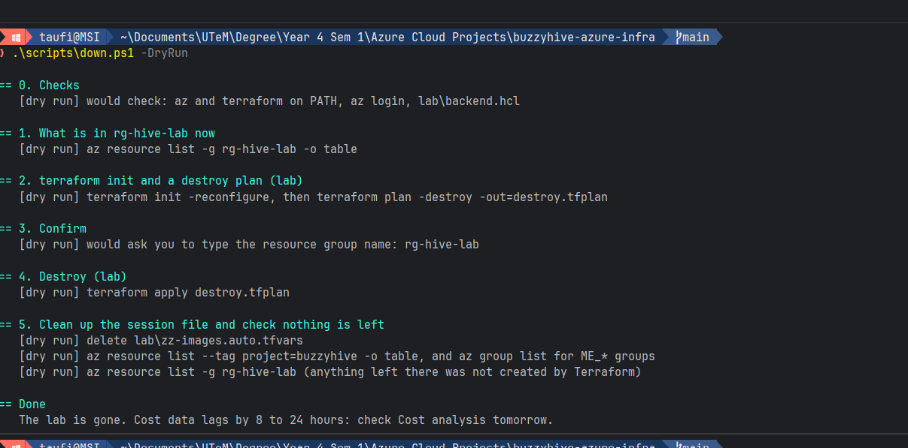
*Figure 9.1. `down.ps1 -DryRun`, with the script as it was then: every step printed, nothing run.*

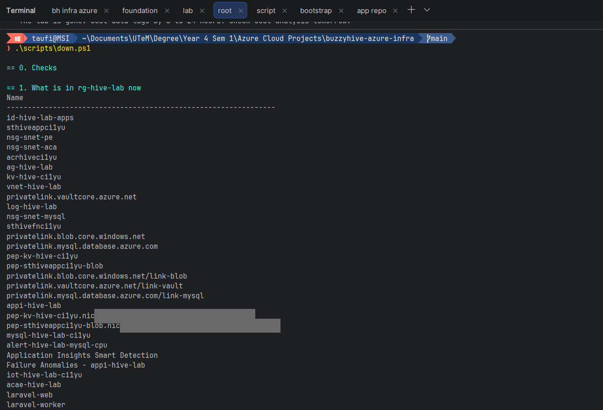
*Figure 9.2. The real run, step 1: the first part of the list of resources in `rg-hive-lab`. The NIC names carry random ids that are covered.*

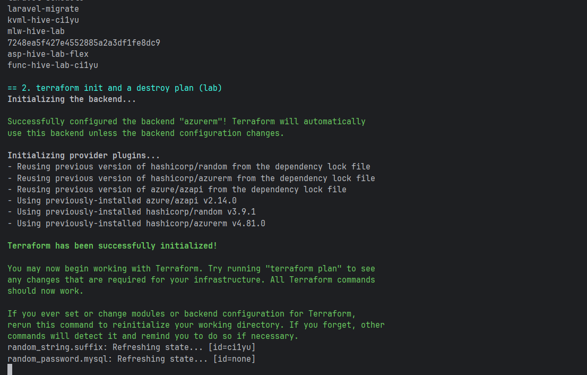
*Figure 9.3. The rest of the list, and step 2: `terraform init` reusing the provider plugins.*

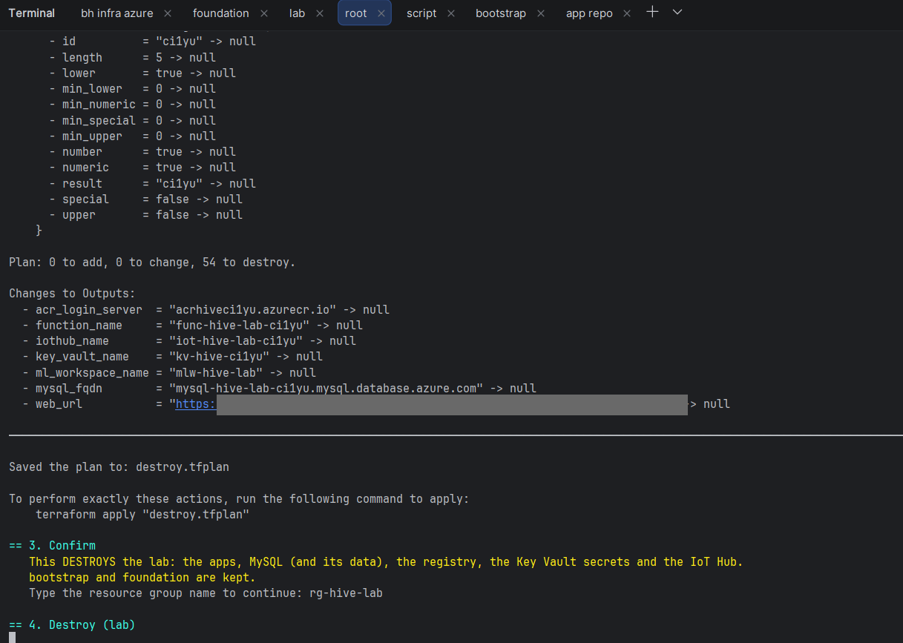
*Figure 9.4. The destroy plan: 54 to destroy, the outputs that go to null, and the prompt to type the resource group name. The lab URL is covered.*

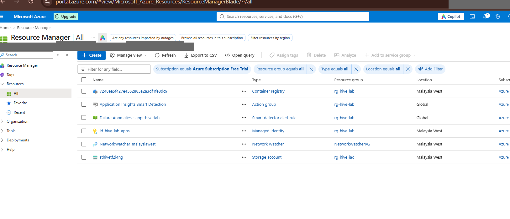
*Figure 9.5. The portal's list of everything in the subscription after the `lab` destroy and before the cleanup: the Azure ML registry, the two Application Insights items, the managed identity, Azure's Network Watcher and the state storage. The account name is covered.*

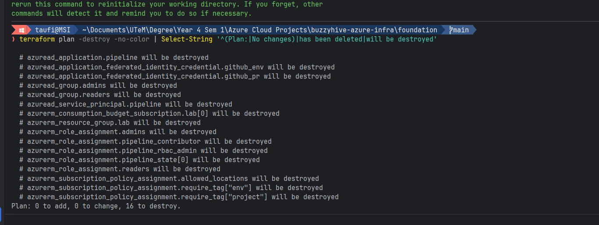
*Figure 9.6. `foundation`: `terraform plan -destroy` lists 16 to destroy. The managed identity is not among them, because it had already been deleted.*

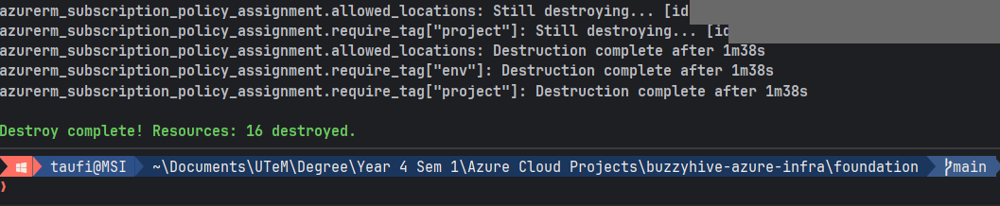
*Figure 9.7. `foundation`: `Destroy complete! Resources: 16 destroyed.`, the policy assignments taking 1 minute 38 seconds. The subscription in the ids is covered.*

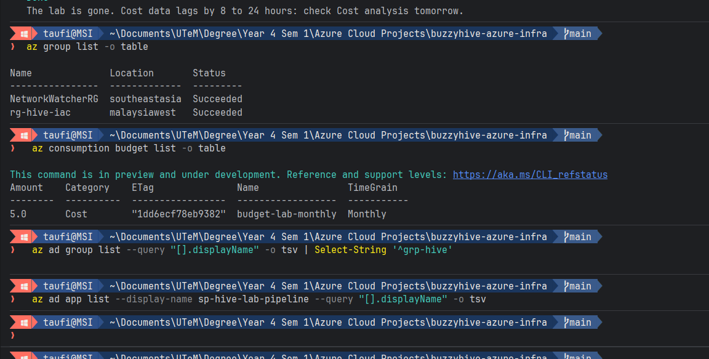
*Figure 9.8. The checks after `foundation`: only `NetworkWatcherRG` and `rg-hive-iac` remain, the older `budget-lab-monthly` budget is not part of this project, and the Entra group and app queries return nothing.*

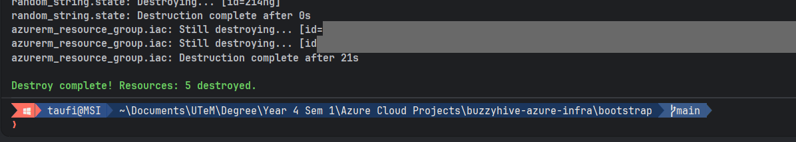
*Figure 9.9. `bootstrap`: `Destroy complete! Resources: 5 destroyed.`, the resource group in 21 seconds. The subscription in the ids is covered.*

**Found afterwards:** the project's Log Analytics workspace was left soft-deleted ([troubleshooting 45](troubleshooting.md)).

**Not known yet:** the measured cost (Cost analysis lags 8 to 24 hours).

## 10. What happened on the redeploy, 25/11/2026

The redeploy ran the same day as the teardown, with `scripts/up-all.ps1 -Seed`, which reads the Pusher key, the app repository path and the device name from files, so nothing is typed.

| Step | Result |
|---|---|
| `bootstrap` | Applied. The state storage account got a new random name, and the script rewrote both `backend.hcl` files and `state_storage_account_name` in the `foundation` tfvars |
| `foundation` | 17 added |
| Soft-deleted `log-hive-lab` | The script found it, recovered it into `rg-hive-lab` and deleted it for good. The `lab` apply then had no name clash, so the workaround in [troubleshooting 45](troubleshooting.md) worked |
| `lab`, first pass | Stopped on a 412 for `flask-ml` ([troubleshooting 46](troubleshooting.md)). The rerun replaced the tainted app |
| Image push | `docker login` unauthorized ([troubleshooting 47](troubleshooting.md)), then fixed |
| `lab`, second pass, migrate and seed | Applied. The migrate Job ran twice, both `Succeeded` (the migration, then the seed) |
| Function code | Uploaded, and `forward_reading` registered |
| Proof | `terraform plan -detailed-exitcode`: **No changes** in `bootstrap`, `foundation` and `lab` |
| Checks | `/up` and `/login` returned 200. The three apps were `Succeeded` and `Running`. Device `NODE-28ZRUR` registered. The registry admin user was `false`. MySQL public network access was `Disabled` |
| Time | The last full run took 21 minutes. The first attempt and the two reruns took longer, and I did not time them |

*Table 10.1. The redeploy, step by step.*

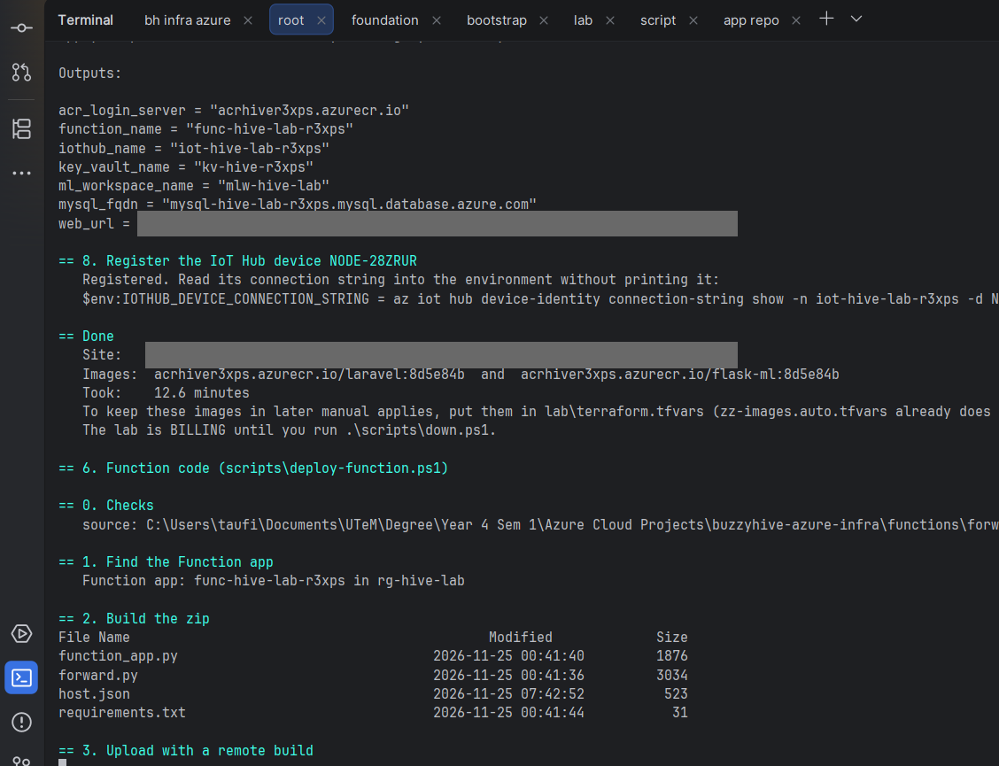
*Figure 10.2. `up.ps1` finishing in 12.6 minutes: the device registered without printing its keys, and the images tagged with the application's short commit. The Function upload starts next. The lab URL is covered.*

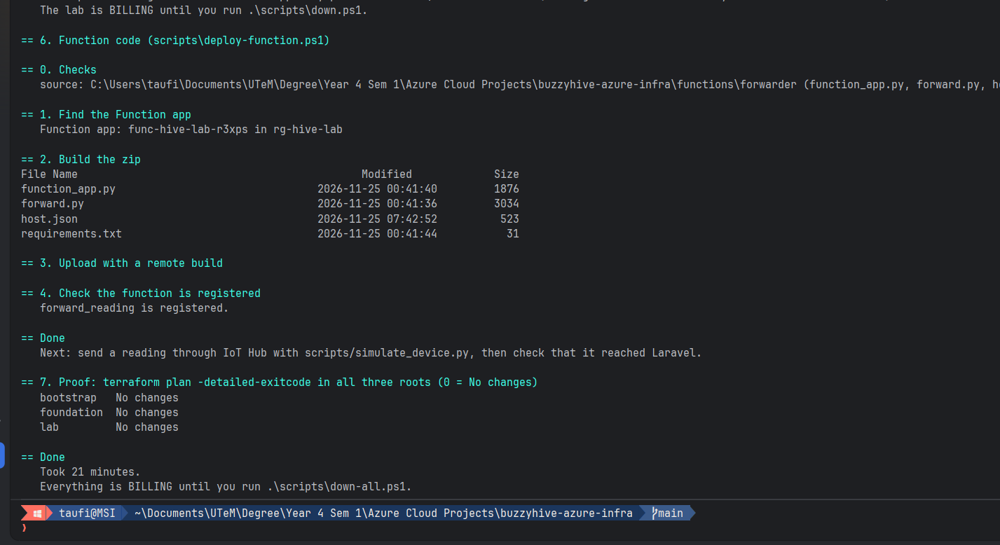
*Figure 10.3. The Function code is uploaded and `forward_reading` is registered. Then the proof step: `No changes` in `bootstrap`, `foundation` and `lab`. The whole run took 21 minutes.*

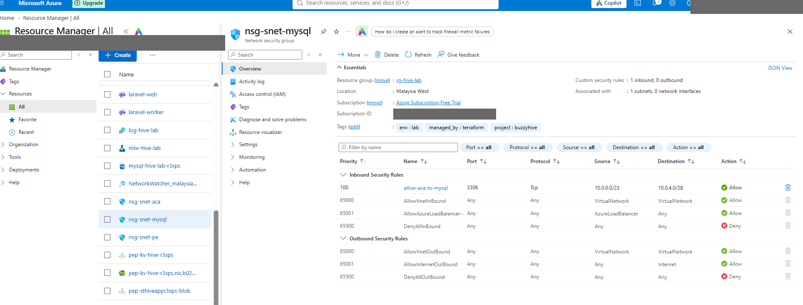
*Figure 10.4. The MySQL subnet's network security group as deployed: one custom inbound rule, `allow-aca-to-mysql`, port 3306 from the Container Apps subnet, above Azure's default rules. The subscription and account are covered.*

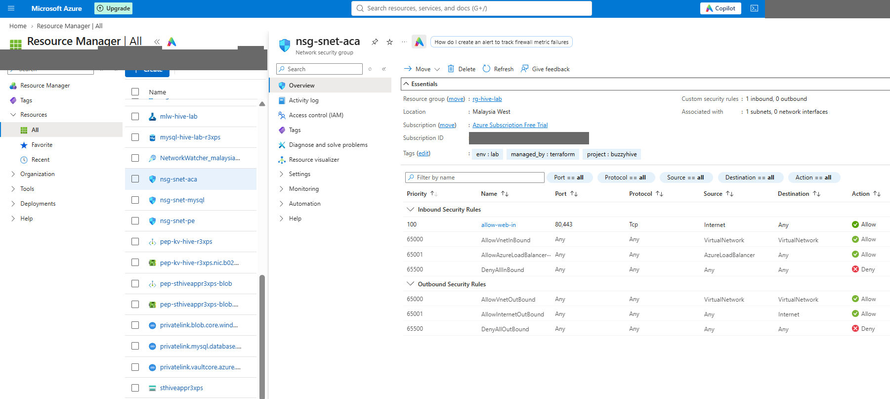
*Figure 10.5. The Container Apps subnet's group: one custom inbound rule, `allow-web-in`, ports 80 and 443 from the internet. The subscription and account are covered.*


### 10.1 A reading sent after the rebuild

A simulated device sent 10 readings through IoT Hub with `scripts/simulate_device.py --hive-id 1 --count 10 --interval 5 --profile baseline`. The device was `NODE-H0J56X`, the node the seeder had made for hive 1, because the seeder's identifiers are random ([troubleshooting 48](troubleshooting.md)).

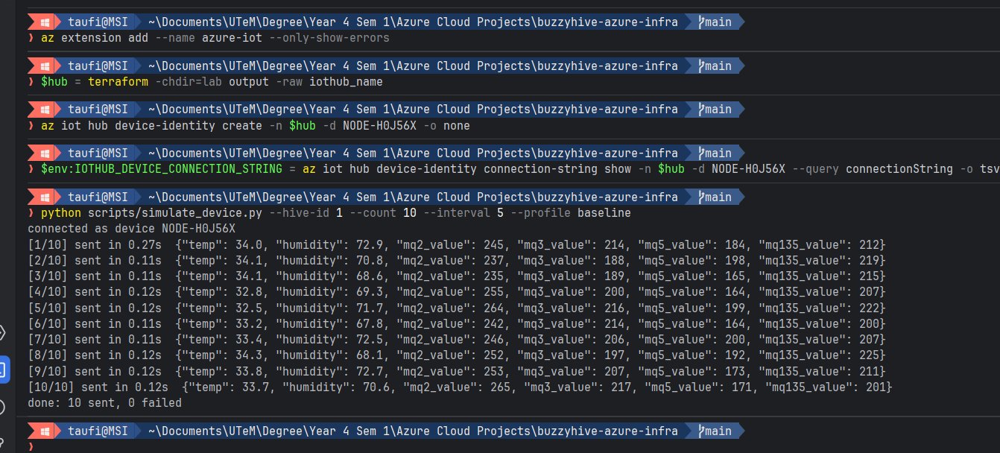
*Figure 10.6. The device is registered under the seeded name, and the simulator sends 10 readings: `done: 10 sent, 0 failed`. The device key was read into the environment and never printed.*

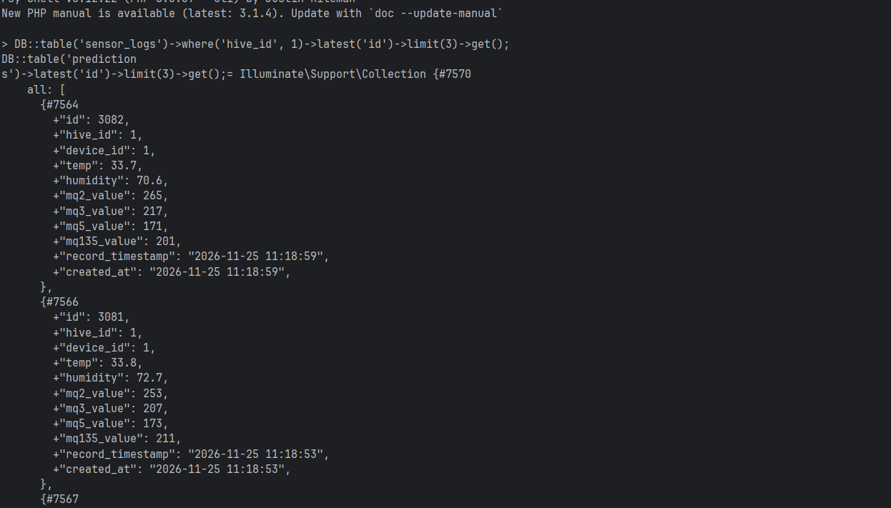
*Figure 10.7. Inside the app container (`php artisan tinker`): the newest `sensor_logs` rows for hive 1 carry the simulator's values, for example 33.7 / 70.6 / 265. So the Function forwarded them, about 5 seconds apart.*

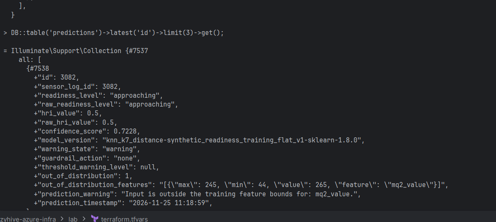
*Figure 10.8. The matching `predictions` row: `approaching`, from `knn_k7_distance-synthetic_readiness_training_flat_v1-sklearn-1.8.0`, the model retrained in Azure ML, not the stale one.*

**Result:** all 10 readings reached the database, each with a prediction, 3082 being the newest id. **One observation:** every prediction carries `out_of_distribution: 1` with the warning "Input is outside the training feature bounds for: mq2_value". The retrained model saw `mq2_value` only between 44 and 245, and the `baseline` profile sends values up to 265. The app flagged it and still gave a sensible label, so it is a note about the simulator profile, not a failure.

**Not done yet:** a Telegram alert after the rebuild (the seed leaves no `telegram_id`, and `baseline` does not trigger one), and the measured cost. The final teardown is in section 11.

## 11. The second teardown, 25/11/2026

The same evening, `scripts/down-all.ps1` removed everything with one command and one confirmation (typing `DESTROY ALL`). The dry run matched the steps in section 3, and the real run took **32.4 minutes**. The last destroy, `bootstrap`, destroyed 5 resources, the resource group in 21 seconds. The terminal output reported no failed step, and I did not see the output of the earlier steps, only the end of it.

I then checked the result independently, with read-only commands:

| Check | Result |
|---|---|
| `az group list` | `NetworkWatcherRG` only |
| `az resource list` (whole subscription) | `NetworkWatcher_malaysiawest` only, which Azure creates itself |
| Resources tagged `project=buzzyhive` | 0 |
| Policy assignments of the project | 0 |
| Entra groups `grp-hive-*` and the pipeline app registration | 0 and 0 |
| Soft-deleted Key Vaults and Log Analytics workspaces of the project | None. The other workspaces and `kv-lab-03` in those lists belong to other projects and were left alone |
| Budgets | `budget-lab-monthly` remains. It is older than this project and not part of it |

*Table 11.1. The subscription after the second teardown.*

The soft-deleted workspace that the first teardown left behind ([troubleshooting 45](troubleshooting.md)) did not come back, so the provider setting added after the first teardown works.

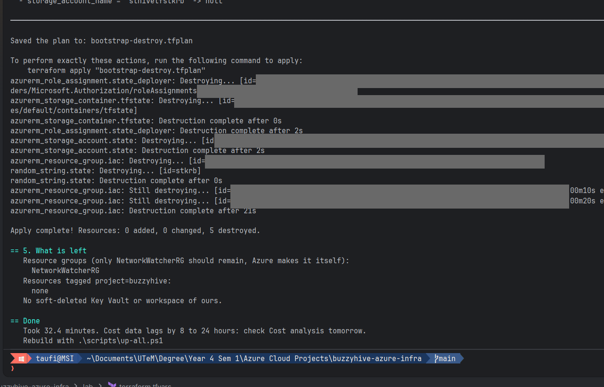
*Figure 11.1. The end of `down-all.ps1`: `bootstrap` destroyed (5 resources), then the final inventory (only `NetworkWatcherRG`, nothing tagged `project=buzzyhive`, no soft-deleted Key Vault or workspace of ours) and the total, 32.4 minutes. The subscription in the ids is covered.*

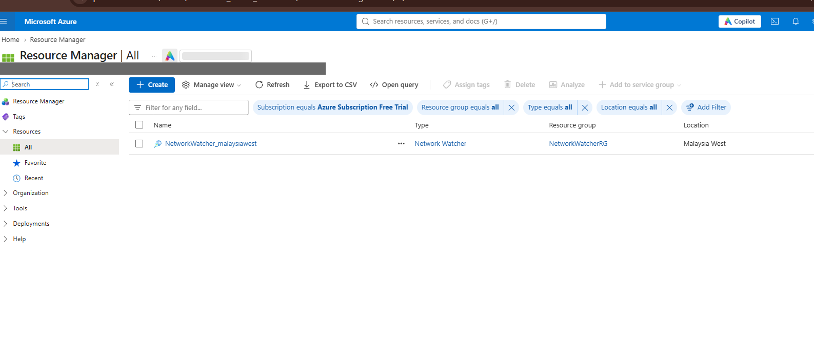
*Figure 11.2. The portal's list of every resource in the subscription afterwards: only `NetworkWatcher_malaysiawest`, which Azure creates itself. The account name is covered.*

**What this does not show:** the cost. Cost analysis lags 8 to 24 hours, so the total for 24/11/2026 to 26/11/2026 comes the next day.

## 12. The second redeploy, 25/11/2026

After the second teardown, `up-all.ps1` ran again from empty, to test the two changes that had only been checked offline: the node rename ([troubleshooting 48](troubleshooting.md)) and the retry of a failed apply. The Function app's name had a new random suffix, so these were new resources.

| Attempt | Result |
|---|---|
| First, `up-all.ps1 -Seed` | Everything up to the seed worked. The node rename failed in `az.cmd` with `) was unexpected at this time` ([troubleshooting 49](troubleshooting.md)) |
| Second, with that fixed and `-Seed` passed again | The database was seeded a second time (it succeeded), and the rename failed in the Azure CLI with `unrecognized arguments: -r ...` ([troubleshooting 50](troubleshooting.md)) |
| Third, with that fixed and no `-Seed` | Finished in 24.7 minutes: the Function code uploaded, `forward_reading` registered, and `No changes` in `bootstrap`, `foundation` and `lab` |

*Table 12.1. The second redeploy.*

Read-only checks afterwards: the migrate Job's two executions were `Succeeded`, the IoT Hub held the device `NODE-28ZRUR`, the Job's command was back to `php artisan migrate --force`, `/up` returned 200, the registry admin user was `false` and MySQL public network access was `Disabled`.

**The rename worked.** `iot_nodes` showed `id 1` as `NODE-28ZRUR`, and the other nodes kept their random names. Ten readings sent as `NODE-28ZRUR` with `--hive-id 1` reached the database (`sensor_logs` ids 3092 to 3094 were the newest), each with an `approaching` prediction from the retrained model. The newest readings were also inside the training range for the first time, with `out_of_distribution` at 0.

**Not seen:** whether the apply retry or the registry login wait was needed. I did not see the first part of the third run, so I can neither say that they ran nor that they did not.

**Still not known:** the measured cost, and a Telegram alert after a rebuild.
