# Troubleshooting

This article lists problems expected from this design and problems hit while deploying it, and how to resolve them.

> [!NOTE]
> Entries 1 to 22 were written before the first apply, from Azure's documented behaviour. An entry says **Hit** or **Confirmed** only where it happened on 2026-11-24. Entries 23 to 32 were hit during the first real deployment and carry the real error text and screenshots. The screenshots are in [`evidence/`](evidence/).

## 1. Read the deployment error

```bash
terraform state list
terraform state show <address>
az monitor activity-log list --resource-group rg-hive-lab --offset 1h -o table
```

`terraform state show` prints a resource's last-known attributes. The Activity Log shows what Azure rejected and why.

## 2. SkuNotAvailable or quota errors

**Symptom:** apply fails creating MySQL, an Azure ML compute cluster, or a VM with `SkuNotAvailable`, `QuotaExceeded` or a capacity message.

**Fix:** capacity and quota are per region and per SKU, and new subscriptions often start with zero vCPUs for some ML families.

1. Check MySQL: `az mysql flexible-server list-skus --location <region> -o table`.
2. Check compute: `az vm list-usage --location <region> -o table`.
3. Request a quota increase, pick another SKU, or change `location`. A region change is a full redeploy, because resources cannot move between regions.

## 3. terraform destroy fails on a lock

**Symptom:** destroy fails with `ScopeLocked` on MySQL or Key Vault.

**Fix:** set `enable_locks = false` in the `foundation` root and apply it, then destroy again. Keep locks in the `foundation` root so they never block the `lab` root.

## 4. Role assignment is forbidden

**Symptom:** apply fails with `AuthorizationFailed` on `Microsoft.Authorization/roleAssignments/write`.

**Fix:** `Contributor` cannot create role assignments. Give the pipeline identity `Role Based Access Control Administrator` on the resource group, then apply again.

## 5. Entra groups or app registration cannot be created

**Symptom:** the `azuread` provider returns `Insufficient privileges to complete the operation`.

**Fix:** your account needs directory rights, such as Application Administrator, in the tenant. A university tenant may block this. Use the tenant that came with your own Azure account.

## 6. Laravel cannot reach MySQL

**Symptom:** the app returns connection errors, or `getaddrinfo` fails for the server name.

**Fix:**

1. Confirm the `privatelink.mysql.database.azure.com` zone exists and is linked to `vnet-hive-lab`.
2. Confirm the Container Apps environment is in `snet-aca`, and the server is in the delegated `snet-mysql`.
3. Check the connection uses TLS and the full server hostname, not an IP.

## 7. Container App cannot pull the image or read a secret

**Symptom:** the revision fails with `ImagePullBackOff`, or a secret reference resolves to nothing.

**Fix:**

1. Confirm the managed identity has `AcrPull` on the registry and `Key Vault Secrets User` on the vault.
2. Confirm the private DNS zones for `vaultcore` and `blob` are linked to the VNet.
3. Role assignments can take several minutes to take effect. Wait, then restart the revision.

## 8. IoT Hub works, but nothing reaches Laravel

**Symptom:** the simulator connects, but no row appears in `sensor_logs`.

**Fix:**

1. Check the Function logs for one invocation per message.
2. Confirm the Function's API key setting matches the one Laravel expects.
3. Confirm `laravel-web` has external ingress and the Function posts to its public URL.
4. On the free tier, check you have not passed 8,000 messages per day.

## 9. Sessions or uploads disappear

**Symptom:** users are logged out at random, or an uploaded file is missing on the next request.

**Fix:** with more than one replica, file sessions and local storage are per replica. Set `SESSION_DRIVER=database` and `CACHE_STORE=database`, and set `TRUSTED_PROXIES=*` so Laravel sees HTTPS. Uploaded files are a separate problem: see entry 18.

## 10. Migrations run twice or not at all

**Symptom:** a deploy fails on a duplicate migration, or the new revision starts before the schema changes.

**Fix:** run `migrate` only as a Container Apps Job, and make the pipeline wait for it to finish before it shifts traffic to the new revision.

## 11. 403 from Key Vault or Storage during apply

**Symptom:** Terraform fails creating a Key Vault secret or a storage share with `403 Forbidden`, though the vault or account exists.

**Fix:** with public network access disabled, only the control plane is reachable from outside the VNet. Create secrets and shares through ARM with `azapi` (for example `Microsoft.KeyVault/vaults/secrets`), or allow your own IP on the firewall for the apply and remove it after.

## 12. Recreating a destroyed resource fails on the name

**Symptom:** the next day's apply fails because a Key Vault or Azure ML workspace name is already in use, though you destroyed it.

**Fix:** both are soft-deleted and keep the name reserved. Set the provider options to purge them on destroy, add a random suffix to the name, or purge by hand with `az keyvault purge --name <name>`.

## 13. Resource provider not registered

**Symptom:** apply fails with `MissingSubscriptionRegistration` for `Microsoft.App`, `Microsoft.Devices` or a similar namespace.

**Fix:** register it with `az provider register --namespace <name>` and wait until `az provider show -n <name> --query registrationState` returns `Registered`. The preflight script does this up front.

**Hit, and handled by the preflight.** `Microsoft.App` was `NotRegistered` on the new subscription. The script registered it during its first run, and the second run said `ok` for every provider (see the [implementation log](implementation-log.md#4-problems-found-before-deployment)).

## 14. Azure Policy blocks the apply

**Symptom:** a create fails with `RequestDisallowedByPolicy`, often on a resource Azure creates itself, such as the Container Apps managed resource group.

**Fix:** set the required-tags assignment to `audit` or `modify`, not `deny`. Check which assignment fired in the error message.

## 15. Function cannot reach its storage account

**Symptom:** the Function fails to start with a storage error after the account was put behind a private endpoint.

**Fix:** a Functions Consumption plan generally cannot use storage behind a private endpoint. Keep the Function and ML workspace on the separate public storage account, and use the private account for Laravel files only.

> Entries 16 to 21 come from running the images. The app-side cause of each is documented in the application repository, `docs/docker/docker.md`; the fixes here are the Azure side.

## 16. Live updates never arrive in the browser

**Symptom:** the dashboard loads but predictions and sensor readings only appear after a refresh. The browser console shows Pusher or Echo configuration errors.

**Fix:** `VITE_PUSHER_*` values are compiled into the JavaScript at build time (`resources/js/app.tsx`). Setting them as runtime environment variables does nothing. Rebuild the image with the build arguments `VITE_PUSHER_APP_KEY` and `VITE_PUSHER_APP_CLUSTER`.

## 17. Redirect loops, http links or "mixed content" behind the ingress

**Symptom:** after login the browser is sent to an `http://` URL, assets are blocked as mixed content, or sessions do not stick.

**Fix:** the ingress terminates TLS and forwards plain HTTP. Set `TRUSTED_PROXIES=*` on the Laravel container apps (the lab Terraform does), so Laravel honours `X-Forwarded-Proto`. The app only reads this variable when it is set, so shared hosting is unaffected.

## 18. Hive images and the thesis PDF disappear

**Symptom:** an uploaded hive image returns 404 after a restart or a deploy.

**Fix:** the app writes uploads to `storage/app/public`, which is the container's own disk. It is lost when the container restarts and is not shared between replicas, which is why the lab runs one web replica. For durability, mount an Azure Files share at `/app/storage/app/public` or move the `public` disk to Blob storage.

## 19. The ML image build fails at "model and scaler load ok"

**Symptom:** `docker build ml` fails on the pickle check with an unpickling or version error.

**Fix:** `model.pkl` was written by scikit-learn 1.8.0 (see `model_version` in `model_metadata.json`), and `requirements-serve.txt` pins that version. After retraining in Azure ML, pin the same scikit-learn in the training environment, or update both pins together. The build check exists so a mismatch fails the build, not the first prediction.

## 20. Database connection fails with a TLS error

**Symptom:** Laravel cannot connect to MySQL Flexible Server, with an SSL or "secure transport" message.

**Fix:** Azure MySQL requires TLS. The lab sets `MYSQL_ATTR_SSL_CA=/etc/ssl/certs/ca-certificates.crt`, which `config/database.php` already reads, and the Debian-based image ships that bundle.

## 21. The migrate Job fails with error 1419

**Symptom:** `php artisan migrate` stops on the `HRI_Summary` trigger with `SQLSTATE[HY000]: General error: 1419 You do not have the SUPER privilege and binary logging is enabled`.

**Fix:** this was hit locally (it is why the compose file starts MySQL with `--log-bin-trust-function-creators=1`) and would hit Azure the same way. Flexible Server keeps binary logging on and its admin has no SUPER privilege. `lab/data.tf` sets the server parameter `log_bin_trust_function_creators` to `ON`.

**Confirmed on Azure.** With the parameter set, the `laravel-migrate` Job ran to `Succeeded` on its first start (see [Deploy](deploy.md#45-lab-second-apply-real-images)).

## 22. The budget cannot be created

**Symptom:** the `foundation` apply fails on `azurerm_consumption_budget_subscription`, for example with a message that the subscription type is not supported.

**Fix:** set `enable_budget = false` in `foundation/terraform.tfvars` and apply again. The budget only sends emails, so check your credit by hand under Cost Management, then Credits.

**Not hit.** The `foundation` apply created the budget on the Free Trial subscription with `enable_budget` left at its default of `true`, so this fallback was not needed there.

> Entries 23 to 32 were hit on 2026-11-24, during the first apply of `lab` and the steps after it.

## 23. The Container Apps environment is rejected: the subnet is not delegated

**Symptom:** the first `lab` apply fails creating `azurerm_container_app_environment.this` with a 400:

```
ManagedEnvironmentSubnetDelegationError: The subnet of the environment must be delegated to the service 'Microsoft.App/environments'.
```

**Fix:** the `snet-aca` subnet had no delegation. Add a `delegation` block for `Microsoft.App/environments` with the action `Microsoft.Network/virtualNetworks/subnets/join/action` to `azurerm_subnet.aca` in `lab/network.tf`, as the MySQL subnet already does for its own service. The plan then showed 1 change (the subnet, in place) and the environment to add.

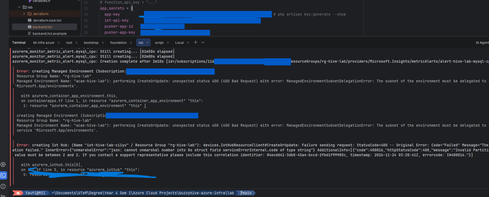
*Figure 23.1. The first `lab` apply ends with two errors, this one and entry 24. The rest of the apply had already succeeded.*

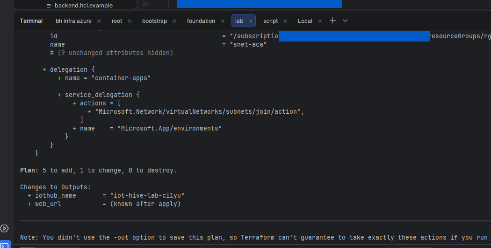
*Figure 23.2. The plan after the fix: 5 to add, 1 to change, 0 to destroy. The change is the delegation block added to `snet-aca`.*

## 24. IoT Hub creation fails on the partition count (IH400016)

**Symptom:** the same apply fails creating `azurerm_iothub.this[0]`:

```
Invalid PartitionCount 4 - value must be between 2 and 2 ... errorcode: IH400016
```

The message also contains `json: cannot unmarshal number into Go struct field serviceErrorInternal.code of type string`. That is the provider failing to parse Azure's error, not a second problem.

**Fix:** the provider defaults `event_hub_partition_count` to 4, and the F1 free tier allows exactly 2. Set `event_hub_partition_count = 2` on the hub in `lab/iot.tf`. After the fix the hub took 4 minutes 9 seconds to create. See figure 23.1 for the error.

## 25. `az acr build` fails in Malaysia West

**Symptom:** `az acr build -r <registry> ...` packs and uploads the source, then fails:

```
Failed to get a SAS URL to upload context. Error: (NoRegisteredProviderFound) No registered resource provider found for location 'malaysiawest' ... for type 'registries/listBuildSourceUploadUrl'.
```

The list of supported locations in the message includes `southeastasia` and `eastasia`, and not `malaysiawest`.

**Fix:** ACR Tasks, which `az acr build` uses, is not offered in Malaysia West. Build with Docker in WSL and push instead (see [Docker images](docker.md#7-push-the-images-to-the-registry)). Earlier versions of this repository's docs said to use `az acr build` with no local Docker; that was wrong for this region.

## 26. `docker login` to the registry returns unauthorized

**Symptom:** `docker login` from WSL fails with `unauthorized: authentication required`. It failed with a token from `az acr login --expose-token` (1162 characters, so not empty), and again after the `AcrPush` role was assigned, and again with the registry's admin credentials.

**What was tried:**

1. Token login with the all-zero username. Unauthorized.
2. Assign `AcrPush` to the signed-in user, wait, fetch a new token, try again. Unauthorized.
3. Enable the admin user and pipe its password into `docker login --password-stdin` through `wsl`. Unauthorized.
4. `curl.exe -u <admin user>:<password> https://<registry>/v2/` from Windows returned **200**, so the credentials were valid.
5. Pass the password to WSL in an environment variable (`$env:WSLENV = "ACR_PW"`) and use `docker login -p "$ACR_PW"`. **Login Succeeded.**

**Fix:** step 5. The only difference between 3 and 5 was how the password reached `docker login`, which points at the PowerShell-to-`wsl` pipe corrupting it. I did not find the exact cause. I also did not test whether the token login would have worked after the role assignment, if the pipe had not been the problem.

**Afterwards:** the admin user was enabled by hand, outside Terraform. Turn it off with `az acr update -n <registry> --admin-enabled false`. The apps pull with their managed identity, so this does not affect them.


*Figure 26.1. Step 1: the token login fails.*

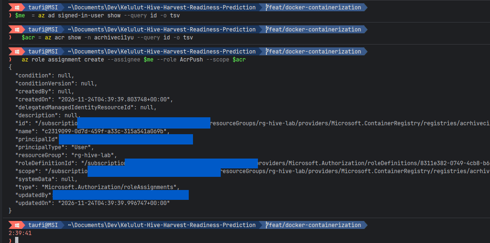
*Figure 26.2. Step 2: `AcrPush` assigned to the signed-in user on the registry.*

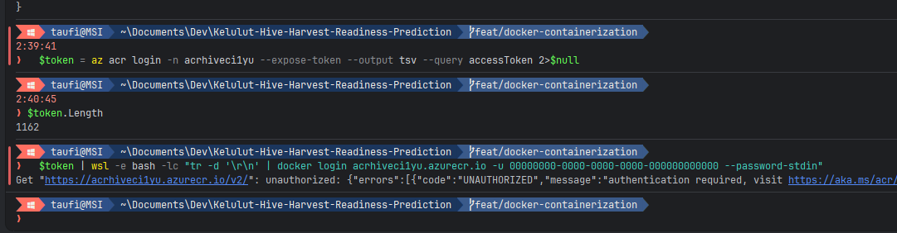
*Figure 26.3. A new token, 1162 characters long, still unauthorized.*


*Figure 26.4. The role assignment list shows `AcrPush`, and the login is still unauthorized.*


*Figure 26.5. Steps 3 to 5: the piped admin password fails, `curl` with the same credentials returns 200, and the environment-variable login succeeds.*

## 27. `docker build` fails in WSL: the daemon is stopped, or "requires 1 argument"

**Symptom 1:** `Cannot connect to the Docker daemon at unix:///var/run/docker.sock`.

**Fix 1:** the engine inside WSL had stopped. Start it as root, which needs no sudo password: `wsl -u root -e bash -lc "service docker start"`. Calling `service` directly (`wsl -u root -e service docker start`) fails with `execvpe(service) failed: No such file or directory`, because `wsl -e` does not search the sbin folders.

**Symptom 2:** `ERROR: docker: 'docker buildx build' requires 1 argument`.

**Fix 2:** the command has no build context. End it with a space and a dot, on the same line. A command pasted over two lines breaks the same way, because the second line runs as a separate command.


*Figure 27.1. A `docker build` with the final `.` missing.*

## 28. Terraform cannot take the state lock after a dropped connection

**Symptom:** the first `terraform plan` fails with:

```
Error acquiring the state lock ... Put "https://<state account>.blob.core.windows.net/tfstate/lab.tfstate?comp=metadata": HTTP response was nil; connection may have been reset
```

Running it again fails differently:

```
Error acquiring the state lock ... state blob is already locked
blob metadata "terraformlockid" was empty
```

**Fix:** the interrupted request left a lease on the state blob but never wrote the lock metadata. That leaves `terraform force-unlock` with no lock ID to use. Check that no other Terraform run is active (`Get-Process terraform`), then break the lease and plan again:

```powershell
az storage blob lease break --blob-name lab.tfstate --container-name tfstate --account-name <state account> --auth-mode login
terraform plan
```

The break returned `0` and the plan ran normally. This changes only the lock, not the state data. Do not do it while a real apply is running. `-lock=false` is not the fix.

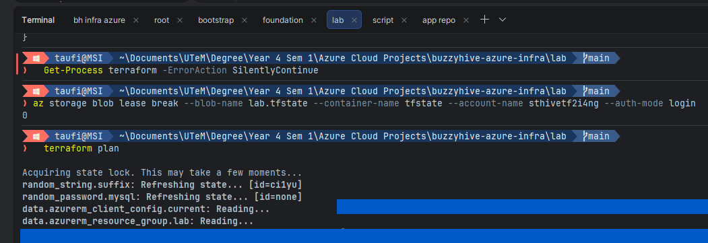
*Figure 28.1. No Terraform process running, the lease broken, and the next plan acquiring the lock.*

## 29. Readings return 201 with `ml_unavailable`: a typo in the image tag

**Symptom:** the simulator gets `201` for every reading, but the response carries a warning:

```
{"status":"ok","warnings":[{"code":"ml_unavailable","message":"Live readiness prediction is temporarily unavailable."}], ...}
```

The first two calls took 10.27 s and 5.08 s. `laravel-web` logged `cURL error 28: Operation timed out after 10001 milliseconds` for the first and then `ML API unavailable ... "status":404` for the rest.

**Cause:** `images.flask` in `lab/terraform.tfvars` ended in `:lates` (the final `t` missing). That tag does not exist, so Azure could not pull it, and the new revision `flask-ml--0000001` stayed in `ActivationFailed`. The older revision, `flask-ml--foqw6k4`, still ran Microsoft's quickstart placeholder and stayed `Running` and `Healthy`. Flask itself never returns 404 on `POST /predict` (see `ml/app.py` in the app repository), so the 404 most likely came from that placeholder, which has no `/predict` route. I did not capture its response, so this is an inference. Either way, the failure looked like an application error and not an image-pull failure.

**How it was found:**

1. `az containerapp replica list` for `flask-ml` was empty, and `az containerapp logs show --type console` said `Could not find a replica for this app` (figure 29.4).
2. `az containerapp revision show` on each revision gave the image and state of both (figure 29.5).

**Fix:** correct the tag, then `terraform apply`. The new revision `flask-ml--0000002` came up `Running` and `Healthy`, and the placeholder revision went to `Deprovisioning`. The next five readings returned `201` in 0.17 to 0.29 s with no warning.

**Check first next time:** `az containerapp revision list -n <app> -g <rg> -o table`. With `revision_mode = "Single"`, a failed new revision does not remove the old one, so a leftover placeholder can serve traffic and hide the real error.


*Figure 29.1. The typo in `terraform.tfvars`: `flask-ml:lates`.*


*Figure 29.2. The symptom: `201` with `ml_unavailable` on every reading, and 10.27 s and 5.08 s on the first two.*

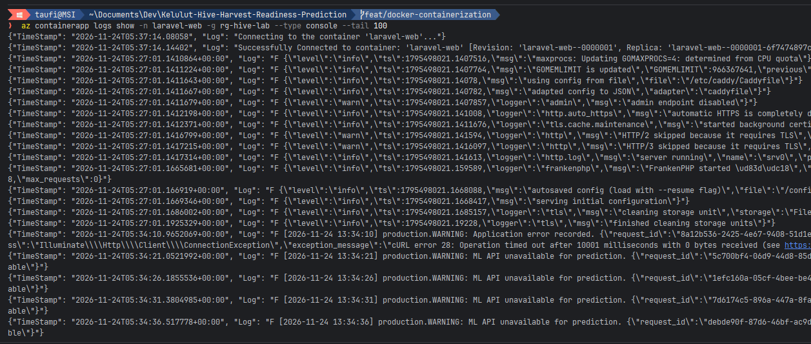
*Figure 29.3. The `laravel-web` log: a 10-second timeout, then 404 from the ML URL.*

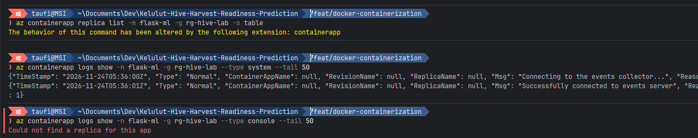
*Figure 29.4. `flask-ml` had no replica.*


*Figure 29.5. The two revisions. `flask-ml--0000001` points at `flask-ml:lates` and failed. `flask-ml--foqw6k4` runs the quickstart placeholder.*

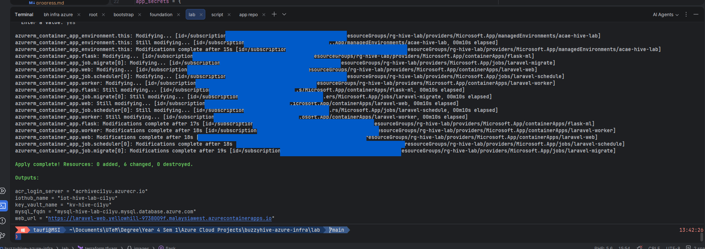
*Figure 29.6. The fix applied: 0 added, 6 changed, 0 destroyed. The six changes were the environment, `flask-ml`, both Jobs, `laravel-web` and `laravel-worker`. This apply also put the migrate Job back after entry 30.*


*Figure 29.7. After the fix: the real image runs in `flask-ml--0000002`, and the placeholder revision is being removed.*

## 30. The simulator gets 422, and seeding the database through the migrate Job

**Symptom:** after the migration, every reading from the simulator fails with `422`:

```
{"message":"The selected hive id is invalid.","errors":{"hive_id":["The selected hive id is invalid."]}}
```

**Cause:** the `migrate` Job only creates the empty tables. The API checks that the hive exists, and then that an active device with a matching `node_identifier` is on it, so it needs data.

**Fix:** run the app's `DatabaseSeeder` as a one-off through the migrate Job. Starting a job with overrides replaces the whole container definition, so change the Job's own args and start it with no overrides. Two things went wrong on the way:

- `az containerapp job start --args ...` fails with `(ContainerAppImageRequired) Container with name 'laravel-migrate' must have an 'Image' property specified`. Overrides need the image, and would also drop the Job's environment.
- `az containerapp job update --args "php artisan db:seed --class=DatabaseSeeder --force"` passes the quoted string as a single argument, and the execution fails with `exec: line 11: php artisan db:seed --class=DatabaseSeeder --force: not found`. `az` reads separate tokens that start with `--` as its own options, so they cannot be passed one by one.

What worked was to remove the dashes: `--args php artisan db:seed`, which runs `DatabaseSeeder` by default. The usual `--force` is only there to skip the production confirmation, so the same update sets `APP_ENV=staging` for that run. It also sets `ADMIN_SEED_PASSWORD` and `BEEKEEPER_SEED_PASSWORD`, because the seeder otherwise falls back to default passwords that are in the app repository, and this app is on the internet. Then start the Job. Afterwards, `terraform apply` puts the Job's args and environment back.

The seeded hives get random node identifiers, so find a hive id and its node by querying from inside the app (see [Deploy](deploy.md#46-seed-the-database)).


*Figure 30.1. The `ContainerAppImageRequired` error, then switching to `job update`.*

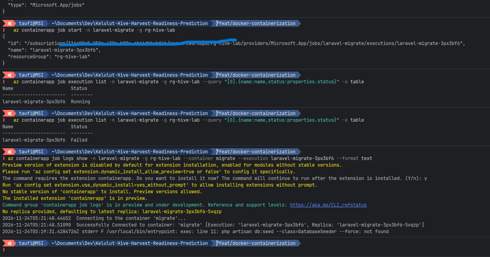
*Figure 30.2. The execution fails because the whole string was treated as one command. The working run is in [Deploy](deploy.md#46-seed-the-database).*

## 31. The first page load is slow

**Symptom:** the first visit shows the BuzzyHive loading screen for a long time before the page appears.

**What was measured:** `curl` on `/up`, which is a bare health check that does not touch the database, took 0.77 s on the first call and 0.06 s on the second. So the container itself answers fast once it is running.

**Status: not resolved.** I did not isolate the cause. The likely contributors are the scale-to-zero cold start (`laravel-web` has `min_replicas = 0`, so the first request after idle waits for a container to start), the image pull, and heavy pages on a small database. To check, time `/up`, then `/login`, then a signed-in page, and compare the replica list (`az containerapp replica list`) before and after. Setting `min_replicas = 1` on `laravel-web` would remove the cold start at a small cost.

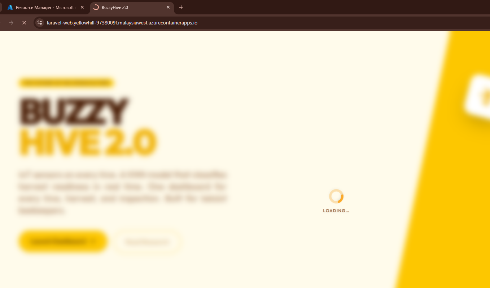
*Figure 31.1. The landing page behind its loading spinner on the first visit.*


*Figure 31.2. `/up` took 0.77 s the first time and 0.06 s the second.*

## 32. Application Insights shows no data

**Symptom:** after the lab had served traffic, Application Insights `appi-hive-lab` showed nothing. The Application map said **No data available**, and Live metrics said **Not available: couldn't connect to your application**. The charts behind the Live metrics message are Microsoft's demo picture, not this app's data.

**What is known:**

- Terraform sets `APPLICATIONINSIGHTS_CONNECTION_STRING` on the Container Apps (`lab/containerapps.tf`, line 36) and on the Function (`lab/iot.tf`).
- A connection string in an environment variable only tells an agent where to send data. Something in the app has to send it.
- I did not verify this, but the Laravel and Flask images most likely contain no Application Insights SDK or agent, so nothing reads the variable.
- The `Failure Anomalies - appi-hive-lab` alert rule cannot fire while the resource receives no data.

**Status: not fixed.** The architecture says logs and traces reach Application Insights ([architecture step 11](architecture.md#2-data-flow)), and that is not what the portal showed. Two ways forward, neither done: add an OpenTelemetry exporter to each image (the Azure Monitor distro for Python on `flask-ml`, and a Laravel exporter), or drop the Application Insights claim and rely on the Container Apps console logs that `az containerapp logs show` already reads.


*Figure 32.1. The Application map has no data.*

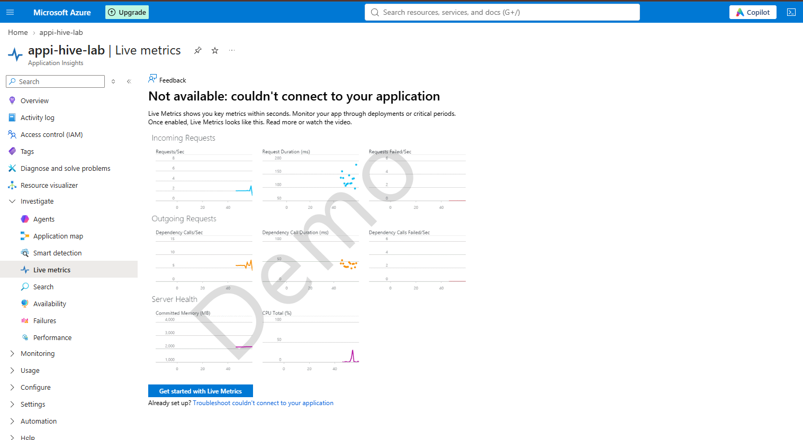
*Figure 32.2. Live metrics cannot connect to an application.*
